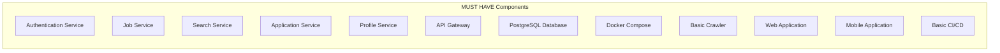
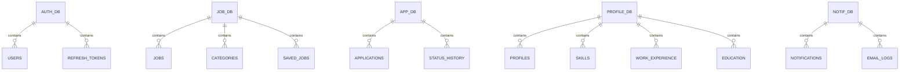
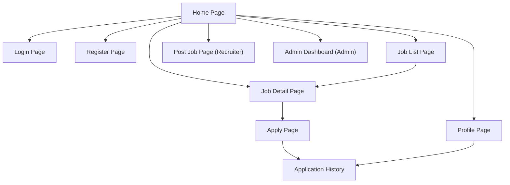
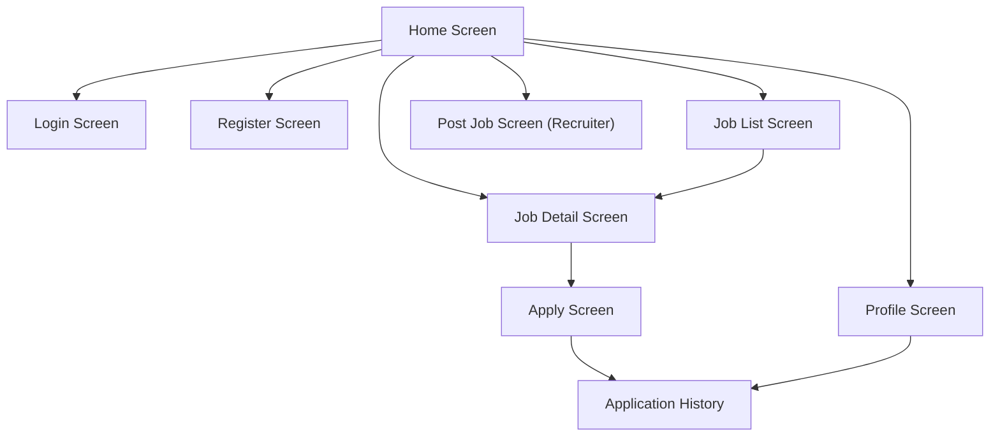

# Software Requirements Specification (SRS)

[English](3-must-have-fr.md) | [Tiếng Việt](../vi/3-must-have-fr.vi.md)

## Vietnam Job Platform - Microservices with .NET + Multirepo

**Version:** 1.0  
**Date:** August 17, 2026  
**Project:** Vietnam Job Platform (Nền tảng việc làm Việt Nam)  

---

## Part 3: Functional Requirements - MUST HAVE

### 3.1 Overview

This section documents all **MUST HAVE** functional requirements. These features are essential for the system to be considered functional and must be 100% stable by the end of Week 4. Each requirement is traceable to the Master Plan and includes acceptance criteria for validation.

The MUST HAVE features are organised into 12 core components:



---

### 3.2 Authentication Service

**Component ID:** AUTH-01  
**Priority:** MUST HAVE  
**Owner:** TM1  
**Target Week:** Week 1  

#### 3.2.1 Description

The Authentication Service manages user identity, registration, login, and session management using token-based authentication (JWT). It provides role-based access control (User, Recruiter) and secures all subsequent API calls.

#### 3.2.2 Functional Requirements

| ID | Requirement | Acceptance Criteria |
|:---|:------------|:-------------------|
| AUTH-01-01 | The system shall allow users to register with email, password, and basic profile information | - Registration endpoint: `POST /api/auth/register`<br>- Email format validated<br>- Password strength enforced (minimum 8 characters, at least 1 number, 1 uppercase letter)<br>- User data persisted to database with hashed password |
| AUTH-01-02 | The system shall allow users to login with email and password | - Login endpoint: `POST /api/auth/login`<br>- Returns access token and refresh token<br>- Invalid credentials return 401 Unauthorised |
| AUTH-01-03 | The system shall issue access tokens with a limited validity period | - Access token valid for 1 hour<br>- Token contains user ID, email, and role claims<br>- Token is cryptographically signed |
| AUTH-01-04 | The system shall support refresh token rotation with a defined TTL | - Refresh endpoint: `POST /api/auth/refresh`<br>- Refresh token valid for **7 days** from issuance (configurable via `REFRESH_TOKEN_TTL_DAYS`); if “Remember Me” selected → **30 days** (`REFRESH_TOKEN_REMEMBER_ME_TTL_DAYS`)<br>- Refresh token stored as **SHA-256 hash** with `expiry_date` (absolute TTL, no sliding), indexed, purged by daily cron<br>- Old refresh token invalidated on use (rotation); reuse detection → revoke entire family and require re-login<br>- Expired → `401 Unauthorized`; new token pair returned when valid |
| AUTH-01-05 | The system shall support logout (token invalidation) | - Logout endpoint: `POST /api/auth/logout`<br>- Refresh token invalidated<br>- Access token remains valid until expiry (no blocklist; short 1-hour TTL) |
| AUTH-01-06 | The system shall assign roles and link each Recruiter account to exactly one Company | - Role field in registration form<br>- Default role = User<br>- Recruiter registration through `POST /api/auth/register` requires a valid `inviteCode` (AUTH-01-09, AUTH-01-15); the user joins the Company of that code, which never comes from client input<br>- A Recruiter account belongs to exactly one Company (`users.company_id`). A second Company needs a separate account; `company_id` is not changed once set in this version<br>- Registration never creates a Company; a Company is created only by company sign-up (AUTH-01-10), which also creates its first admin<br>- The deprecated `companyName` auto-create path is removed (auth-svc never implemented it)<br>- `POST /api/companies` returns `409 ACCOUNT_ALREADY_HAS_COMPANY` for a Recruiter whose account already has a `company_id`; every Recruiter has one, so this version creates no Company through that endpoint (removal: backlog C14)<br>- `POST /api/companies` by any other caller keeps the existing role rule (`403` for non-Recruiters)<br>- The creator (`companies.created_by`) is the **Company Admin**; the Company's other Recruiters are members. `GET /api/companies/mine` (Recruiter only) returns the camelCase company detail plus `isCompanyAdmin`: true only for the creator. Members have view-only company access (they cannot update the Company); there is no member-list endpoint |
| AUTH-01-07 | The system shall allow requesting a password reset via email | - Endpoint: `POST /api/auth/forgot-password { email }`<br>- If email exists, create reset_token (UUID), store **SHA-256 hash** + `expiry_date` = 15 minutes, `is_used=false`<br>- Send email with link `{WEB_URL}/reset-password?token=...` (15-min TTL, one-time)<br>- Always return `200 OK` even if email not found (anti-enumeration)<br>- Rate-limit: 5 requests / IP / hour |
| AUTH-01-08 | The system shall allow resetting password with a token | - Endpoint: `POST /api/auth/reset-password { token, newPassword }`<br>- Token must be valid, not expired, not used<br>- `newPassword` must meet strength as AUTH-01-01<br>- Invalidate token after use (`is_used=true`), **revoke all refresh tokens** of the user (force re-login on other devices)<br>- Return `200 OK` + login guidance |
| AUTH-01-09 | The system shall let only a Company's creator issue single-use, expiring recruiter invite codes, each bound to one email address, that join an existing Company | - Invite codes join an existing Company only. Company sign-up (AUTH-01-10) does not use them<br>- Issuer is the Company admin, i.e. the creator (`companies.created_by`)<br>- Issue endpoint: `POST /api/companies/{id}/invite-codes` (job-svc), body `{ email }` (the address the code is bound to, AUTH-01-15). Caller must have the Recruiter role and equal `companies.created_by`; otherwise `403 INVITE_CODE_NOT_CREATOR`. A Company whose `created_by` is the empty GUID (legacy rows) cannot issue codes<br>- Code: 12 characters from `ABCDEFGHJKLMNPQRSTUVWXYZ23456789` (no 0, O, 1 or I), generated with a cryptographic random generator; displayed as `XXXX-XXXX-XXXX`<br>- The response shows the plain code once. The server stores only the SHA-256 hash of the normalised code (trimmed, uppercase, dashes removed) in a unique column. The plain code is never logged or returned again<br>- Expiry: 7 days from issuance (`INVITE_CODE_TTL_DAYS`, default 7). No sliding window<br>- Single use: auth-svc calls `check` with `{ code, email }` (read-only), then checks email uniqueness, then calls `redeem` with `{ code, email }`, one conditional update (`used_at IS NULL AND status = Active AND expires_at > now AND email matches`) that returns `companyId`. A code can be redeemed once<br>- If user creation fails after redeem, auth-svc calls `release` with the `inviteCodeId`. If release also fails, the code stays used and the creator must issue a new one<br>- Every bad code (unknown, malformed, expired, used, revoked, or bound to another address) returns the same `422 INVITE_CODE_INVALID`<br>- State: `status` is Active or Revoked. A code is used when `used_at` is set, and expired when `expires_at` has passed<br>- Revocation: an unused code is set to `status` = Revoked, `revoked_at` = now and `revoke_reason` = `ADMIN_CHANGED`. Used codes are not changed. A revoked code is rejected with `422 INVITE_CODE_INVALID`, the same error as an unknown, expired or used code<br>- Support approval of a new Company admin (AUTH-01-14) revokes the previous admin's unused codes with reason `ADMIN_CHANGED`<br>- Internal endpoints are protected by `JOB_INTERNAL_TOKEN_FOR_AUTH` (fail-closed: 401 when unset or wrong) and are not routed by the gateway<br>- `POST /api/auth/register` keeps its existing rate limit and error rules; the invite code adds no account-existence signal |
| AUTH-01-10 | The system shall let a company sign up on its own, creating the Company and its first admin account, or a join request when its domain already belongs to a verified Company | - Endpoint: `POST /api/auth/register-company { companyName, taxCode?, email, password, fullName }`, anonymous; returns `202 Accepted` with `{ message }` and no tokens. The response is identical for every outcome: a new sign-up, an email that already has an account, a `companyName` or `taxCode` already in use, and a domain that matches a verified Company (AUTH-01-12). The `{ message }` text is one fixed string, and the response time must not depend on the outcome (for example, every mail, including the notice, is sent asynchronously)<br>- Both lookups run on every sign-up, and again at verification, whatever the domain, before any outcome is chosen: (1) domain match, `POST /api/internal/companies/domain-match` (AUTH-01-12); and (2) availability, `POST /api/internal/companies/availability { companyName, taxCode? }` returning `{ available }`. `available` is true only when `companyName` is free and, if `taxCode` is given, `taxCode` is free, under the uniqueness rules of `POST /api/companies`. Both lookups are POST with the values in the body, so company names and tax codes never appear in access logs or gateway traces (owner decision 2026-11-16; the earlier draft showed a `GET` with a query string). Both have no side effects and are protected by the internal bearer token `JOB_INTERNAL_TOKEN_FOR_AUTH` (fail-closed `401`). The outcome is then chosen from their results and the account check below; a domain match ignores the availability result. If either lookup fails, sign-up returns `503` and stores nothing; the failure does not depend on the outcome. A taken value is not reported in the response (same response as above, except the `503` case); the notice email reports it to the mailbox owner instead (below)<br>- `email` must pass AUTH-01-11 (checked first, before any lookup, since it depends only on the address); `password` must meet AUTH-01-01 strength<br>- New sign-up: if the email has no account, and `companyName` and `taxCode` are free (or the domain matches a verified Company, so they are not checked), sign-up stores a pending sign-up (`pending_company_signups`, password stored as a hash) and sends the verification email with the link (AUTH-01-11). No Company, join request or active account exists until the link is verified<br>- Notice instead: if the email already has an account, or `companyName` or `taxCode` is already in use (and the domain does not match a verified Company), nothing is stored and the notice email is sent to the address in the request. The notice is one fixed text in each language, the same for every notice case: the company could not be registered with these details, and it points to support. It is one notice for all causes. It contains no link and is never sent to anyone else: not to the holder of the taken name or tax code, and not to the admin of any Company<br>- A notice-case sign-up also deletes any pending sign-up for that email, so only the newest attempt can be verified<br>- A new sign-up for an email that already has a pending sign-up replaces the earlier one<br>- On verification, auth-svc re-runs the domain check (AUTH-01-12) and the availability lookup, as at sign-up, and creates the user inactive (`is_active = false`). If the email has gained an account, or the domain does not match and `companyName` or `taxCode` has been taken since sign-up, nothing is created: the pending sign-up is deleted, the fixed notice email is sent to that address, and the response is the same `{ message }`<br>- No verified Company holds the domain: auth-svc calls job-svc `POST /api/internal/companies { name, taxCode?, createdBy, emailDomain }`, which creates the Company with `created_by` = that user, `email_domain` set and `verified` = true (AUTH-01-11). The user then becomes an active Recruiter with `company_id` set<br>- A verified Company holds the domain: no Company is created. auth-svc calls job-svc `POST /api/internal/company-join-requests { userId, companyId }` (AUTH-01-12). The user then becomes an active User with no `company_id`<br>- If the job-svc call fails, auth-svc deletes the inactive user, verification fails as a whole, and the same link works again until it expires<br>- The admin is the creator and the only issuer of the Company's invite codes (AUTH-01-09) |
| AUTH-01-11 | The system shall require a verified work email for company sign-up | - The email domain must not be on a configured blocklist of free public email providers (at least gmail.com, yahoo.com, outlook.com, hotmail.com, live.com, icloud.com, aol.com, proton.me); otherwise `422 WORK_EMAIL_REQUIRED`<br>- Blocklisted domains are never matched to a Company (AUTH-01-12) and never stored as `email_domain`. A free-provider sign-up therefore never joins or creates a Company that another account owns; in this version it is rejected, not turned into an independent Company<br>- Sends a verification email with a single-use link (or, in the notice cases of AUTH-01-10, the fixed notice email, which has no link) `{WEB_URL}/verify-email?token=...`; the token is random, stored as a SHA-256 hash, and `expiry_date` = 24 hours after sending<br>- `POST /api/auth/verify-email { token }` (anonymous) consumes the token and completes AUTH-01-10; a bad, expired or used token returns `422 VERIFICATION_TOKEN_INVALID`<br>- Rate-limited like forgot-password: 5 sign-ups per IP per hour. Every request counts, whatever its outcome (including the notice cases), so the limit does not reveal whether an address exists<br>- **Clicking the link proves** that the person could receive mail at that address when they clicked, and that the domain is not on the blocklist<br>- **Clicking the link does not prove** that the person works for the company or may act for it; that the company exists or is registered; that the company owns the domain (subdomains and shared hosted mailboxes pass); that no other Company uses the same domain (routing sends later sign-ups to the existing Company, AUTH-01-12); or that the company is genuine. A completed verification sets `Company.verified = true` and `email_domain` (AUTH-01-10). That flag only means the founding admin proved a mailbox at the domain (backlog A12, decided 2026-11-15) |
| AUTH-01-12 | The system shall route a work-email sign-up whose domain already belongs to a verified Company to a join request for that Company's admin, instead of creating a second Company | - Domain match: a verified Company whose `email_domain` equals the sign-up domain, with the domain not blocklisted (AUTH-01-11). At most one Company holds a domain (`companies.email_domain` unique)<br>- Checked at sign-up and again at verification (AUTH-01-10) through job-svc `POST /api/internal/companies/domain-match` (`{ domain }` returns `{ companyId }` or `{ companyId: null }`; internal, not gateway-routed). The check at verification is the authoritative one<br>- A match creates no Company and ignores `companyName` and `taxCode`<br>- The join request is stored in job-svc (`company_join_requests`) with status Pending, `company_id`, `user_id` (unique: one request per account) and `expires_at` (AUTH-01-13)<br>- Only the Company admin (`companies.created_by`) lists, approves or rejects the Company's requests: `GET /api/companies/{id}/join-requests`, `POST /api/companies/{id}/join-requests/{requestId}/approve` and `POST .../reject`. Other callers get `403 JOIN_REQUEST_NOT_ADMIN`<br>- Approve: job-svc calls auth-svc `POST /api/internal/users/{userId}/link-company { companyId }`, which sets the role to Recruiter and `company_id` (idempotent for the same Company; a different Company returns `409 ACCOUNT_ALREADY_HAS_COMPANY`). The request becomes Approved only after auth-svc confirms; if the call fails, the request stays Pending and the admin may retry<br>- Reject: status Rejected; the account stays an active User with no Company. A rejected request is final: the requester cannot send another join request for that Company or any other (`user_id` is unique, one request per account). After the waiting period, when the request reads as Expired (AUTH-01-13), the requester may escalate it to support (AUTH-01-14); that is the only way to reverse a rejection<br>- Unknown request: `404 JOIN_REQUEST_NOT_FOUND`. Deciding a request that is not Pending, or has expired: `409 JOIN_REQUEST_STATE_INVALID`<br>- Email notification to the admin when a request is created is not in this version (backlog C13) |
| AUTH-01-13 | The system shall expire a pending join request after a configurable waiting period | - `COMPANY_JOIN_REQUEST_TTL_DAYS`, default **7** days from creation (decided 2026-11-15, backlog A11)<br>- A request with `now >= expires_at` is Expired whatever its stored status; a daily job stores the status Expired<br>- The admin cannot approve or reject an expired request (`409 JOIN_REQUEST_STATE_INVALID`)<br>- Expiry changes nothing else: the Company, its admin and its other requests stay as they are<br>- Expiry grants nothing. There is no automatic takeover: waiting never makes the requester a Recruiter or a Company admin. Only an admin decision (AUTH-01-12) or a support decision after escalation (AUTH-01-14) can do that<br>- The requester sees the status and expiry on `GET /api/companies/me/join-request` |
| AUTH-01-14 | The system shall let a requester escalate an expired join request to manual platform-support review | - The requester calls `POST /api/companies/me/join-request/escalate`. Allowed once, and only when the status is Expired (the effective status of AUTH-01-13, so a Rejected request whose `expires_at` has passed qualifies); otherwise `409 JOIN_REQUEST_STATE_INVALID`. Escalation before expiry is not possible, so the waiting period always runs first<br>- Status becomes Escalated and the request enters the platform-support review queue (internal tool; no public endpoint)<br>- Support decides with `POST /api/internal/company-join-requests/{id}/support-decision { decision: approve or reject, reason }` (job-svc; internal bearer token, fail-closed, not gateway-routed). Only Escalated requests can be decided; otherwise `409 JOIN_REQUEST_STATE_INVALID`<br>- Before approving, support must verify out of band that the requester controls the Company. The decision, reason, operator and time are logged<br>- Approve: status SupportApproved; the requester becomes an active Recruiter of the Company (job-svc calls auth-svc link-company, AUTH-01-12) and becomes the Company admin (`companies.created_by`). The previous admin stays a Recruiter of the Company. Unused invite codes issued by the previous admin are revoked (AUTH-01-09: `status` = Revoked, `revoke_reason` = `ADMIN_CHANGED`)<br>- Reject: status SupportRejected; the account stays an active User with no Company; the Company is unchanged |
| AUTH-01-15 | The system shall bind each invite code to one email address and accept it only with that address | - Issuing requires `email`; it is stored normalised (trimmed, lowercase) in `invite_codes.email`<br>- `check` and `redeem` require `{ code, email }`. A code presented with any other address is rejected with `422 INVITE_CODE_INVALID`, the same error as every bad code, so the holder of a code learns nothing about its state<br>- Accepting the code with its bound address proves that address. The invited Recruiter account is active on registration and no verification email is sent; there is no separate verification step<br>- The account still meets the AUTH-01-01 password rules and needs an address not already in use (AUTH-01-09) |

#### 3.2.3 API Specifications

| Endpoint | Method | Request Body | Response | Validation Rules |
|:---------|:-------|:-------------|:---------|:-----------------|
| `/api/auth/register` | POST | `{ email, password, fullName, role, inviteCode? }` | `{ userId, message }` | Email must be unique; password meets strength requirements; role must be valid; if `role=Recruiter` `inviteCode` is required and must redeem to a Company with its bound email (AUTH-01-09, AUTH-01-15), otherwise `422 INVITE_CODE_INVALID`; `companyId` and `companyName` are ignored |
| `/api/auth/login` | POST | `{ email, password, rememberMe? }` | `{ accessToken, refreshToken, user }` | Credentials must match; account must be active; `rememberMe` decides refresh TTL (7 vs 30 days) |
| `/api/auth/refresh` | POST | `{ refreshToken }` | `{ accessToken, refreshToken }` | Token must be valid, not expired (7/30 days) and not revoked; reuse → revoke family |
| `/api/auth/logout` | POST | `{ refreshToken }` | `{ message }` | Token must be valid and not already revoked |
| `/api/auth/me` | GET | (Bearer Token) | `{ user }` | Token must be valid; returns user profile |
| `/api/auth/forgot-password` | POST | `{ email }` | `{ message }` | Always 200 OK; rate-limit 5/IP/hour |
| `/api/auth/reset-password` | POST | `{ token, newPassword }` | `{ message }` | Token valid, not expired (15 min), not used; password meets strength |
| `/api/auth/register-company` | POST | `{ companyName, taxCode?, email, password, fullName }` | `{ message }` (202) | Anonymous; the same `202` and `{ message }` for every outcome: new sign-up, existing email, taken `companyName` or `taxCode`, or domain match (AUTH-01-10, AUTH-01-12); email must pass AUTH-01-11, else `422 WORK_EMAIL_REQUIRED`; both lookups run on every request, and `503` with nothing stored if one fails; creates nothing until verified |
| `/api/auth/verify-email` | POST | `{ token }` | `{ message }` | Anonymous; single use, 24 h; bad, expired or used token gives `422 VERIFICATION_TOKEN_INVALID`; creates the admin user and the Company, or the requester's join request; in the race case (AUTH-01-10: the email gained an account, or `companyName` or `taxCode` was taken since sign-up, without a domain match) deletes the pending sign-up and sends the fixed notice, creating nothing; the same `{ message }` whichever outcome (AUTH-01-10, AUTH-01-12) |
| `/api/companies` | POST | `{ name, tax_code?, website?, description?, logo_url?, address?, industry?, size? }` | `{ id, message }` | Requires Recruiter role; a Recruiter whose account already has a `company_id` gets `409 ACCOUNT_ALREADY_HAS_COMPANY` (AUTH-01-06); `name` unique; `tax_code` unique if provided |
| `/api/companies/{id}` | GET | - | CompanyDetailDTO | Public; valid id |
| `/api/companies` | GET | Query: `q, page, size` | Paginated `[Company]` | Public |
| `/api/companies/mine` | GET | - | `{ id, name, …, isCompanyAdmin }` | Requires Recruiter role; resolves the linked Company from the `company_id` claim (falling back to `created_by`); `404` when no Company is linked; `isCompanyAdmin` is true only for the creator (AUTH-01-06) |
| `/api/companies/{id}/jobs` | GET | Query: `page` (0-based), `size` (default 20, max 100) | Paginated `[PublicJobSummary]` | Public; `Active` jobs of the Company only, newest first; unknown Company `404` |
| `/api/companies/{id}` | PUT | `{ name, tax_code?, website?, description?, logo_url?, address?, industry?, size? }` | `{ message }` | Requires owner Recruiter role (`created_by`); `name` unique; `tax_code` unique if provided; `logo_url` is a URL string (there is no logo upload); **extension** (NICE) enabling US-07b "manage my company profile" |
| `/api/companies/{id}/invite-codes` | POST | `{ email }` | `{ id, code, email, expiresAt }` (201; `code` shown once) | Requires Recruiter role and caller = `created_by`, else `403 INVITE_CODE_NOT_CREATOR`; unknown company `404 COMPANY_NOT_FOUND`; see AUTH-01-09, AUTH-01-15 |
| `/api/internal/invite-codes/check` | POST | `{ code, email }` | `{ companyId, companyName }` | Internal only, not gateway-routed; bearer `JOB_INTERNAL_TOKEN_FOR_AUTH` (fail-closed `401`); read-only; bad code or other address gives `422 INVITE_CODE_INVALID` |
| `/api/internal/invite-codes/redeem` | POST | `{ code, email }` | `{ inviteCodeId, companyId }` | Same auth; atomic single use; bad code or other address gives `422 INVITE_CODE_INVALID` |
| `/api/internal/invite-codes/{id}/release` | POST | - | `204 No Content` | Same auth; clears `used_at` after a failed registration only |
| `/api/internal/companies` | POST | `{ name, taxCode?, createdBy, emailDomain }` | `{ companyId }` (201) | Internal only, not gateway-routed; bearer `JOB_INTERNAL_TOKEN_FOR_AUTH` (fail-closed `401`); called only by auth-svc during verification when no verified Company holds the domain (AUTH-01-10) |
| `/api/internal/companies/domain-match` | POST | `{ domain }` | `{ companyId }` or `{ companyId: null }` (200) | Internal only; bearer `JOB_INTERNAL_TOKEN_FOR_AUTH` (fail-closed `401`); read-only; a blocklisted domain always returns null; called on every sign-up and at verification (AUTH-01-10, AUTH-01-11, AUTH-01-12) |
| `/api/internal/companies/availability` | POST | Body: `companyName`, `taxCode?` | `{ available }` (200) | Internal only; bearer `JOB_INTERNAL_TOKEN_FOR_AUTH` (fail-closed `401`); no side effects; called on every sign-up and at verification, whatever the domain (AUTH-01-10). POST so the values stay out of access logs (owner decision 2026-11-16) |
| `/api/internal/company-join-requests` | POST | `{ userId, companyId }` | `{ joinRequestId, expiresAt }` (201) | Internal only; bearer `JOB_INTERNAL_TOKEN_FOR_AUTH` (fail-closed `401`); called only by auth-svc during verification (AUTH-01-10, AUTH-01-12) |
| `/api/internal/users/{userId}/link-company` | POST | `{ companyId }` | `204 No Content` | Internal only, served by auth-svc; called only by job-svc on admin or support approval; its own internal bearer token (fail-closed `401`; per-caller tokens, backlog B8); not gateway-routed. Idempotent for the same Company; a different Company gives `409 ACCOUNT_ALREADY_HAS_COMPANY` (AUTH-01-12) |
| `/api/companies/{id}/join-requests` | GET | Query: `status?`, `page`, `size` | Paginated `[JoinRequest]` | Requires Recruiter role and caller = `created_by`, else `403 JOIN_REQUEST_NOT_ADMIN`; unknown company `404 COMPANY_NOT_FOUND` (AUTH-01-12) |
| `/api/companies/{id}/join-requests/{requestId}/approve` | POST | - | `{ message }` | Same guard; unknown request `404 JOIN_REQUEST_NOT_FOUND`; not Pending or expired `409 JOIN_REQUEST_STATE_INVALID` (AUTH-01-12, AUTH-01-13) |
| `/api/companies/{id}/join-requests/{requestId}/reject` | POST | - | `{ message }` | Same guard and errors as approve (AUTH-01-12) |
| `/api/companies/me/join-request` | GET | - | `{ status, companyId, expiresAt }` | Any signed-in account that has a join request (the requester); none gives `404 JOIN_REQUEST_NOT_FOUND` (AUTH-01-13) |
| `/api/companies/me/join-request/escalate` | POST | - | `{ message }` | Requester only; allowed once, only when Expired; otherwise `409 JOIN_REQUEST_STATE_INVALID` (AUTH-01-14) |
| `/api/internal/company-join-requests/{id}/support-decision` | POST | `{ decision, reason }` | `{ status }` | Internal only, platform-support tooling; internal bearer token (fail-closed `401`); not gateway-routed; only Escalated requests (AUTH-01-14) |

#### 3.2.4 Data Model

| Entity | Required Attributes | Relationships |
|:-------|:--------------------|:--------------|
| User | id, email (unique), password_hash, full_name, role, is_active, company_id (FK nullable; set once for a Recruiter, AUTH-01-06), created_at, updated_at | One User has many Refresh Tokens; One User (Recruiter) belongs to one Company |
| Refresh Token | id, token_hash (unique, SHA-256), user_id, expiry_date (absolute TTL 7 days, 30 days if rememberMe), is_revoked, created_at | Many Refresh Tokens belong to one User |
| Password Reset Token | id, user_id (FK), token_hash (SHA-256, unique), expiry_date (TTL 15 min), is_used, created_at | Many Password Reset Tokens belong to one User |
| Company | id, name (unique), tax_code (unique, nullable), verified (bool, default false, true after company sign-up verification, AUTH-01-10), email_domain (unique, nullable; never a blocklisted domain, AUTH-01-12), logo_url, website, description, address, industry, size, created_by (FK → User, Recruiter owner and Company Admin), created_at, updated_at | One Company has many Users (Recruiters, members except the creator); One Company has many Jobs; One Company has many Join Requests |
| Invite Code | id, company_id (FK → Company), code_hash (SHA-256 hex, unique), email (normalised, bound address), created_by (FK → User, issuing creator), expires_at (created_at + 7 days), used_at (nullable), status (Active or Revoked), revoked_at (nullable), revoke_reason (nullable; `ADMIN_CHANGED`), created_at | Many Invite Codes belong to one Company; each code is bound to one email and redeemed at most once; a Revoked code is never redeemed |
| Pending Company Sign-up | id, company_name, tax_code (nullable), email, password_hash, full_name, token_hash (SHA-256, unique), expiry_date (created_at + 24 hours), created_at | Holds no Company or User; deleted on verification or expiry |
| Company Join Request | id, company_id (FK → Company), user_id (FK → User, unique), status (Pending, Approved, Rejected, Expired, Escalated, SupportApproved, SupportRejected), expires_at (created_at + COMPANY_JOIN_REQUEST_TTL_DAYS), decided_by (FK → User, nullable), decided_at (nullable), decision_reason (nullable), created_at, updated_at | Many Join Requests belong to one Company; one Join Request per User account; stored in job-svc (AUTH-01-12 to AUTH-01-14) |

---

### 3.3 Job Service

**Component ID:** JOB-01  
**Priority:** MUST HAVE  
**Owner:** TM2  
**Target Week:** Week 2  

#### 3.3.1 Description

The Job Service provides CRUD operations for job postings and category management. It is the core business component of the platform, enabling recruiters to post jobs and job seekers to browse opportunities.

#### 3.3.2 Functional Requirements

| ID | Requirement | Acceptance Criteria |
|:---|:------------|:-------------------|
| JOB-01-01 | The system shall allow Recruiters to create job postings linked to a Company | - Create endpoint: `POST /api/jobs`<br>- Required fields: title, description, company_id (FK), location, salary range, category, requirements<br>- Job saved to database with status = `Active` and `company_id` referencing a verified Company; it publishes instantly, with no approval step |
| JOB-01-02 | The system shall allow Recruiters to retrieve their own job postings | - Get recruiter jobs endpoint: `GET /api/jobs/recruiter`<br>- Pagination support (page, size)<br>- Filter by status |
| JOB-01-03 | The system shall allow Recruiters to update job postings | - Update endpoint: `PUT /api/jobs/{id}`<br>- Only the job owner can update<br>- Updated timestamp updated automatically |
| JOB-01-04 | The system shall allow Recruiters to delete job postings | - Delete endpoint: `DELETE /api/jobs/{id}`<br>- Only the job owner can delete<br>- Soft delete (marked as deleted, not physically removed) |
| JOB-01-05 | The system shall allow users to view job details by ID | - Get endpoint: `GET /api/jobs/{id}`<br>- Returns complete job details<br>- Returns `Active` and `Closed` jobs; `Deleted` (and legacy `Pending`/`Rejected` rows) are not returned |
| JOB-01-06 | The system shall support job categories | - Category management endpoints: `GET /api/categories`<br>- Predefined categories: IT, Finance, Marketing, Healthcare, Education, Engineering, Sales, Hospitality, Others<br>- Administrators can add/modify categories |

#### 3.3.3 API Specifications

| Endpoint | Method | Request Body | Response | Validation Rules |
|:---------|:-------|:-------------|:---------|:-----------------|
| `/api/jobs` | POST | JobCreateDTO | `{ id, message }` | User must have Recruiter role; all required fields must be present |
| `/api/jobs/recruiter` | GET | Query: `status, page, size` | Paginated response | User must have Recruiter role |
| `/api/jobs/{id}` | PUT | JobUpdateDTO | `{ message }` | User must be the job owner; valid job ID |
| `/api/jobs/{id}` | DELETE | - | `{ message }` | User must be the job owner; valid job ID |
| `/api/jobs/{id}` | GET | - | JobDetailDTO | Valid job ID; job must not be deleted |
| `/api/categories` | GET | - | `[ { id, name } ]` | No authentication required |

#### 3.3.4 Data Model

| Entity | Required Attributes | Relationships |
|:-------|:--------------------|:--------------|
| Category | id, name (unique), description, created_at | One Category has many Jobs |
| Company | id, name (unique), tax_code (unique, nullable), verified (bool), logo_url, website, description, address, industry, size, created_by (FK → User, Recruiter owner and Company Admin), created_at, updated_at | One Company has many Jobs; One Company has many Users (Recruiters; members except the creator) |
| Job | id, title, description, company_id (FK → Company.id), location, salary_min, salary_max, salary_currency, category_id, requirements, benefits, employment_type, experience_level, recruiter_id, status (Active, Closed or Deleted; legacy Pending/Rejected rows were migrated), moderation_reason (nullable), moderated_by (nullable), moderated_at (nullable), view_count, created_at, updated_at | Many Jobs belong to one Company and one Category; One Recruiter has many Jobs; `company` free-text is deprecated, replaced by `company_id` |
| Saved Job | id, user_id, job_id, saved_at | Many Saved Jobs belong to one User and one Job |

---

### 3.4 Search Service

**Component ID:** SEARCH-01  
**Priority:** MUST HAVE  
**Owner:** TM2  
**Target Week:** Week 2  

#### 3.4.1 Description

The Search Service provides full-text search capabilities. It indexes job postings and supports keyword-based and location-based searches with pagination.

#### 3.4.2 Functional Requirements

| ID | Requirement | Acceptance Criteria |
|:---|:------------|:-------------------|
| SEARCH-01-01 | The system shall index job postings for search | - Jobs automatically indexed on creation/update<br>- Search index updated when job data changes |
| SEARCH-01-02 | The system shall provide keyword-based search | - Search endpoint: `GET /api/search/jobs?q={keyword}`<br>- Returns matching jobs with relevance scoring<br>- Handles Vietnamese text appropriately |
| SEARCH-01-03 | The system shall support location-based filtering | - Search endpoint: `GET /api/search/jobs?location={city}`<br>- Matches jobs in specified location<br>- Supports partial matching |
| SEARCH-01-04 | The system shall support pagination | - Pagination parameters: `page` (0-based), `size` (default 20, max 100)<br>- Returns total count and pages<br>- Consistent across results |
| SEARCH-01-05 | The system shall handle search with no results gracefully | - Empty results returned with status 200 OK<br>- Clear message: "No jobs found matching your criteria"<br>- Suggestions for broadening search |

#### 3.4.3 API Specifications

| Endpoint | Method | Query Parameters | Response | Validation Rules |
|:---------|:-------|:------------------|:---------|:-----------------|
| `/api/search/jobs` | GET | `q`, `location`, `page`, `size` | `{ items, total, page, size, totalPages }` | Page must be >= 0; size must be between 1 and 100 |
| `/api/search/suggest` | GET | `q` | `[ "suggestion1", ... ]` | Query parameter is required |
| `/api/search/index`, `/api/search/bulk-index`, `/api/search/index/{id}` | POST, POST, DELETE | - | `200`; `401` when the header is missing or wrong; `503` when `SEARCH_INDEX_TOKEN` is unset outside Development | Internal index writes, not for clients. The header `X-Internal-Token` must equal `SEARCH_INDEX_TOKEN` (SHA-256, fixed-time compare), and the gateway route for `/api/search/*` is anonymous, so the token is the only barrier. The only caller is the ops script `scripts/reindex_jobs.py`, which copies the documents of an old index into the current one so each document gets its embedding again after a mapping change. Job events reach the index over Kafka; job-svc no longer calls these endpoints |

#### 3.4.4 Searchable Fields

The following fields shall be indexed and searchable:

| Field | Type | Searchable | Filterable | Sortable |
|:------|:-----|:-----------|:-----------|:---------|
| title | Text | Yes | No | Yes |
| description | Text | Yes | No | No |
| company | Text | Yes | Yes | Yes |
| location | Text | Yes | Yes | Yes |
| salary_min | Numeric | No | Yes (range) | No |
| salary_max | Numeric | No | Yes (range) | No |
| category | Keyword | No | Yes | Yes |
| employment_type | Keyword | No | Yes | Yes |
| created_at | Date | No | No | Yes |

---

### 3.5 Application Service

**Component ID:** APP-01  
**Priority:** MUST HAVE  
**Owner:** TM1  
**Target Week:** Week 3  

#### 3.5.1 Description

The Application Service manages the job application process. It allows job seekers to apply for jobs, upload CVs, track application status, and view their application history.

#### 3.5.2 Functional Requirements

| ID | Requirement | Acceptance Criteria |
|:---|:------------|:-------------------|
| APP-01-01 | The system shall allow job seekers to apply for a job | - Apply endpoint: `POST /api/applications`<br>- Submit: job_id, cover_letter (optional), CV file upload<br>- CV stored in object storage |
| APP-01-02 | The system shall prevent duplicate applications | - User can only apply once per job<br>- Returns 409 Conflict if already applied |
| APP-01-03 | The system shall allow job seekers to view their application history | - GET endpoint: `GET /api/applications/me`<br>- Pagination support<br>- Filters by status |
| APP-01-04 | The system shall allow job seekers to view application details | - GET endpoint: `GET /api/applications/{id}`<br>- Returns full application details<br>- Only accessible by the applicant |
| APP-01-05 | The system shall allow recruiters to view applications for their jobs | - GET endpoint: `GET /api/applications/job/{jobId}`<br>- Only recruiter who owns the job<br>- Pagination and status filters |
| APP-01-06 | The system shall support application status updates | - PUT endpoint: `PUT /api/applications/{id}/status`<br>- Valid statuses: pending, reviewed, shortlisted, accepted, rejected<br>- Recruiter can update status<br>- Applicant is notified of status change (SHOULD HAVE) |

#### 3.5.3 API Specifications

| Endpoint | Method | Request Body | Response | Validation Rules |
|:---------|:-------|:-------------|:---------|:-----------------|
| `/api/applications` | POST | FormData: job_id, cover_letter, cv_file | `{ id, message }` | User must be authenticated; job must exist; no duplicate application |
| `/api/applications/me` | GET | Query: status, page, size | Paginated response | User must be authenticated |
| `/api/applications/{id}` | GET | - | ApplicationDetailDTO | User must be applicant or job owner |
| `/api/applications/job/{jobId}` | GET | Query: status, page, size | Paginated response | User must be recruiter who owns the job |
| `/api/applications/{id}/status` | PUT | `{ status }` | `{ message }` | Status must be valid; user must be recruiter who owns the job |

#### 3.5.4 Data Model

| Entity | Required Attributes | Relationships |
|:-------|:--------------------|:--------------|
| Application | id, job_id, applicant_id, cover_letter, cv_url, status (pending/reviewed/shortlisted/accepted/rejected), recruiter_notes, score (optional), created_at, updated_at | One Application belongs to one Job; One Application belongs to one User (applicant) |
| Status History | id, application_id, status, note, changed_by, changed_at | One Status History belongs to one Application |

---

### 3.6 Profile Service

**Component ID:** PROFILE-01  
**Priority:** MUST HAVE  
**Owner:** TM2  
**Target Week:** Week 3  

#### 3.6.1 Description

The Profile Service manages user profiles, including personal information, skills, work experience, and education history. It provides a comprehensive view of a user's professional background.

#### 3.6.2 Functional Requirements

| ID | Requirement | Acceptance Criteria |
|:---|:------------|:-------------------|
| PROFILE-01-01 | The system shall allow users to create/update their profile | - PUT endpoint: `PUT /api/profiles/me`<br>- Fields: fullName, phone, address, headline, summary<br>- User ID from authentication for authorisation |
| PROFILE-01-02 | The system shall allow users to add/update skills | - POST endpoint: `POST /api/profiles/skills`<br>- Skills: name, proficiency (1-5), yearsOfExperience<br>- Skills linked to user profile |
| PROFILE-01-03 | The system shall allow users to manage work experience | - CRUD endpoints for experience entries<br>- Fields: company, title, startDate, endDate, description, isCurrent<br>- Multiple experiences per user |
| PROFILE-01-04 | The system shall allow users to manage education history | - CRUD endpoints for education entries<br>- Fields: institution, degree, field, startDate, endDate, grade<br>- Multiple education entries per user |
| PROFILE-01-05 | The system shall allow users to view their own profile | - GET endpoint: `GET /api/profiles/me`<br>- Returns complete profile with all sections<br>- Public view option for recruiters |
| PROFILE-01-06 | The system shall allow users to view other users' public profiles | - GET endpoint: `GET /api/profiles/{userId}`<br>- Returns limited public information<br>- Does not include sensitive data |

#### 3.6.3 API Specifications

| Endpoint | Method | Request Body | Response | Validation Rules |
|:---------|:-------|:-------------|:---------|:-----------------|
| `/api/profiles/me` | PUT | ProfileUpdateDTO | `{ id, message }` | User must be authenticated |
| `/api/profiles/me` | GET | - | ProfileDetailDTO | User must be authenticated |
| `/api/profiles/{userId}` | GET | - | PublicProfileDTO | Valid user ID |
| `/api/profiles/skills` | POST | SkillDTO | `{ id, message }` | User must be authenticated; proficiency must be 1-5 |
| `/api/profiles/skills/{id}` | DELETE | - | 204 No Content | User must be the skill owner |
| `/api/profiles/experiences` | POST | ExperienceDTO | `{ id, message }` | User must be authenticated |
| `/api/profiles/experiences/{id}` | PUT / DELETE | ExperienceDTO / - | `{ id, message }` / 204 No Content | User must be the entry owner |
| `/api/profiles/educations` | POST | EducationDTO | `{ id, message }` | User must be authenticated |
| `/api/profiles/educations/{id}` | PUT / DELETE | EducationDTO / - | `{ id, message }` / 204 No Content | User must be the entry owner |

Field names and shapes follow the [API conventions](../../api-conventions.md) (camelCase JSON).

#### 3.6.4 Data Model

| Entity | Required Attributes | Relationships |
|:-------|:--------------------|:--------------|
| Profile | id, user_id (unique), full_name, phone, address, headline, summary, avatar_url, date_of_birth, created_at, updated_at | One Profile belongs to one User |
| Skill | id, profile_id, name, proficiency (1-5), years_of_experience, created_at, updated_at | Many Skills belong to one Profile |
| Work Experience | id, profile_id, company, title, start_date, end_date, is_current, description, created_at, updated_at | Many Work Experiences belong to one Profile |
| Education | id, profile_id, institution, degree, field, start_date, end_date, grade, created_at, updated_at | Many Education entries belong to one Profile |

---

### 3.7 API Gateway

**Component ID:** GW-01  
**Priority:** MUST HAVE  
**Owner:** TM1  
**Target Week:** Week 4  

#### 3.7.1 Description

The API Gateway acts as the single entry point for all client requests. It handles routing, JWT validation, rate limiting, and cross-cutting concerns.

#### 3.7.2 Functional Requirements

| ID | Requirement | Acceptance Criteria |
|:---|:------------|:-------------------|
| GW-01-01 | The gateway shall route requests to the appropriate microservice | - Path-based routing rules defined<br>- `/api/auth/*` routes to Auth Service<br>- `/api/jobs/*` routes to Job Service<br>- `/api/search/*` routes to Search Service<br>- `/api/applications/*` routes to Application Service<br>- `/api/profiles/*` routes to Profile Service<br>- Route resolution works for all endpoints |
| GW-01-02 | The gateway shall validate JWT tokens on protected routes | - All routes except `/api/auth/login`, `/api/auth/register`, `/api/auth/register-company` and `/api/auth/verify-email` require JWT<br>- Token validated: signature, expiry, audience<br>- 401 Unauthorised if token invalid |
| GW-01-03 | The gateway shall forward user claims to downstream services | - Claims (user_id, role) forwarded as headers<br>- Headers: X-User-Id, X-User-Role<br>- Services can use these for authorisation |
| GW-01-04 | The gateway shall support CORS configuration | - CORS policy allowing Web and Mobile origins<br>- Allowed methods: GET, POST, PUT, DELETE, OPTIONS<br>- Allowed headers: Authorisation, Content-Type |
| GW-01-05 | The gateway shall provide basic rate limiting | - Rate limiting per IP or API key<br>- Default: 100 requests per minute<br>- Returns 429 Too Many Requests when exceeded |
| GW-01-06 | The gateway shall handle service health checks | - Health check endpoint: GET /api/health<br>- Aggregates health status of all services<br>- Returns overall status and per-service status |

#### 3.7.3 Routing Rules

| Route Pattern | Target Service | Authentication Required |
|:--------------|:---------------|:-----------------------|
| `/api/auth/register` | Auth Service | No |
| `/api/auth/register-company` | Auth Service | No |
| `/api/auth/verify-email` | Auth Service | No |
| `/api/auth/login` | Auth Service | No |
| `/api/auth/*` | Auth Service | No at the gateway (the route is anonymous, because login, refresh, register, register-company, verify-email and the password-reset endpoints are under it). Auth-svc requires a valid token on `/me` and `/logout` itself, so the enforcement point is the service, not the route |
| `/api/jobs/*` | Job Service | Yes |
| `/api/search/*` | Search Service | Yes |
| `/api/applications/*` | Application Service | Yes |
| `/api/profiles/*` | Profile Service | Yes |
| `/api/notifications/*` | Notification Service | Yes |
| `/api/ai/*` | AI Service | Yes |
| `GET /api/companies`, `GET /api/companies/{id}`, `GET /api/companies/{id}/jobs` | Job Service | No |
| `GET /api/companies/mine` | Job Service | Yes, Recruiter role (gateway #51, exact route before the anonymous companies catch-all) |
| `/api/companies/me/join-request`, `/api/companies/me/join-request/escalate` | Job Service | Yes |
| `POST /api/companies`, `PUT /api/companies/{id}`, `POST /api/companies/{id}/invite-codes`, `/api/companies/{id}/join-requests*` | Job Service | Yes, Recruiter role (ownership check in the service) |
| `/api/health` | Gateway (aggregated) | No |

This table is the coarse routing view. The per-route policies in §8.8.2.1 (Gateway Route Policies) are authoritative and more specific: public reads under `/api/jobs/*`, `/api/search/*`, `/api/companies/*`, `GET /api/profiles/{userId}` and `/api/applications/status-flow` are anonymous, while the mutating routes under the same prefixes need a token, and a role where the table above says so. Routes without a policy are anonymous; a request to a protected route with no token returns `401` and with the wrong role returns `403`.

Company routes: the literal `/api/companies/me/join-request*` and `/api/companies/mine` routes must match before `/api/companies/{id}`, so `me` and `mine` are never read as company ids. Recruiter routes are checked by job-svc against the forwarded `X-User-Role` and `X-User-Id` headers (GW-01-03). Internal routes (`/api/internal/*`) are never routed by the gateway.

---

### 3.8 PostgreSQL Database

**Component ID:** DB-01  
**Priority:** MUST HAVE  
**Owner:** TM1  
**Target Week:** Week 1  

#### 3.8.1 Description

PostgreSQL serves as the primary relational database for all services, following the database-per-service pattern. Each microservice has its own dedicated database schema to maintain loose coupling.

#### 3.8.2 Functional Requirements

| ID | Requirement | Acceptance Criteria |
|:---|:------------|:-------------------|
| DB-01-01 | Each service shall have its own database/schema | - Auth uses auth_db<br>- Job uses job_db<br>- Application uses app_db<br>- Profile uses profile_db<br>- Notification uses notif_db |
| DB-01-02 | Databases shall support ACID transactions | - Transactions ensure all-or-nothing operations<br>- Data consistency across related operations<br>- Rollback on failure |
| DB-01-03 | Services shall use an ORM or data access layer for database operations | - Code-first database generation<br>- Migration support for schema changes<br>- Repository pattern or equivalent data access abstraction |
| DB-01-04 | Database schema changes shall be managed through migrations | - Schema versioning supported<br>- Migrations can be applied, rolled back, or tested<br>- No manual schema changes in production |
| DB-01-05 | Connection strings shall be managed via environment variables | - No hardcoded credentials in source code<br>- Environment variable override<br>- Different configurations for development, staging, and production |

#### 3.8.3 Data Model Overview



#### 3.8.4 Database-Per-Service Summary

| Service | Database Name | Primary Tables |
|:--------|:--------------|:---------------|
| Authentication | auth_db | users, refresh_tokens |
| Job | job_db | jobs, categories, saved_jobs |
| Application | app_db | applications, status_history |
| Profile | profile_db | profiles, skills, work_experience, education |
| Notification | notif_db | notifications, email_logs |

---

### 3.9 Docker Compose

**Component ID:** DOCK-01  
**Priority:** MUST HAVE  
**Owner:** TM1  
**Target Week:** Week 1  

#### 3.9.1 Description

Container orchestration enables the entire system to run on a single machine with minimal configuration, ensuring consistency across development environments.

#### 3.9.2 Functional Requirements

| ID | Requirement | Acceptance Criteria |
|:---|:------------|:-------------------|
| DOCK-01-01 | The system shall start all infrastructure services | - PostgreSQL database runs<br>- Redis cache runs<br>- Elasticsearch runs<br>- Kafka message broker runs<br>- All services connect successfully |
| DOCK-01-02 | The system shall start all microservices | - All .NET services (Auth, Job, Search, Application, Profile, Notification)<br>- Services communicate with each other<br>- Ready to accept requests |
| DOCK-01-03 | The system shall start the API Gateway | - Gateway service runs<br>- Routes to all microservices<br>- Environment variables configured |
| DOCK-01-04 | The system shall start the web application (optional) | - React development server runs<br>- Hot reload enabled<br>- Proxy configured for API |
| DOCK-01-05 | The system shall start the crawler (on-demand) | - Crawler can be triggered manually<br>- Connects to PostgreSQL and Elasticsearch |
| DOCK-01-06 | The system shall support environment-specific configuration | - Environment variables file for configuration<br>- Different configurations for development and production<br>- Override capability for local development |

---

### 3.10 Basic Crawler

**Component ID:** CRAWL-01  
**Priority:** MUST HAVE  
**Owner:** TM2  
**Target Week:** Week 4  

#### 3.10.1 Description

The crawler extracts job data from external sources, primarily vieclam.gov.vn (the Vietnamese government job portal). The crawler provides seed data for the platform and demonstrates automated data collection.

#### 3.10.2 Functional Requirements

| ID | Requirement | Acceptance Criteria |
|:---|:------------|:-------------------|
| CRAWL-01-01 | The crawler shall extract job data from vieclam.gov.vn | - Extracts: title, company, location, salary, description, requirements<br>- Crawls at least 500 jobs<br>- Respects robots.txt and rate limits: delay 1–3s between requests, obeys `Crawl-Delay`, identified User-Agent |
| CRAWL-01-02 | The crawler shall clean and transform extracted data | - Remove HTML tags<br>- Normalise salary formats<br>- Standardise location names<br>- Handle missing data gracefully |
| CRAWL-01-03 | The crawler shall avoid duplicate entries | - Check existing jobs by URL or unique identifier<br>- Skip duplicates<br>- Update existing jobs if changed |
| CRAWL-01-04 | The crawler shall save data to PostgreSQL | - Jobs saved to database<br>- Categories mapped or created<br>- Duplicate detection prevents re-insertion |
| CRAWL-01-05 | The crawler shall index data in Elasticsearch | - After saving to PostgreSQL, sync to search index<br>- Searchable immediately |
| CRAWL-01-06 | The crawler shall handle errors and retry | - Retry on network errors (3 attempts) with exponential backoff<br>- Log failures with detailed context (URL, status, HTML snippet)<br>- Continue crawling after failures |
| CRAWL-01-07 | The crawler shall handle blocking and seed-data fallback | - If HTTP 403/429 or parse failures >5 consecutive times, stop crawling and log details<br>- Automatic fallback: load seed data from `seed/jobs.json` in `job-platform-crawler` repository (≥500 records) into PostgreSQL and sync to Elasticsearch so search demo remains unblocked<br>- Alert Admin via log/email; `infra` mounts seed on deployment |

---

### 3.11 Web Application

**Component ID:** WEB-01  
**Priority:** MUST HAVE  
**Owner:** TM3  
**Target Week:** Weeks 1-3  

#### 3.11.1 Description

The web application is a Single Page Application (SPA) providing the full user interface for all platform features, optimised for desktop and laptop users.

#### 3.11.2 Functional Requirements

| ID | Requirement | Acceptance Criteria |
|:---|:------------|:-------------------|
| WEB-01-01 | The web app shall provide registration and login screens | - Registration form with validation<br>- Login form with error messages<br>- Redirect to dashboard after login |
| WEB-01-02 | The web app shall provide a job list page | - Search bar at top<br>- Job cards with title, company, location, salary<br>- Pagination controls |
| WEB-01-03 | The web app shall provide a job detail page | - Full job description<br>- Company information<br>- "Apply" button (if user is Job Seeker)<br>- "Edit" button (if Recruiter owns the job) |
| WEB-01-04 | The web app shall provide an application form | - Upload CV file<br>- Cover letter text area<br>- Submit button<br>- Success confirmation |
| WEB-01-05 | The web app shall provide a user profile page | - View profile information<br>- Edit profile form<br>- Skills, experience, education management |
| WEB-01-06 | The web app shall provide an application history page | - List of applications<br>- Status badges<br>- Detail view of each application |
| WEB-01-07 | The web app shall provide a job posting form (Recruiter) | - Job form with all required fields<br>- Category selection<br>- Submit with validation |
| WEB-01-08 | The web app shall have consistent navigation | - Header with logo, search, user menu<br>- Footer with links<br>- Breadcrumbs for deep pages |

#### 3.11.3 Page Flow



#### 3.11.4 Screen Requirements Summary

| Screen | User Type | Key Features |
|:-------|:----------|:-------------|
| Home | All | Search bar, featured jobs, quick links |
| Login | All | Email/password form, validation, error handling |
| Register | All | Registration form, role selection, validation |
| Job List | All | Search results, filters, pagination |
| Job Detail | All | Full job info, application button, edit button |
| Apply | Job Seeker | CV upload, cover letter, submit |
| Profile | All | Personal info, skills, experience, education |
| Application History | Job Seeker | Application list, status tracking |
| Post Job | Recruiter | Job form, category selection, publish |
| Admin Dashboard | Admin | User management, job moderation (takedown/restore), statistics |

---

### 3.12 Mobile Application

**Component ID:** MOB-01  
**Priority:** MUST HAVE  
**Owner:** TM4  
**Target Week:** Weeks 1-3  

#### 3.12.1 Description

The mobile application is a cross-platform app supporting both iOS and Android. It provides a mobile-optimised interface for all platform features, focusing on usability on smaller screens.

#### 3.12.2 Functional Requirements

| ID | Requirement | Acceptance Criteria |
|:---|:------------|:-------------------|
| MOB-01-01 | The mobile app shall provide registration and login screens | - Registration form with validation<br>- Login form with error messages<br>- Redirect to dashboard after login |
| MOB-01-02 | The mobile app shall provide a job list screen | - Search bar at top<br>- Job cards with title, company, location, salary<br>- Infinite scrolling or pagination |
| MOB-01-03 | The mobile app shall provide a job detail screen | - Full job description<br>- Company information<br>- "Apply" button (if user is Job Seeker) |
| MOB-01-04 | The mobile app shall provide an application form | - Upload CV file (pick from device)<br>- Cover letter text area<br>- Submit button<br>- Success confirmation |
| MOB-01-05 | The mobile app shall provide a user profile screen | - View profile information<br>- Edit profile form<br>- Skills, experience, education management |
| MOB-01-06 | The mobile app shall provide an application history screen | - List of applications<br>- Status badges<br>- Detail view of each application |
| MOB-01-07 | The mobile app shall have consistent bottom navigation | - Home, Search, Applications, Profile<br>- Role-based tabs (Recruiter sees Jobs tab) |
| MOB-01-08 | The mobile app shall support both iOS and Android | - Runs on iOS 16+<br>- Runs on Android 12+<br>- Platform-specific UI adaptations |

#### 3.12.3 Screen Flow



#### 3.12.4 Screen Requirements Summary

| Screen | User Type | Key Features |
|:-------|:----------|:-------------|
| Home | All | Search, featured jobs, quick actions |
| Login | All | Email/password form, validation |
| Register | All | Registration, role selection |
| Job List | All | Search results, filters, scrolling |
| Job Detail | All | Full job info, apply button |
| Apply | Job Seeker | CV picker, cover letter, submit |
| Profile | All | Personal info, skills, experience |
| Application History | Job Seeker | Status tracking, details |
| Post Job | Recruiter | Job form, publish |

---

### 3.13. Basic CI/CD (Multirepo Adaptation)

Since the project uses a multirepo architecture, CI/CD pipelines must be implemented **per repository** with a clear separation between **Shared Library Repo** and **Service Repos**.

#### 3.13.1. Shared Library CI/CD (`job-platform-shared`)

| Step | Action | Validation |
|:-----|:-------|:-----------|
| 1 | Build the .NET class library | Build succeeds |
| 2 | Run unit tests | All tests pass |
| 3 | Pack NuGet package (`dotnet pack`) | `.nupkg` file generated |
| 4 | Publish to private feed (GitHub Packages / Azure Artifacts) | Package appears in feed |
| 5 | Tag release with version number (SemVer) | Git tag created |

**Trigger:** On every push to `main` branch.

#### 3.13.2. Service CI/CD (`job-platform-*-svc`)

| Step | Action | Validation |
|:-----|:-------|:-----------|
| 1 | Restore NuGet packages (including shared library) | Restore succeeds |
| 2 | Build the service | Build succeeds |
| 3 | Run unit tests | All tests pass |
| 3b | Run contract tests against latest `job-platform-shared` | No breaking changes; Event Schema compatible |
| 4 | Build Docker image | Image created successfully |
| 5 | Push to container registry (GHCR) via `publish-image.yml` | Image pushed |

**Trigger:** On every push to `main` branch. There is **no automatic deploy**: per-repo CI only builds, tests and publishes images to GHCR. Deployment to the Azure test VM (and `terraform apply`) is manual only, through `workflow_dispatch` workflows in `job-platform-infra` gated by the `production` environment (see Part 9, 9.7.4).

**Optional SonarCloud analysis (PBL6-50):** each .NET repository's `ci.yml` builds and tests; an additional SonarCloud job (`dotnet-sonarscanner` begin/end around build and test, with opencover coverage) runs **only when the `SONAR_TOKEN` secret exists** and is skipped otherwise (including fork PRs). Project key `dut-pbl6-2026_<repo>`, organisation `dut-pbl6-2026`, overridable via repository variables `SONAR_PROJECT_KEY` / `SONAR_ORGANIZATION`. The `job-platform-infra` CI lints `docker-compose.prod.yml` and dry-runs the deploy and provisioning scripts, and (PBL6-83) also runs `terraform fmt`/`validate` and `actionlint`. Deployment is a manual CD: `terraform.yml` (plan/apply, apply gated by the `production` environment) and `deploy-azure.yml` (`workflow_dispatch` up/down/status/rollback with an image tag; see 9.7.4). Each service repo publishes its GHCR image through `publish-image.yml` (PBL6-84; tags long SHA + `latest`).

#### 3.13.3. Dependency Management Between Repos

When the shared library (`job-platform-shared`) is updated and a new NuGet package version is published:

1. The shared repo pipeline automatically publishes the new version.
2. Each service repo must update its `PackageReference` to the new version.
3. This can be done manually (via Dependabot or Renovate) or automated using `repository_dispatch` events.

**Recommended:** Use **Dependabot** to automatically create pull requests in service repos when a new version of the shared package is available.

#### 3.13.4. CI/CD Pipeline Diagram (Multirepo)

```mermaid
flowchart TB
    subgraph Shared["Shared Library Repo"]
        SharedPush["Push to main"] -- SharedBuild["Build & Test"]
        SharedBuild -- SharedPack["Pack NuGet"]
        SharedPack -- SharedPublish["Publish to Feed"]
    end

    subgraph Service["Service Repo (e.g., Auth Service)"]
        ServicePush["Push to main"] -- ServiceRestore["Restore Packages"]
        ServiceRestore -- ServiceBuild["Build & Test"]
        ServiceBuild -- ServiceDocker["Build Docker Image"]
        ServiceDocker -- ServiceDeploy["Manual deploy to Azure VM (workflow_dispatch)"]
    end

    SharedPublish -.-|Dependabot PR| ServicePush
```

#### 3.13.5. CI/CD Implementation Requirements

| Requirement | Description | Priority |
|:------------|:------------|:----------|
| Each repo has its own GitHub Actions workflow | Independent CI/CD per repository | MUST |
| Shared library publishes NuGet to private feed | GitHub Packages or Azure Artifacts | MUST |
| Services reference shared library via PackageReference | No direct folder references | MUST |
| Contract tests against `job-platform-shared` latest must pass before merge to `main` | Consumer-driven contract tests (Pact / Schema verifier); block merge on breaking Event/DTO changes | MUST |
| Event Schema versioning via SemVer | Breaking change → major version, dual-read for one version to stay compatible | SHOULD |
| Dependabot enabled for shared library updates | Automatic PRs for version updates | SHOULD |
| Staging deployment automated on main branch push | Continuous delivery to staging | SHOULD |
| Production deployment manual (tag-based) | Controlled releases | SHOULD |

---

## 3.14 MUST HAVE Requirements Summary

| Component | ID | Key Features | Target Week | Owner |
|:----------|:---|:-------------|:------------|:------|
| Authentication Service | AUTH-01 | Register, Login, JWT, Refresh Tokens (7/30 days), Logout, Forgot/Reset Password (15-min TTL), Company self-serve sign-up with work-email verification, domain join requests (admin approval, waiting period, support escalation), Recruiter invite codes (7-day, single-use, bound to one email) | 1 | TM1 |
| Job Service | JOB-01 | CRUD Jobs, Categories, Saved Jobs | 2 | TM2 |
| Search Service | SEARCH-01 | Keyword Search, Location Filter, Pagination | 2 | TM2 |
| Application Service | APP-01 | Apply, Upload CV, Status Tracking, History | 3 | TM1 |
| Profile Service | PROFILE-01 | Profile CRUD, Skills, Experience, Education | 3 | TM2 |
| API Gateway | GW-01 | Routing, JWT Validation, Rate Limiting, Health | 4 | TM1 |
| PostgreSQL Database | DB-01 | Database-per-service, Migrations | 1 | TM1 |
| Docker Compose | DOCK-01 | All Services Containerised | 1 | TM1 |
| Basic Crawler | CRAWL-01 | Scrape 500+ Jobs from vieclam.gov.vn | 4 | TM2 |
| Web Application | WEB-01 | Login, Register, Job List, Apply, Profile | 1-3 | TM3 |
| Mobile Application | MOB-01 | Login, Register, Job List, Apply, Profile | 1-3 | TM4 |
| Basic CI/CD | CICD-01 | Build, Test Automation | 4 | TM1 |

---

**End of Part 3**

---