# Software Requirements Specification (SRS)

[English](8-system-architecture.md) | [Tiếng Việt](../vi/8-system-architecture.vi.md)

## Vietnam Job Platform - Microservices Architecture

**Version:** 1.0  
**Date:** August 17, 2026  
**Project:** Vietnam Job Platform (Nền tảng việc làm Việt Nam)  

---

## Part 8: System Architecture

### 8.1 Overview

This section describes the system architecture of the Vietnam Job Platform. It provides a comprehensive view of the architectural decisions, component interactions, data flow, and deployment strategies. The architecture follows microservices principles to achieve scalability, maintainability, and independent deployability.

The architecture is organised into the following layers:

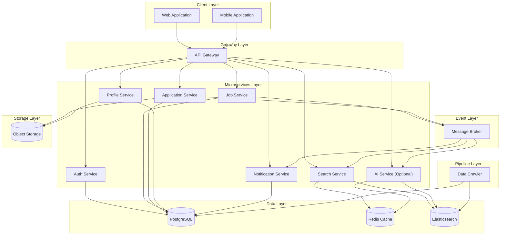

---

### 8.2 Architectural Principles

The system architecture is guided by the following principles:

| Principle | Description | Rationale |
|:----------|:------------|:----------|
| **Microservices** | Each business capability is implemented as an independent service | Enables independent development, deployment, and scaling |
| **Database per Service** | Each microservice has its own database/schema | Ensures loose coupling and data isolation |
| **API-First Design** | All service interactions are through well-defined APIs | Enables clear contracts and independent evolution |
| **Event-Driven Communication** | Asynchronous communication via message broker for cross-service events | Decouples services and enables eventual consistency |
| **Stateless Services** | Services do not maintain state between requests | Enables horizontal scaling and resilience |
| **Containerization** | All services run in containers | Ensures consistency across environments |
| **Infrastructure as Code** | All infrastructure defined in code | Enables reproducibility and version control |

---

### 8.3 Component Description

#### 8.3.1 Client Layer

The client layer consists of the user-facing applications that interact with the platform.

| Component | Description | Technology | Priority |
|:----------|:------------|:-----------|:----------|
| **Web Application** | Single Page Application (SPA) providing full platform interface | Modern SPA framework | MUST |
| **Mobile Application** | Cross-platform mobile app for iOS and Android | Cross-platform mobile framework | MUST |

**Responsibilities:**
- Render user interfaces
- Handle user interactions
- Make API calls to the backend
- Manage client-side state
- Provide offline capabilities (NICE TO HAVE)

#### 8.3.2 Gateway Layer

The gateway layer provides a single entry point for all client requests.

| Component | Description | Technology | Priority |
|:----------|:------------|:-----------|:----------|
| **API Gateway** | Reverse proxy handling routing, authentication, and rate limiting | Modern API Gateway framework | MUST |

**Responsibilities:**
- Route requests to appropriate microservices
- Validate JWT tokens
- Forward user claims to downstream services
- Enforce rate limiting
- Handle CORS
- Aggregate health checks

#### 8.3.3 Microservices Layer

The microservices layer contains all business logic services.

| Service | Description | Primary Responsibilities | Port | Priority |
|:--------|:------------|:------------------------|:-----|:----------|
| **Auth Service** | User authentication and authorisation | Registration, login, JWT generation, token refresh, logout | 5001 | MUST |
| **Job Service** | Job posting management | CRUD operations for jobs, category management | 5002 | MUST |
| **Search Service** | Job search and indexing | Elasticsearch indexing, search queries, filtering | 5003 | MUST |
| **Application Service** | Job application management | Apply, CV upload, status tracking, history | 5004 | MUST |
| **Profile Service** | User profile management | Profile CRUD, skills, experience, education | 5005 | MUST |
| **Notification Service** | Outbound communications | Email notifications, push notifications, in-app notifications | 5006 | SHOULD |
| **AI Service** | AI-powered features (optional) | Chatbot, resume scoring, recommendations | 6000 | NICE |

**Shared Responsibilities:**
- All services must authenticate requests via JWT
- All services must validate input data
- All services must log operations
- All services must expose health check endpoints

#### 8.3.4 Data Layer

The data layer provides persistence, caching, and search capabilities.

| Component | Description | Purpose | Priority |
|:----------|:------------|:--------|:----------|
| **PostgreSQL** | Relational database management system | Primary data storage for all services | MUST |
| **Redis Cache** | In-memory data store | Caching, session storage, rate limiting | SHOULD |
| **Elasticsearch** | Search and analytics engine | Full-text search, indexing, analytics | MUST |

**Data Layer Responsibilities:**
- Provide ACID transactions (PostgreSQL)
- Provide high-performance caching (Redis)
- Provide full-text search capabilities (Elasticsearch)
- Ensure data persistence and durability
- Support database-per-service pattern

#### 8.3.5 Event Layer

The event layer handles asynchronous communication between services.

| Component | Description | Purpose | Priority |
|:----------|:------------|:--------|:----------|
| **Message Broker** | Distributed messaging system | Event publishing and consumption | SHOULD |

**Event Layer Responsibilities:**
- Publish domain events (job created, application submitted)
- Enable event-driven workflows
- Decouple service dependencies
- Support eventual consistency

#### 8.3.6 Pipeline Layer

The pipeline layer handles data extraction and processing.

| Component | Description | Purpose | Priority |
|:----------|:------------|:--------|:----------|
| **Data Crawler** | Web scraping and data extraction | Extract job data from external sources | MUST |

**Pipeline Layer Responsibilities:**
- Scrape job data from external sources
- Clean and transform extracted data
- Load data into PostgreSQL and Elasticsearch
- Handle duplicates and errors

#### 8.3.7 Storage Layer

The storage layer provides object storage for files.

| Component | Description | Purpose | Priority |
|:----------|:------------|:--------|:----------|
| **Object Storage** | Scalable file storage | Store CV files, avatars, company logos | SHOULD |

**Storage Layer Responsibilities:**
- Store uploaded files (CVs, avatars, logos)
- Generate secure access URLs
- Enforce file size and type validation
- Handle file deletion

---

### 8.4 Data Architecture

#### 8.4.1 Database per Service Pattern

Each microservice owns its own database/schema to ensure loose coupling and data isolation.

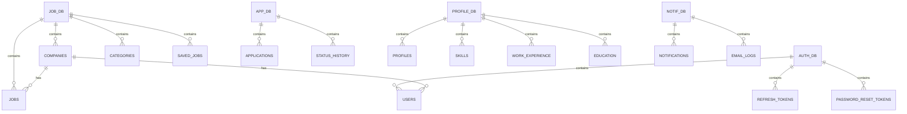

#### 8.4.2 Data Ownership

| Service | Owned Data | Shared Data (Read-Only) |
|:--------|:-----------|:-----------------------|
| Auth Service | User credentials, refresh tokens (SHA-256 hash, TTL 7/30 days), password reset tokens (TTL 15 min) | Company (via Job Service API) |
| Job Service | Companies, Jobs, categories, saved jobs | Users (via Auth API) |
| Application Service | Applications, status history | Jobs + Company (via API) |
| Profile Service | Profiles (phone/address/DOB encrypted AES-256-GCM), skills, experience, education | None |
| Search Service | Search index (Elasticsearch) | Jobs + Company (via `job.created` event with `company_id`) |
| Notification Service | Notification logs, email logs | None |
| AI Service | Chat history (TTL 24h Redis, 30 days DB summary), scoring cache (Redis), context window 20 msgs / 8000 tokens | Jobs, Company, profiles (via API) |

#### 8.4.3 Data Flow Patterns

```mermaid
flowchart TB
    subgraph Sync["Synchronous Data Flow"]
        API["Client API Request"] --> GW["API Gateway"]
        GW --> Svc["Microservice"]
        Svc --> DB["Database"]
        DB --> Svc
        Svc --> GW
        GW --> API
    end

    subgraph Async["Asynchronous Data Flow"]
        Pub["Service A"] --> Broker["Message Broker"]
        Broker --> Sub["Service B"]
        Sub --> Process["Process Event"]
    end

    subgraph Index["Search Indexing Flow"]
        Job["Job Service"] --> Broker2["Message Broker"]
        Broker2 --> Search["Search Service"]
        Search --> ES["Elasticsearch"]
    end
```

---

### 8.5 Event Architecture

#### 8.5.1 Event Types

| Event Name | Publisher | Consumer(s) | Trigger | Payload Key Fields |
|:-----------|:----------|:------------|:--------|:-------------------|
| `job.created` | Job Service | Search Service, Notification Service | New job posted | `job_id`, `title`, `company`, `location`, `recruiter_id` |
| `job.updated` | Job Service | Search Service | Job updated | `job_id`, `title`, `company`, `location` |
| `job.deleted` | Job Service | Search Service | Job deleted | `job_id` |
| `job.approved` | Admin Service | Notification Service | Job approved | `job_id`, `recruiter_id`, `status` |
| `application.submitted` | Application Service | Notification Service | Application submitted | `application_id`, `job_id`, `applicant_id`, `job_title` |
| `application.updated` | Application Service | Notification Service | Status changed | `application_id`, `job_id`, `applicant_id`, `status` |

#### 8.5.2 Event Flow Diagram

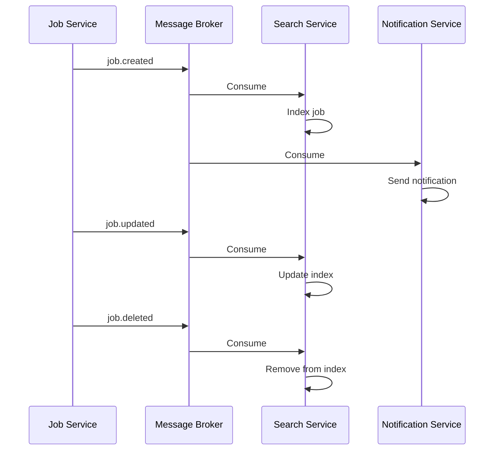

#### 8.5.3 Event Delivery Guarantees

| Guarantee | Implementation | Priority |
|:----------|:---------------|:----------|
| **At-least-once delivery** | Consumer offset management, idempotent consumers | SHOULD |
| **Message persistence** | Configurable retention period (7 days) | SHOULD |
| **Dead letter queue** | Messages that fail after retries go to DLQ | SHOULD |
| **Event replay** | Ability to replay events from retention period | NICE |

---

### 8.6 Deployment Architecture

#### 8.6.1 Development Environment (Local)

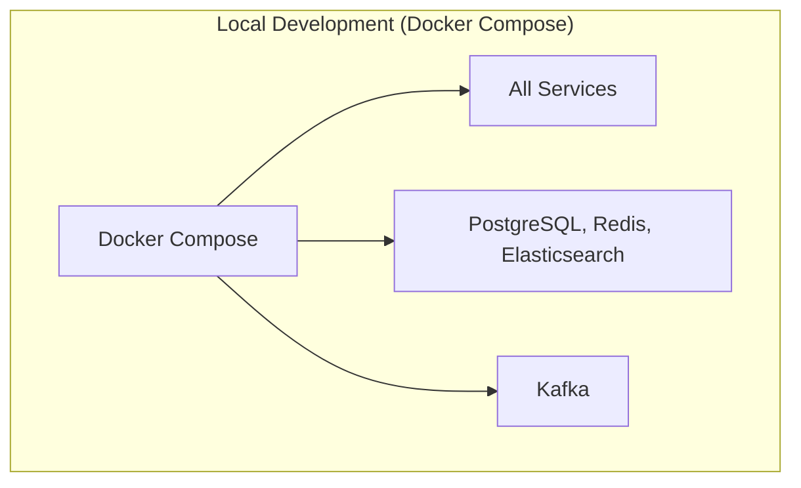

**Characteristics:**
- All services run in Docker containers
- Docker Compose orchestrates all containers
- Hot-reload for development
- Local volume mounts for code changes
- Environment variables for configuration

#### 8.6.2 Staging / Test Environment (Azure VM)

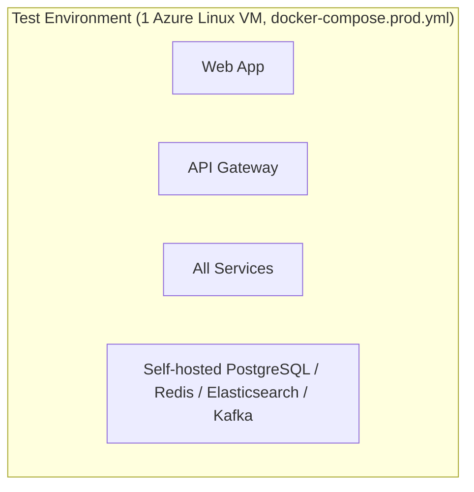

**Characteristics:**
- Deployed to Microsoft Azure (Azure for Students credit): ONE Linux VM (e.g. `Standard_B2ms`, 8 GB) runs the full `docker-compose.prod.yml` from GHCR images (see Part 9, 9.6.1)
- PostgreSQL, Redis, Elasticsearch and Kafka are self-hosted by the compose stack on the VM; only the gateway and web are published
- Started only when testing (`scripts/deploy.sh azure up`) and deallocated afterwards (`azure down`)
- Used for user testing and validation

#### 8.6.3 Production / Demo Environment (Azure VM)

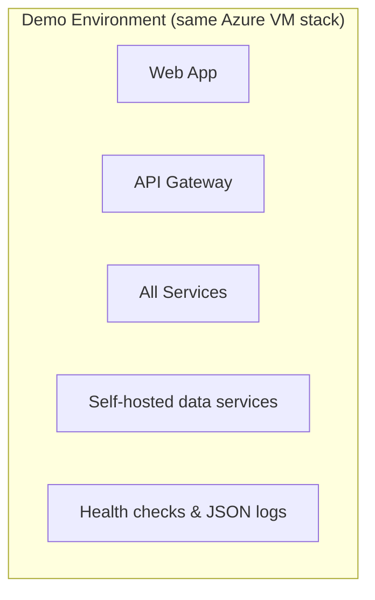

**Characteristics:**
- Same single-VM compose stack as 8.6.2; no auto-scaling (vertical resize of the VM only)
- Health checks (`/health`, `/health/ready`) and structured JSON logs (see 8.6.5)
- VM provisioned with Terraform (one workspace per student subscription); deployment through the manual `deploy-azure.yml` workflow or `scripts/deploy.sh` (see Part 9, 9.7.4)
- Rollback by redeploying a previous image tag (`scripts/deploy.sh --tag <sha> azure rollback`)
- Backup and recovery are limited to the VM disk; volumes persist across deallocation

#### 8.6.4 Deployment Strategy

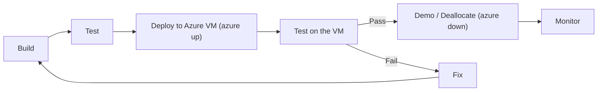

**Deployment Steps:**

| Step | Description | Frequency |
|:-----|:------------|:----------|
| Build | Build all services and applications | Every code push |
| Test | Run unit and integration tests | Every code push |
| Deploy to Azure VM | `scripts/deploy.sh azure up` (pull GHCR images, `compose up -d --wait`) | Per test session (manual) |
| Test on the VM | Run smoke tests and manual verification | Every deployment |
| Deallocate | `scripts/deploy.sh azure down` after testing (disk + static IP cost only) | End of every session |

#### 8.6.5 Health Checks and Logging (PBL6-49)

Every .NET service (gateway, auth, job, search, app, profile, notif) exposes two probes:

| Endpoint | Purpose | Behaviour |
|:---------|:--------|:----------|
| `GET /health` | Cheap liveness (used by the compose healthchecks) | Static `{"status":"ok","service":"<name>"}`, no dependency calls |
| `GET /health/ready` | Readiness (dependency checks) | HTTP 503 when a required dependency is unhealthy; exception text is never returned |

Readiness checks per service: **auth** - PostgreSQL, Redis (only when `REDIS_URL` is set); **job** - PostgreSQL, Kafka publisher circuit-breaker state (open circuit = degraded, an HTTP fallback exists); **search** - Elasticsearch (unhealthy = 503), Redis (degraded, the cache falls back to misses); **gateway** - proxy configuration loaded (routes and clusters), plus an optional upstream probe via `HEALTH_READY_CHECK_UPSTREAMS=true` reported as degraded only; **app** - PostgreSQL, Kafka TCP check (degraded); **profile** - PostgreSQL; **notif** - PostgreSQL, Kafka and SMTP TCP checks (degraded).

Logging uses Serilog with compact JSON console output (outside Development), a service-name enricher and `X-Correlation-Id` propagation: an incoming id is accepted only if it is at most 64 characters of letters, digits, `-`, `_` or `.`; otherwise a new id is generated. The id is echoed in the response (and forwarded to upstreams by the gateway) and attached to every log event. `/health` requests are logged at Verbose level; request headers, bodies and tokens are not logged.

> **Implementation status:** gateway #23, auth-svc #33, job-svc #30, search-svc #14, app-svc #8, profile-svc #7 and notif-svc #7 (all still open pull requests at the time of writing).
| Monitor | Monitor after deployment for issues | Ongoing |

---

### 8.7 Multirepo Structure

#### 8.7.1 Source Code Organisation

The project is organised as a **multirepo**: each service and application resides in its own dedicated repository (see Section 2.4.2). The shared library (`job-platform-shared`) is built and published as a **NuGet package**; all services reference it via `PackageReference` — no direct folder references are used.

```text
job-platform/                     # GitHub organization (or namespace)
├── job-platform-docs/            # Master plan, SRS, git strategy, governance, templates
├── job-platform-shared/          # Shared kernel, DTOs, EventContracts (NuGet package)
├── job-platform-auth-svc/        # Auth microservice
├── job-platform-job-svc/         # Job microservice
├── job-platform-search-svc/      # Search microservice
├── job-platform-app-svc/         # Application microservice
├── job-platform-profile-svc/     # Profile microservice
├── job-platform-notif-svc/       # Notification microservice
├── job-platform-gateway/         # API Gateway (YARP)
├── job-platform-web/             # React web application
├── job-platform-mobile/          # Flutter mobile application
├── job-platform-crawler/         # Python Scrapy crawler
├── job-platform-ai-svc/          # Python FastAPI AI service (optional)
└── job-platform-infra/           # Docker Compose, K8s manifests, deployment scripts
```

Each service repository follows the same internal layout (Clean Architecture style):

```text
<service-repo>/
├── .github/workflows/            # Per-repo CI/CD pipeline
├── src/
│   ├── <Service>.Api/            # Controllers, endpoints
│   ├── <Service>.Core/           # Business logic, domain models
│   └── <Service>.Infrastructure/ # Database, external services
├── tests/
│   └── <Service>.Tests/          # Unit and integration tests
├── Dockerfile
└── README.md
```

#### 8.7.2 Module Dependencies

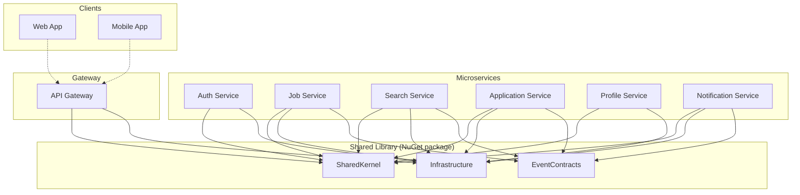

All shared modules are consumed from the published NuGet package rather than referenced from a shared folder; new versions propagate to service repositories via Dependabot or `repository_dispatch` events, as described in Section 3.13.

#### 8.7.4 Contract Testing and Event Schema Compatibility

To prevent runtime failures when `job-platform-shared` changes an Event Schema (e.g., adding/removing fields in `job.created`):

- **Mandatory contract tests:** In each service’s CI, run consumer-driven contract tests (Pact / schema verifier) against the latest `job-platform-shared` before merging to `main`; block merge on breaking changes.
- **SemVer versioning:** Breaking change → major version bump; support **dual-read** (accept both old and new fields) for one version to enable safe rolling updates.
- **Compatibility strategy:** Consumers ignore unknown fields, Producers only add optional fields in minor versions; every breaking change requires an ADR and migration guide.

#### 8.7.3 Multirepo Benefits for This Project

| Benefit | Rationale |
|:---------|:-----------|
| **Independent versioning and deployment** | Each repository versions and deploys on its own schedule |
| **Per-repository CI/CD** | Pipelines are scoped to a single service; a change only rebuilds that service |
| **Team ownership** | Each team member owns and manages their repository independently |
| **Course requirement compliance** | Distribution across multiple repositories/organizations matches the academic requirements |
| **Clearer boundaries** | Service and technology boundaries are enforced by repository structure |
| **Simplified onboarding** | New developers focus on a single repository instead of the entire system |

**Trade-offs:** Shared code is distributed via a NuGet package, so a change to the shared library requires a version bump and update of dependent services rather than an atomic commit.

---

### 8.8 Security Architecture

#### 8.8.1 Authentication Flow

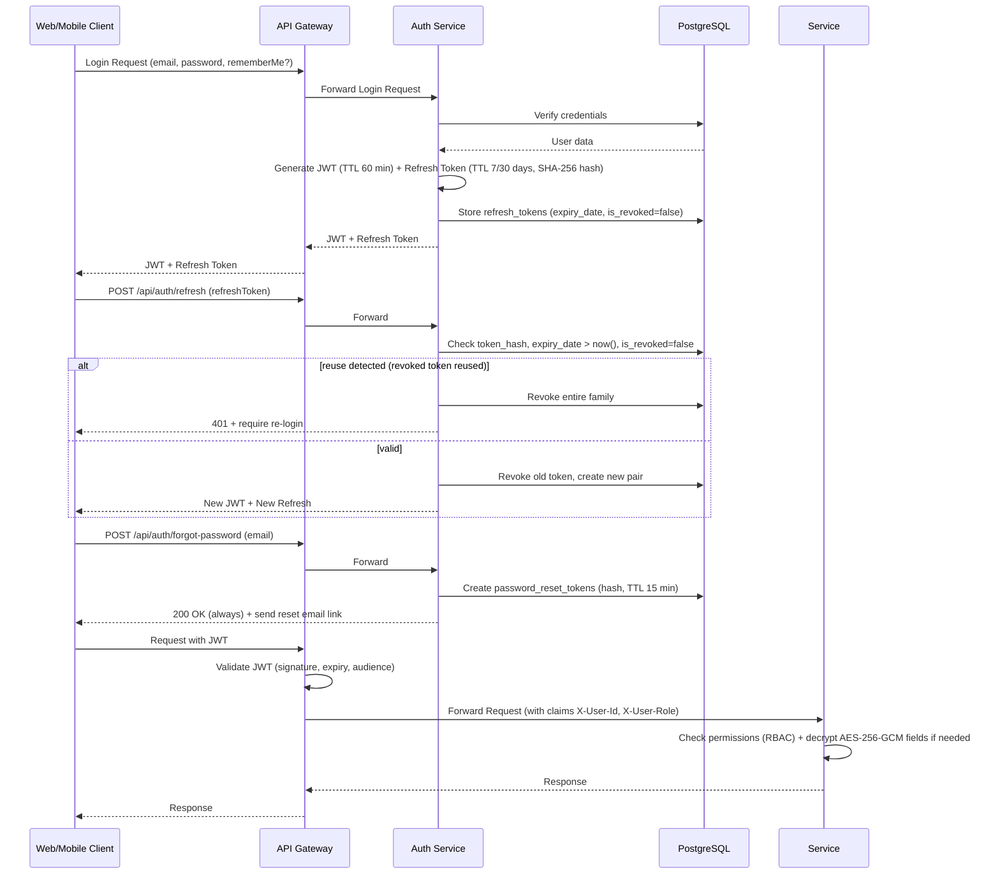

#### 8.8.1.1 Sensitive Data Encryption (SEC-08)

- Fields `phone`, `address`, `date_of_birth` in `profile_db` are encrypted with **AES-256-GCM** at the application layer with per-record IV; key from Secret Manager / Env Var, rotated every 90 days (see `6.3.1`).
- Passwords hashed `bcrypt cost 12`; CVs via pre-signed URL 1h; secrets via K8s Secret/Vault.

#### 8.8.2 Authorization Flow

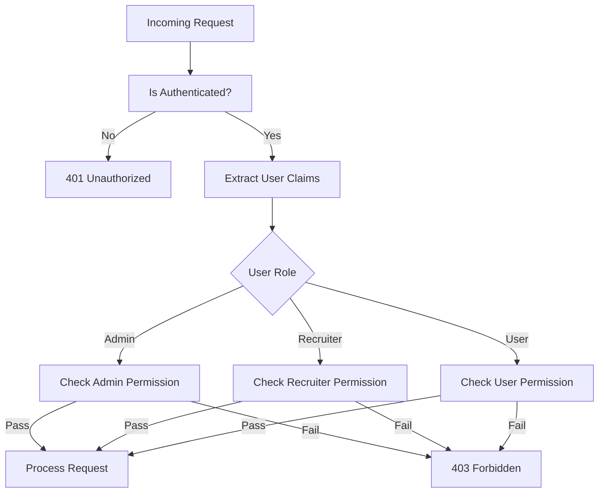

#### 8.8.2.1 Gateway Route Policies (PBL6-44)

The gateway applies an authorisation policy per YARP route. Policies `Admin`, `Recruiter` and `User` (candidate) check the `role` claim; `Authenticated` only requires a valid JWT. Routes without a policy are anonymous. Routes where the downstream service allows more than one role (or the resource owner) stay on `Authenticated` and are enforced by the service itself.

| Policy | Routes |
|:-------|:-------|
| Anonymous | `/api/auth/*`, public reads under `/api/jobs/*`, `/api/categories/*`, `/api/companies/*`, `/api/search/*`, `/api/applications/status-flow`, `GET /api/profiles/{userId}` (public profile), health routes |
| `Admin` | `/api/admin/users/*`, `/api/admin/stats`, `/api/admin/jobs/*` |
| `Recruiter` | `POST /api/jobs`, `GET /api/jobs/recruiter`, `PUT`/`DELETE /api/jobs/{id}`, `POST /api/companies`, `PUT /api/companies/{id}` |
| `User` | `POST /api/applications`, `GET /api/applications/me` |
| `Authenticated` | other `/api/applications/*` (by job, status update, CV download), other `/api/profiles/*`, `/api/notifications/*` |

An anonymous call to a protected route returns 401; a valid token with the wrong role returns 403. Status: the `Admin` policy routes are merged (gateway #21); the `Recruiter`/`User` policies are in gateway #22 (open at the time of writing). Admin user management, job approval and stats are served by auth-svc #30/#31/#32 and job-svc #26 (merged).

---

### 8.9 Technology Stack Summary

The following table summarises the technology choices for the system architecture. Note that the SRS defines requirements and interfaces, not specific implementations, but this summary is provided for context.

| Layer | Technology | Purpose | Priority |
|:------|:-----------|:--------|:----------|
| Backend Framework | Modern enterprise framework (.NET) | Service implementation | MUST |
| API Gateway | Modern API Gateway (YARP) | Request routing and auth | MUST |
| Web Frontend | Modern SPA framework (React + Vite) | Web interface | MUST |
| Mobile Framework | Cross-platform framework (Flutter) | Mobile interface | MUST |
| Database | PostgreSQL | Primary data store | MUST |
| Cache | Redis | Caching and session storage | SHOULD |
| Search Engine | Elasticsearch | Full-text search | MUST |
| Message Broker | Kafka | Event-driven communication | SHOULD |
| File Storage | S3-compatible (Cloudflare R2) | File storage | SHOULD |
| Containerisation | Docker + Docker Compose | Container management | MUST |
| CI/CD | GitHub Actions | Automation | MUST |
| Monitoring | Grafana + Prometheus | Observability | SHOULD |

---

**End of Part 8**

---