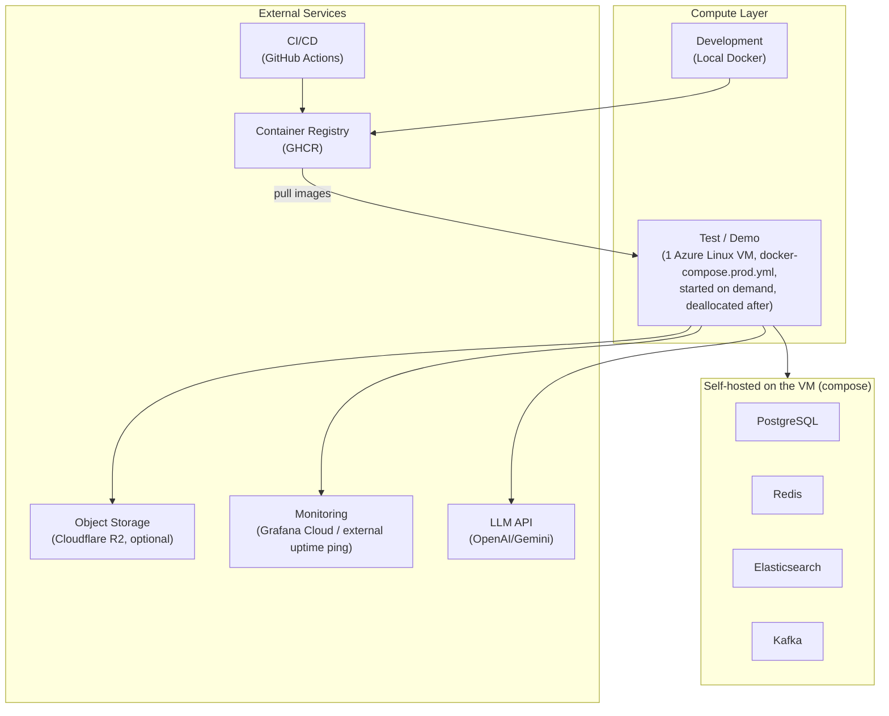
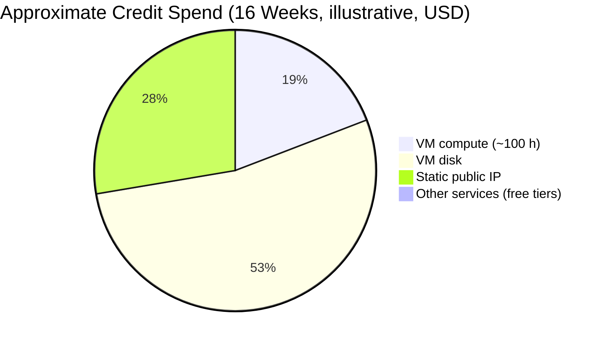
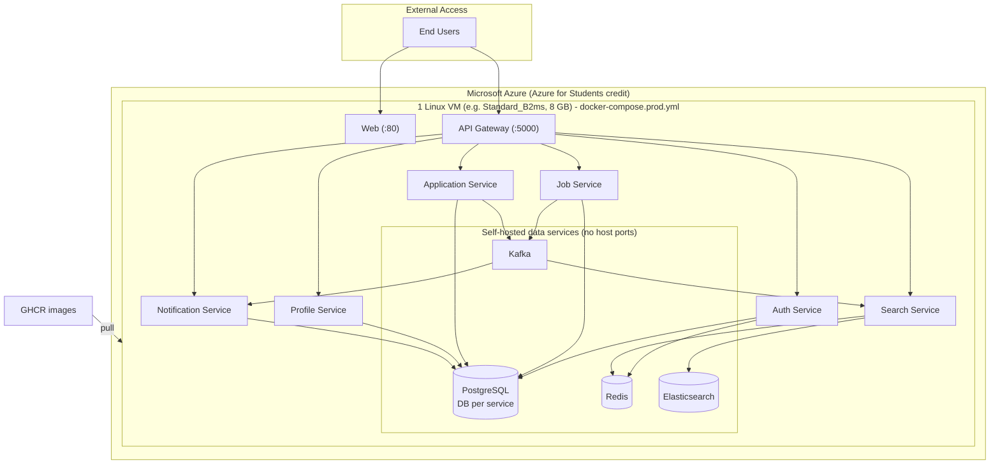
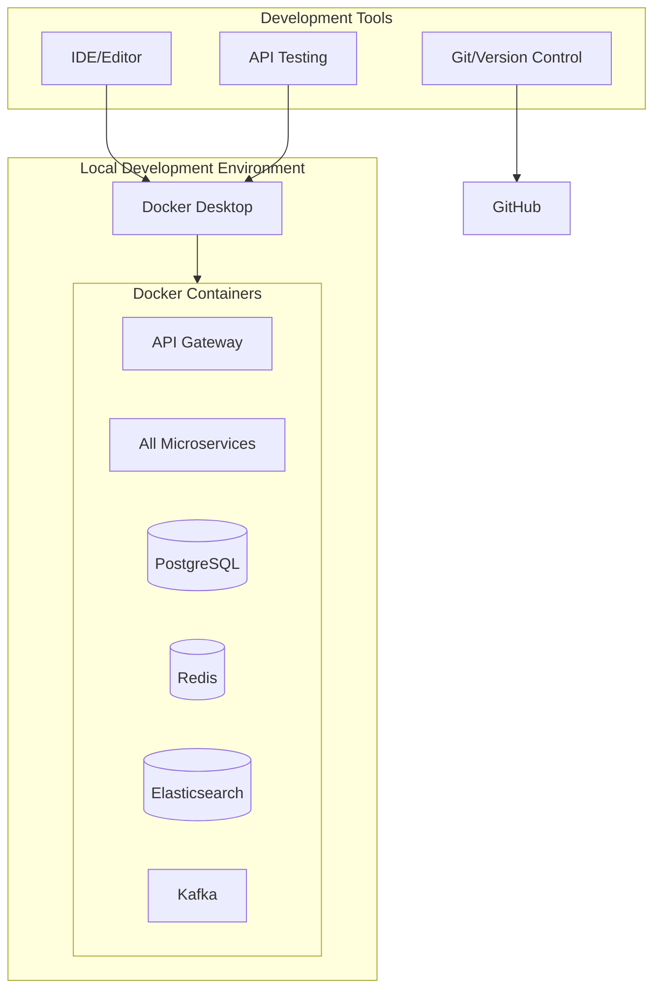
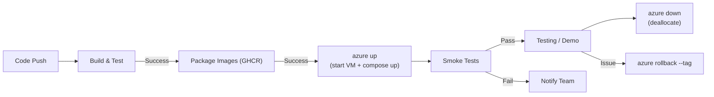

# Software Requirements Specification (SRS)

[English](9-infra-cost-analysis.md) | [Tiếng Việt](../vi/9-infra-cost-analysis.vi.md)

## Vietnam Job Platform - Microservices Architecture

**Version:** 1.0  
**Date:** August 17, 2026  
**Project:** Vietnam Job Platform (Nền tảng việc làm Việt Nam)  

---

## Part 9: Infrastructure and Cost Analysis

### 9.1 Overview

This section documents the infrastructure strategy and cost analysis for the Vietnam Job Platform. **The deploy target is Microsoft Azure** (an earlier hosting provider was dropped in favour of Azure, and the product has never run in production; PBL6-51 and PBL6-83, `job-platform-infra` PR #18): ONE Linux VM (e.g. `Standard_B2ms`, 2 vCPU / 8 GB) runs the full `docker-compose.prod.yml` from GHCR images. The VM is started only when testing and deallocated afterwards, so it is funded by **Azure for Students credit** (3 accounts x $100, not pooled) rather than by an always-free tier. The cost is therefore *not literally $0*: it is a small, credit-funded amount (see 9.3 and 9.4) with **no out-of-pocket spend** expected within the 16-week project. All dollar figures below are approximate and must be re-checked with the Azure pricing calculator.

The compose stack self-hosts PostgreSQL, Redis, Elasticsearch and Kafka on the VM for the test environment. Managed free tiers (Supabase, Upstash, Bonsai, Confluent, Cloudflare R2, Grafana Cloud, ...) remain documented in 9.3 and 9.8 as alternatives and for services outside the compose stack.

The infrastructure is organised into the following layers:

---

### 9.2 Infrastructure Components

The following table documents all infrastructure components required for the system.

| Component Category | Component | Purpose | Provider | Priority |
|:-------------------|:----------|:--------|:---------|:----------|
| **Compute** | Development Environment | Local development and testing | Docker Compose (Local) | MUST |
| **Compute** | Staging / Test Environment | Pre-production testing (single VM, started on demand) | Microsoft Azure VM (Azure for Students) | SHOULD |
| **Compute** | Production / Demo Environment | Demo deployment (same VM and compose stack) | Microsoft Azure VM (Azure for Students) | SHOULD |
| **Database** | PostgreSQL | Primary data storage | Self-hosted in compose on the VM (Supabase = alternative) | MUST |
| **Cache** | Redis | Caching and session storage | Self-hosted in compose on the VM (Upstash = alternative) | SHOULD |
| **Search Engine** | Elasticsearch | Full-text search and indexing | Self-hosted in compose on the VM (Bonsai / Elastic Cloud = alternatives) | MUST |
| **Message Broker** | Kafka | Event-driven communication | Self-hosted in compose on the VM (Confluent Cloud = alternative) | SHOULD |
| **Object Storage** | S3-compatible Storage | File storage (CV, avatars) | Cloudflare R2 | SHOULD |
| **Container Registry** | Docker Registry | Container image storage | GitHub Container Registry | MUST |
| **CI/CD** | Automation Pipeline | Build, test, and deployment automation | GitHub Actions | MUST |
| **Monitoring** | Observability Stack | Metrics, logs, and alerts | Grafana Cloud | SHOULD |
| **AI Services** | LLM API | AI chatbot and resume scoring | OpenAI / Google Gemini | NICE |
| **Domain/Tunnel** | Public Exposure | Secure public access | Cloudflare Tunnel | SHOULD |

---

### 9.3 Cost Breakdown Analysis

The following table provides a cost analysis for the infrastructure components over the 16-week project duration. Azure figures are **approximate** (Standard_B2ms, Southeast Asia region assumed; check the Azure pricing calculator). Rows marked *alternative* are not used by the compose-based test environment.

| Component Category | Service Provider | Offer / Estimated Price | Validity Period | 16-Week Cost |
|:-------------------|:-----------------|:------------------------|:----------------|:-------------|
| **Compute (VM)** | Microsoft Azure (Azure for Students) | `Standard_B2ms` (2 vCPU, 8 GB), ~$0.09/h while running; runs the full compose stack | 3 accounts x $100 credit (not pooled); credit-funded | ~$9 per 100 running hours (credit) |
| **VM disk** | Microsoft Azure (Azure for Students) | 64 GB StandardSSD, ~$5-8/month; billed while the VM is deallocated | Same credit | ~$20-30 (credit) |
| **Public IP** | Microsoft Azure (Azure for Students) | Standard-SKU public IP is static, ~$3.6/month; billed even while the VM is deallocated | Same credit | ~$13 (credit) |
| **Auto-shutdown** | Azure `az vm auto-shutdown` | Nightly safety net (default 22:00 Vietnam time) | Free | $0 |
| **Compute (VM)** | Google Cloud Platform | f1-micro instance: 0.2 vCPU, 0.6 GB RAM, 30 GB HDD (alternative) | Always Free (within limits) | $0 |
| **Managed Database** | Supabase | PostgreSQL: 500 MB storage (alternative to the self-hosted Postgres) | Always Free (within limits) | $0 |
| **Managed Database** | Neon | PostgreSQL: 1 GB storage, branching (alternative) | Always Free (within limits) | $0 |
| **Managed Cache** | Upstash | Redis: 10,000 commands per day (alternative) | Always Free (within limits) | $0 |
| **Search Engine** | Bonsai | Elasticsearch: 1 GB cluster (alternative) | Always Free (within limits) | $0 |
| **Search Engine** | Elastic Cloud | Elasticsearch: 1 GB cluster (trial, alternative) | 14-day trial (renewable) | $0 |
| **Message Broker** | Confluent Cloud | Kafka: Basic tier with limited throughput (alternative) | Always Free (within limits) | $0 |
| **Object Storage** | Cloudflare R2 | 10 GB storage, unlimited egress (no bandwidth charges) | Always Free (within limits) | $0 |
| **Container Registry** | GitHub Container Registry | Unlimited public repositories | Always Free | $0 |
| **CI/CD Pipeline** | GitHub Actions | 2,000 free minutes/month (private repos), unlimited (public repos) | Always Free (within limits) | $0 |
| **Code Quality** | SonarCloud | Optional CI job, runs only when the `SONAR_TOKEN` secret exists (see 3.13) | Free for public projects | $0 |
| **Monitoring Stack** | Grafana Cloud | 10,000 Prometheus metrics, 50 GB logs, 50 GB traces/month | Always Free (within limits) | $0 |
| **AI Services (Self-Hosted)** | In-service open-source models (multilingual-e5-small, Qwen2.5) on CPU | Local inference, $0 API token costs | Always Free / Open Source | $0 |
| **AI Services (Cloud Fallback / Eval)** | Google Gemini / OpenAI | Free tier (~15-60 RPM) / promo credits | Evaluation / Fallback | $0 |
| **Domain / Tunnel** | Cloudflare Tunnel | Secure public exposure without public IP or paid domain | Always Free | $0 |

---

### 9.4 Total Estimated Cost

The Azure VM is **not free**; it is paid from the Azure for Students credit. Illustrative estimate for the 16 weeks (approximate; assumes ~100 hours of running time for test and demo sessions and a 64 GB disk kept for ~3.7 months):

| Item | Assumption | Approx. cost (USD) |
|:-----|:-----------|:-------------------|
| VM compute | ~100 h x ~$0.09/h | ~$9 |
| VM disk | ~$5-8/month x ~3.7 months | ~$20-30 |
| Static public IP | ~$3.6/month x ~3.7 months (billed while deallocated) | ~$13 |
| Everything else | Free tiers / open-source / GitHub | $0 |
| **Total** | Within a single $100 student credit | **~$40-50, funded by credit** |

**Out-of-pocket cost: $0 expected**, provided the VM is deallocated after every session (a running VM burns credit 24/7; stopping the OS from inside the VM does *not* stop billing). If one account's credit runs low, the next student subscription is used (re-run the provisioning script; data on the VM disk does not migrate and must be re-seeded).

---

### 9.5 Cost Optimisation Strategies

The following strategies keep the infrastructure within the Azure for Students credit (no out-of-pocket cost):

| Strategy | Description | Implementation |
|:---------|:------------|:---------------|
| **Single On-Demand VM** | One Azure VM runs the full compose stack; start only when testing, deallocate afterwards (deallocated = disk + static IP cost only) | `scripts/deploy.sh azure up` / `azure down`; nightly `az vm auto-shutdown` as a safety net |
| **Student Credit Rotation** | Use Azure for Students credit (3 accounts x $100, not pooled); rotate to the next subscription when credit runs low | `AZURE_SUBSCRIPTION_ID` + re-run `scripts/azure-provision.sh` |
| **Free Tier Utilization** | Use Always Free tiers for services outside the compose stack | Cloudflare R2, GHCR, GitHub Actions, Grafana Cloud (Supabase, Upstash, Bonsai kept as alternatives) |
| **Egress Cost Avoidance** | Use services with free data transfer (egress) | Cloudflare R2 provides free egress |
| **Self-Hosted AI & Fallback Management** | Run open-source AI models (multilingual-e5, Qwen2.5) locally on CPU; use free-tier cloud APIs for evaluation | Completely eliminates runtime API costs and rate limits; cloud providers serve as optional evaluation baseline |
| **Containerized Deployment** | Package all services using Docker; images built in CI and published to GHCR | `docker-compose.prod.yml` pulls GHCR images onto the Azure VM |
| **Self-Hosted Data Services (test env)** | PostgreSQL, Redis, Elasticsearch and Kafka run inside the compose stack on the VM, avoiding managed-service quotas | Data persists on the VM disk across deallocation; never `docker compose down -v` |
| **Infrastructure as Code** | Automate infrastructure provisioning | Reduces manual errors and management costs |

---

### 9.6 Infrastructure Architecture

#### 9.6.1 Test / Demo Architecture (Azure VM)

All services run on one Azure Linux VM via `docker-compose.prod.yml` (project `job-platform-prod`, internal network, only the gateway and web are published). The AI service is not part of the compose stack.

#### 9.6.2 Development Architecture

---

### 9.7 Deployment Procedure

#### 9.7.1 Test Session Deployment Steps (Azure VM)

| Step | Action | Owner | Validation |
|:-----|:-------|:------|:-----------|
| 1 | Build all services and applications | CI/CD (GitHub Actions) | All builds pass |
| 2 | Run all automated tests (optional SonarCloud analysis) | CI/CD (GitHub Actions) | All tests pass |
| 3 | Package Docker images and push to GHCR | CI/CD (GitHub Actions) | Images pushed successfully |
| 4 | Start the VM and deploy: `scripts/deploy.sh azure up` (starts VM, syncs compose and env, pulls images, `up -d --wait`) | TM1 | Containers healthy |
| 5 | Run smoke tests (`/health` through the gateway, `/health/ready` per service) | All | Key endpoints respond |
| 6 | Invite users for testing | All | Users can access the environment |
| 7 | Collect and address feedback | All | Issues resolved |
| 8 | Deallocate: `scripts/deploy.sh azure down` | TM1 | VM deallocated (disk + static IP cost only) |

The VM is created once with Terraform (`terraform/`, see 9.7.4; `scripts/azure-provision.sh` remains as a fallback). The steps above can also be run from the manual `deploy-azure.yml` workflow. Both scripts support `--dry-run`.

#### 9.7.2 Rollback and Credit Management

| Step | Action | Owner | Validation |
|:-----|:-------|:------|:-----------|
| 1 | Roll back to a previous image tag: `scripts/deploy.sh --tag <previous-sha> azure rollback` | TM1 | Previous version healthy |
| 2 | Never remove volumes (`docker compose down -v`) | TM1 | Data preserved across sessions |
| 3 | Always deallocate after testing; check `azure status` | TM1 | VM not running idle |
| 4 | When credit runs low, rotate to the next student subscription and re-provision | TM1 | New VM up; data re-seeded |
| 5 | Update documentation | All | Documentation reflects the environment |

#### 9.7.3 Deployment Pipeline

There is no automatic deploy: CI builds, tests and publishes images to GHCR only; every deploy (`deploy-azure.yml`) and every `terraform apply` is a manual `workflow_dispatch` in the `production` environment. The diagram shows the manual flow.

> **Image publishing status (PBL6-84):** all 8 deployable repositories (`auth-svc`, `gateway`, `job-svc`, `search-svc`, `app-svc`, `profile-svc`, `notif-svc`, `web`) publish `ghcr.io/dut-pbl6-2026/job-platform-<repo>` (tags: long commit SHA and `latest`) once the pending PRs merge: `search-svc` #14, `app-svc` #8, `profile-svc` #7 and `notif-svc` #7 (each PR now bundles health/logging, optional SonarCloud and `publish-image.yml`) and `web` #23 add `publish-image.yml` (`auth-svc`, `gateway` and `job-svc` already publish). `mobile` #16 removes the old hosting URL from the mobile app. GHCR packages are private by default: make them public, or set `GHCR_USER` / `GHCR_TOKEN` (PAT with `read:packages`) for the VM pull. The `web` image bakes `VITE_API_BASE_URL` in at build time from a repository variable, so set it to the public gateway URL before the first publish.

#### 9.7.4 Infrastructure as Code and Manual CD (PBL6-83)

`job-platform-infra` PR #18 (open at the time of writing; it also contains the PBL6-51 production compose and deploy scripts) replaces the manual provisioning script with Terraform and adds manually triggered GitHub Actions workflows:

| Item | Description |
|:-----|:------------|
| `terraform/` (`azurerm ~> 4`, pinned) | Resource group, VNet/subnet, NSG (SSH restricted to `admin_cidr`; 80, 443 and optional gateway port), Standard static public IP with DNS label, NIC, Ubuntu 24.04 VM (`Standard_B2ms`, 64 GB StandardSSD, cloud-init installs Docker + compose plugin), and a VM shutdown schedule (default 15:00 UTC = 22:00 Vietnam time) |
| One workspace per subscription | `envs/sub1\|sub2\|sub3.tfvars` with one Terraform workspace/state each; optional `azurerm` remote backend; tfstate and tfvars are git-ignored. Rotating to the next student subscription = new workspace + `apply` |
| `terraform.yml` | PRs touching `terraform/**` run `fmt` + `validate`; `plan` only when OIDC and remote state are configured (otherwise skipped); manual `workflow_dispatch` `plan` or `apply`, where **apply runs in the `production` environment** (required reviewers) |
| `deploy-azure.yml` | Manual `workflow_dispatch` with action `up`, `down`, `status` or `rollback`, an `image_tag` and `auto_deallocate_after_hours` (0-23); runs `scripts/deploy.sh`; smoke test on `/health` and `/health/ready` (readiness enforced only when `REQUIRE_HEALTH_READY=true`); concurrency-guarded |
| Authentication | Azure OIDC (`azure/login`) when the `AZURE_CLIENT_ID` / `AZURE_TENANT_ID` / `AZURE_SUBSCRIPTION_ID` secrets exist; otherwise an SSH-only fallback (`AZURE_VM_HOST`, `AZURE_SSH_PRIVATE_KEY`, `PROD_ENV_FILE`) that supports only `up` and `rollback` (no VM power control) |
| Auto-deallocate | No sleep jobs: `auto_deallocate_after_hours=N` (OIDC mode) re-sets the VM's native Azure auto-shutdown to now + N hours; the nightly 22:00 Vietnam-time schedule from Terraform remains the safety net |

`scripts/azure-provision.sh` is kept only as a no-Terraform fallback. The infra CI additionally runs `terraform fmt`/`validate` and `actionlint`. Not yet tested by the PR author: real `terraform plan/apply`, OIDC login, workflow runs, and SSH from GitHub runners (the NSG blocks them unless `admin_cidr` is widened).

---

### 9.8 Free Tier Strategy

#### 9.8.1 Primary Services (Always Free, except Azure compute)

| Service | Provider | Limit | Usage |
|:--------|:---------|:------|:------|
| **Compute** | GCP | f1-micro (0.2 vCPU, 0.6 GB RAM) | Lightweight gateway or monitoring |
| **Compute** | Microsoft Azure (student credit) | 1 VM, ~$0.09/h running, credit-funded (not free) | All microservices + web + self-hosted data services |
| **Database** | Supabase | 500 MB storage | Alternative to the self-hosted PostgreSQL |
| **Cache** | Upstash | 10,000 commands/day | Alternative to the self-hosted Redis |
| **Search** | Bonsai | 1 GB cluster | Alternative to the self-hosted Elasticsearch |
| **Message Broker** | Confluent | Basic tier (limited throughput) | Alternative to the self-hosted Kafka |
| **Storage** | Cloudflare R2 | 10 GB storage | CV, avatar, logo storage |
| **CI/CD** | GitHub Actions | 2,000 minutes/month | Build and test automation |
| **Monitoring** | Grafana Cloud | 10,000 metrics | Observability |
| **Tunnel** | Cloudflare | Unlimited | Secure public exposure |

#### 9.8.2 Backup Services

| Service | Provider | Limit | When to Use |
|:--------|:---------|:------|:------------|
| **Compute** | AWS | 12-month free tier | If Azure credit is exhausted on all accounts |
| **Compute** | DigitalOcean/Vultr | $200-$250 credits | If additional compute needed |
| **Database** | Neon | 1 GB storage | If Supabase limits exceeded |
| **Search** | Elastic Cloud | 14-day trial | If Bonsai limits exceeded |

---

### 9.9 Resource Monitoring

To ensure free tier limits and the Azure credit are not exceeded, the following monitoring strategy is implemented. The Azure VM is deallocated outside test sessions, so uptime monitors will alert while it is down and should be paused.

| Resource | Metric | Alert Threshold | Action |
|:---------|:-------|:-----------------|:-------|
| **Azure credit** | Remaining credit per student subscription | Running low (check Azure Cost Management) | Rotate to the next subscription |
| **Azure VM** | Power state | Running while nobody is testing | Run `scripts/deploy.sh azure down` |
| **Supabase** (if used) | Storage usage | > 400 MB | Archive old data |
| **Supabase** (if used) | Database connections | > 15 | Increase pooling limits |
| **Upstash** (if used) | Commands/day | > 8,000 | Optimise caching strategy |
| **Bonsai** (if used) | Cluster size | > 800 MB | Delete old indexes |
| **Confluent** (if used) | Throughput | > 80% of limit | Throttle event publishing |
| **GitHub Actions** | Minutes/month | > 1,800 | Optimise CI pipeline |
| **Grafana** | Metrics | > 8,000 | Reduce metric collection |

---

### 9.10 Risk Considerations

| Risk | Probability | Impact | Mitigation Strategy |
|:-----|:------------|:-------|:-------------------|
| **Free tier resource exhaustion** | Medium | High | Monitor usage metrics; upgrade only if necessary |
| **Azure credit exhaustion** | Medium | High | Deallocate the VM after every session; nightly auto-shutdown; rotate to the next student subscription (3 x $100, not pooled); data does not migrate and must be re-seeded |
| **VM left running** | Medium | Medium | `az vm auto-shutdown`; check `azure status`; stopping the OS inside the VM does not stop billing |
| **Student subscription restrictions** (region/SKU/quota) | Medium | Medium | Check `az vm list-skus` / `az vm list-usage` first; region and size are parameters of the provisioning script |
| **API rate limiting (AI services)** | Medium | Low | Implement caching and rate limiting; use Gemini for high-volume requests |
| **Data persistence across service restarts** | Low | High | Data lives on the VM disk (Docker volumes) and survives deallocation; never `down -v`; there is no managed-service backup in the test environment |
| **Service provider changes free tier** | Low | High | Have backup providers identified |
| **Cloud service outage** | Low | Medium | Multi-region where possible; local development always available |
| **Database connection limits** | Medium | High | Connection pooling; monitor active connections |

---

### 9.11 Infrastructure Requirements Summary

| Category | MUST | SHOULD | NICE | Total |
|:---------|:-----|:-------|:-----|:------|
| Compute | 1 | 2 | 0 | 3 |
| Database | 1 | 0 | 0 | 1 |
| Cache | 0 | 1 | 0 | 1 |
| Search | 1 | 0 | 0 | 1 |
| Message Broker | 0 | 1 | 0 | 1 |
| Storage | 0 | 1 | 0 | 1 |
| Container Registry | 1 | 0 | 0 | 1 |
| CI/CD | 1 | 0 | 0 | 1 |
| Monitoring | 0 | 1 | 0 | 1 |
| AI Services | 0 | 0 | 1 | 1 |
| Domain/Tunnel | 0 | 1 | 0 | 1 |
| **Total** | **5** | **7** | **1** | **13** |

---

### 9.12 Post-Project Considerations

While the project is designed to stay within the Azure for Students credit (no out-of-pocket cost) during the 16-week period, the following considerations apply for potential future use:

| Consideration | Recommendation | Estimated Cost |
|:--------------|:----------------|:---------------|
| **Production Scale-Up** | Upgrade to paid tiers when user base grows | $50-200/month |
| **Data Growth** | Expand database and storage as needed | $10-50/month |
| **AI Features** | Subscribe to paid AI services for production | $20-100/month |
| **High Availability** | Deploy to multiple regions for redundancy | $100-300/month |
| **Professional Support** | Purchase support plans for critical services | $50-200/month |

---

**End of Part 9**

---