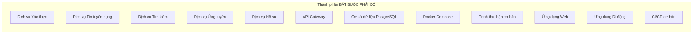
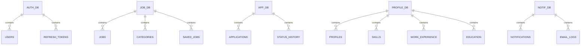
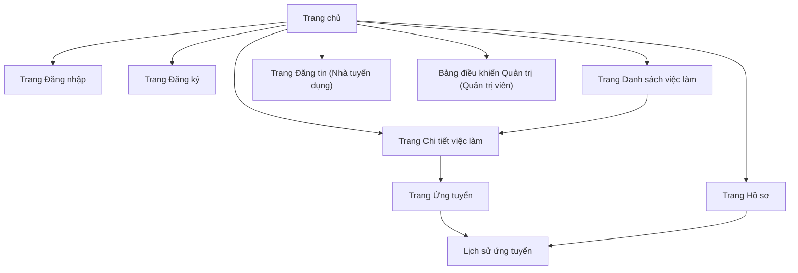
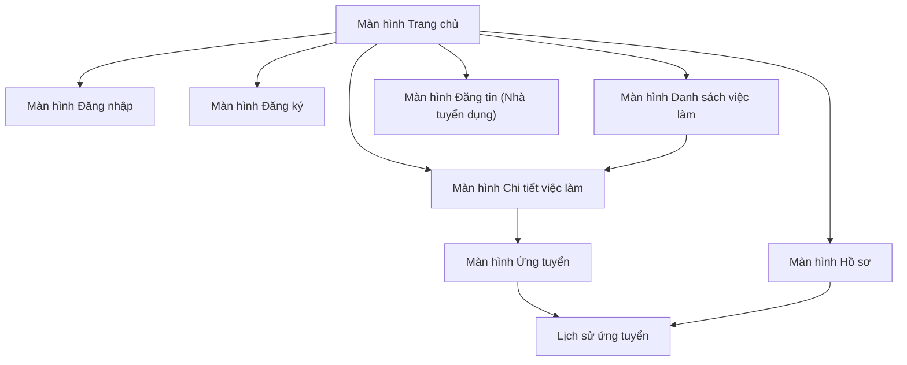
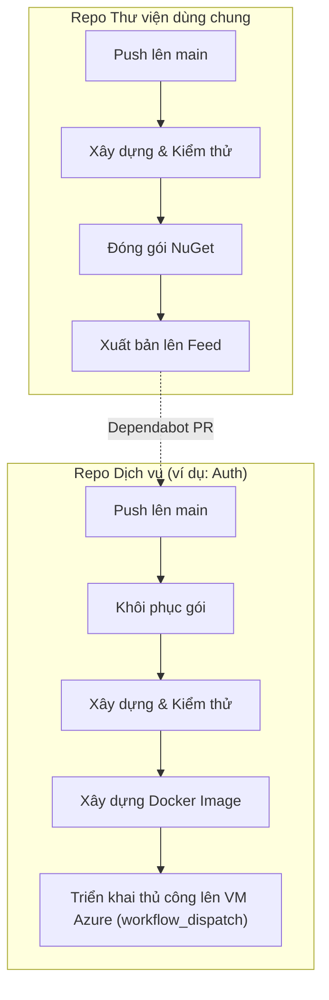

# Đặc tả Yêu cầu Phần mềm (SRS)

[English](../en/3-must-have-fr.md) | [Tiếng Việt](3-must-have-fr.vi.md)

## Nền tảng Việc làm Việt Nam - Microservices với .NET + Multirepo

**Phiên bản:** 1.0  
**Ngày:** 17 tháng 8 năm 2026  
**Dự án:** Nền tảng Việc làm Việt Nam (Vietnam Job Platform)  

---

## Phần 3: Yêu cầu chức năng - BẮT BUỘC PHẢI CÓ

### 3.1 Tổng quan

Phần này ghi lại tất cả các yêu cầu chức năng **BẮT BUỘC PHẢI CÓ**. Các tính năng này là thiết yếu để hệ thống được coi là hoạt động và phải ổn định 100% vào cuối Tuần 4. Mỗi yêu cầu đều có thể truy xuất đến Kế hoạch tổng thể và bao gồm các tiêu chí chấp nhận để xác nhận.

Các tính năng BẮT BUỘC PHẢI CÓ được tổ chức thành 12 thành phần cốt lõi:

---

### 3.2 Dịch vụ Xác thực

**ID thành phần:** AUTH-01  
**Mức độ ưu tiên:** BẮT BUỘC PHẢI CÓ  
**Người phụ trách:** TM1  
**Tuần mục tiêu:** Tuần 1  

#### 3.2.1 Mô tả

Dịch vụ Xác thực quản lý danh tính người dùng, đăng ký, đăng nhập và quản lý phiên sử dụng xác thực dựa trên token (JWT). Nó cung cấp kiểm soát truy cập dựa trên vai trò (Người dùng, Nhà tuyển dụng) và bảo mật tất cả các lệnh gọi API tiếp theo.

#### 3.2.2 Yêu cầu chức năng

| ID | Yêu cầu | Tiêu chí chấp nhận |
|:---|:--------|:-------------------|
| AUTH-01-01 | Hệ thống cho phép người dùng đăng ký với email, mật khẩu và thông tin hồ sơ cơ bản | - Điểm cuối đăng ký: `POST /api/auth/register` - Định dạng email được xác thực - Độ mạnh mật khẩu được thực thi (tối thiểu 8 ký tự, ít nhất 1 số, 1 chữ hoa) - Dữ liệu người dùng được lưu vào cơ sở dữ liệu với mật khẩu đã băm |
| AUTH-01-02 | Hệ thống cho phép người dùng đăng nhập với email và mật khẩu | - Điểm cuối đăng nhập: `POST /api/auth/login` - Trả về access token và refresh token - Thông tin đăng nhập không hợp lệ trả về 401 Unauthorised |
| AUTH-01-03 | Hệ thống cấp access token với thời gian hiệu lực giới hạn | - Access token có hiệu lực trong 1 giờ - Token chứa user ID, email và các claim về vai trò - Token được ký mã hóa bằng mật mã |
| AUTH-01-04 | Hệ thống hỗ trợ cơ chế làm mới token có thời hạn xác định | - Điểm cuối làm mới: `POST /api/auth/refresh` - Refresh token có hiệu lực **7 ngày** kể từ khi cấp (có thể cấu hình qua `REFRESH_TOKEN_TTL_DAYS`); nếu chọn “Ghi nhớ đăng nhập” → **30 ngày** (`REFRESH_TOKEN_REMEMBER_ME_TTL_DAYS`) - Refresh token được lưu dạng **hash SHA-256** với `expiry_date` (TTL tuyệt đối, không sliding) và `is_revoked`, index trên `expiry_date`, purge cron hàng ngày - Refresh token cũ bị vô hiệu hóa khi sử dụng (rotation); phát hiện reuse → thu hồi cả family và yêu cầu đăng nhập lại - Hết hạn → `401 Unauthorized` và yêu cầu đăng nhập lại; cặp token mới được trả về khi hợp lệ |
| AUTH-01-05 | Hệ thống hỗ trợ đăng xuất (vô hiệu hóa token) | - Điểm cuối đăng xuất: `POST /api/auth/logout` - Refresh token bị vô hiệu hóa - Access token vẫn có hiệu lực cho đến khi hết hạn (không blocklist; TTL ngắn 1 giờ) |
| AUTH-01-06 | Hệ thống gán vai trò và liên kết mỗi tài khoản Nhà tuyển dụng với đúng một Company | - Trường vai trò trong form đăng ký - Vai trò mặc định = Người dùng - Đăng ký Nhà tuyển dụng qua `POST /api/auth/register` yêu cầu `inviteCode` hợp lệ (AUTH-01-09, AUTH-01-15); người dùng gia nhập Company của mã đó, và Company không bao giờ lấy từ dữ liệu client gửi lên - Một tài khoản Nhà tuyển dụng thuộc đúng một Company (`users.company_id`). Company thứ hai cần một tài khoản khác; `company_id` không thay đổi sau khi đã đặt trong phiên bản này - Đăng ký không bao giờ tạo Company; Company chỉ được tạo qua đăng ký doanh nghiệp (AUTH-01-10), đăng ký này cũng tạo quản trị viên đầu tiên - Đường tạo tự động qua `companyName` (deprecated) bị loại bỏ (auth-svc chưa từng triển khai) - `POST /api/companies` trả `409 ACCOUNT_ALREADY_HAS_COMPANY` đối với Nhà tuyển dụng đã có `company_id`; mọi Nhà tuyển dụng đều có Company, nên phiên bản này không tạo Company qua endpoint đó (gỡ bỏ: backlog C14) - `POST /api/companies` từ người gọi khác giữ nguyên quy tắc vai trò hiện có (`403` với người không phải Nhà tuyển dụng) |
| AUTH-01-07 | Hệ thống cho phép yêu cầu đặt lại mật khẩu qua email | - Điểm cuối: `POST /api/auth/forgot-password { email }` - Nếu email tồn tại, tạo reset_token (UUID), lưu **hash SHA-256** + `expiry_date` = 15 phút, `is_used=false` - Gửi email chứa link `{WEB_URL}/reset-password?token=...` (TTL 15 phút, one-time) - Luôn trả `200 OK` kể cả khi email không tồn tại (chống enumeration) - Rate-limit: 5 yêu cầu / IP / giờ |
| AUTH-01-08 | Hệ thống cho phép đặt lại mật khẩu bằng token | - Điểm cuối: `POST /api/auth/reset-password { token, newPassword }` - Token phải hợp lệ, chưa hết hạn, chưa dùng - `newPassword` phải thỏa mãn độ mạnh như AUTH-01-01 - Vô hiệu hóa token sau khi dùng (`is_used=true`), **thu hồi tất cả refresh tokens** của user (bắt đăng nhập lại trên thiết bị khác) - Trả về `200 OK` + hướng dẫn đăng nhập lại |
| AUTH-01-09 | Hệ thống chỉ cho phép người tạo Company phát hành mã mời Nhà tuyển dụng dùng một lần, có thời hạn, mỗi mã gắn với một địa chỉ email, để gia nhập một Company đã có | - Mã mời chỉ đưa Nhà tuyển dụng vào một Company đã có. Đăng ký doanh nghiệp (AUTH-01-10) không dùng mã mời - Người phát hành là quản trị viên Company, tức người tạo (`companies.created_by`) - Điểm cuối phát hành: `POST /api/companies/{id}/invite-codes` (job-svc), body `{ email }` (địa chỉ mà mã được gắn vào, AUTH-01-15). Người gọi phải có vai trò Nhà tuyển dụng và bằng `companies.created_by`; nếu không trả `403 INVITE_CODE_NOT_CREATOR`. Company có `created_by` là GUID rỗng (dữ liệu cũ) không được phát mã - Mã: 12 ký tự từ bảng `ABCDEFGHJKLMNPQRSTUVWXYZ23456789` (không có 0, O, 1, I), sinh bằng bộ sinh số ngẫu nhiên an toàn về mật mã; hiển thị dạng `XXXX-XXXX-XXXX` - Phản hồi chỉ hiển thị mã gốc một lần. Máy chủ chỉ lưu băm SHA-256 của mã đã chuẩn hóa (cắt khoảng trắng, chữ hoa, bỏ dấu gạch) trong cột duy nhất. Mã gốc không bao giờ được ghi log hoặc trả lại - Hạn: 7 ngày kể từ khi phát hành (`INVITE_CODE_TTL_DAYS`, mặc định 7). Không gia hạn trượt - Dùng một lần: auth-svc gọi `check` với `{ code, email }` (chỉ đọc), kiểm tra email chưa tồn tại, rồi gọi `redeem` với `{ code, email }`, một lệnh cập nhật có điều kiện (`used_at IS NULL AND status = Active AND expires_at > now AND email khớp`) trả về `companyId`. Mỗi mã chỉ đổi được một lần - Nếu tạo người dùng thất bại sau khi redeem, auth-svc gọi `release` với `inviteCodeId`. Nếu release cũng thất bại, mã vẫn ở trạng thái đã dùng và người tạo phải phát mã mới - Mọi mã không hợp lệ (không tồn tại, sai định dạng, hết hạn, đã dùng, đã thu hồi, hoặc gắn với địa chỉ khác) đều trả cùng một lỗi `422 INVITE_CODE_INVALID` - Trạng thái: `status` là Active hoặc Revoked. Mã đã dùng khi `used_at` có giá trị, và hết hạn khi `expires_at` đã qua - Thu hồi: mã chưa dùng được đặt `status` = Revoked, `revoked_at` = thời điểm hiện tại và `revoke_reason` = `ADMIN_CHANGED`. Mã đã dùng không bị thay đổi. Mã đã thu hồi bị từ chối với `422 INVITE_CODE_INVALID`, cùng lỗi với mã không tồn tại, hết hạn hoặc đã dùng - Duyệt quản trị viên mới của Company bởi bộ phận hỗ trợ (AUTH-01-14) sẽ thu hồi các mã chưa dùng của quản trị viên cũ với lý do `ADMIN_CHANGED` - Endpoint nội bộ được bảo vệ bởi `JOB_INTERNAL_TOKEN_FOR_AUTH` (fail-closed: 401 khi chưa đặt hoặc sai token) và không đi qua gateway - `POST /api/auth/register` giữ nguyên giới hạn tần suất và quy tắc lỗi hiện có; mã mời không tạo thêm tín hiệu lộ sự tồn tại của tài khoản |
| AUTH-01-10 | Hệ thống cho phép một doanh nghiệp tự đăng ký, tạo Company và tài khoản quản trị viên đầu tiên, hoặc tạo yêu cầu gia nhập khi tên miền đã thuộc một Company đã xác minh | - Điểm cuối: `POST /api/auth/register-company { companyName, taxCode?, email, password, fullName }`, công khai; trả `202 Accepted` với `{ message }` và không có token. Phản hồi giống nhau trong mọi trường hợp: đăng ký mới, email đã có tài khoản, `companyName` hoặc `taxCode` đã được dùng, và tên miền khớp với Company đã xác minh (AUTH-01-12). Chuỗi `{ message }` là một chuỗi cố định, và thời gian phản hồi không được phụ thuộc vào kết quả (ví dụ mọi email, kể cả thư thông báo, được gửi bất đồng bộ) - Mọi lần đăng ký, và lần kiểm tra lại khi xác minh, đều chạy hai lệnh tra cứu sau trước khi chọn kết quả, bất kể tên miền: (1) kiểm tra khớp tên miền, `POST /api/internal/companies/domain-match` (AUTH-01-12); và (2) kiểm tra khả dụng, `GET /api/internal/companies/availability?companyName=...&taxCode=...` trả `{ available }`. `available` chỉ là true khi `companyName` còn trống và, nếu có `taxCode`, `taxCode` cũng còn trống, theo quy tắc duy nhất của `POST /api/companies`. Cả hai đều chỉ đọc và được bảo vệ bằng bearer `JOB_INTERNAL_TOKEN_FOR_AUTH` (fail-closed `401`). Kết quả được chọn từ kết quả của hai lệnh này và kiểm tra tài khoản bên dưới; khi tên miền khớp, kết quả khả dụng bị bỏ qua. Nếu một trong hai lệnh tra cứu thất bại, đăng ký trả `503` và không lưu gì; sự thất bại này không phụ thuộc kết quả. Giá trị đã có không được báo trong phản hồi (giống như trên, trừ trường hợp `503`); thay vào đó, thư thông báo báo cho chủ hộp thư (bên dưới) - `email` phải đạt AUTH-01-11 (kiểm tra trước mọi tra cứu, vì chỉ phụ thuộc địa chỉ gửi lên); `password` phải đạt độ mạnh của AUTH-01-01 - Đăng ký mới: nếu email chưa có tài khoản, và `companyName` và `taxCode` còn trống (hoặc tên miền khớp với Company đã xác minh, nên không kiểm tra chúng), đăng ký lưu một bản đăng ký chờ xác minh (`pending_company_signups`, mật khẩu lưu dạng băm) và gửi email xác minh kèm liên kết (AUTH-01-11). Chưa có Company, yêu cầu gia nhập hay tài khoản hoạt động nào tồn tại cho đến khi liên kết được xác minh - Thay bằng thông báo: nếu email đã có tài khoản, hoặc `companyName` hoặc `taxCode` đã được dùng (và tên miền không khớp với Company đã xác minh), không lưu gì và thư thông báo được gửi tới địa chỉ trong yêu cầu. Nội dung thông báo là một chuỗi cố định cho mỗi ngôn ngữ, giống nhau cho mọi trường hợp thông báo: doanh nghiệp không thể đăng ký với các thông tin này, và thư hướng người dùng tới bộ phận hỗ trợ. Đây là một thông báo chung cho mọi nguyên nhân. Thông báo không chứa liên kết và không bao giờ được gửi cho người khác: không gửi cho người đang giữ tên hoặc mã số thuế đã dùng, cũng không gửi cho quản trị viên của bất kỳ Company nào - Đăng ký thuộc trường hợp thông báo cũng xóa mọi bản đăng ký chờ của email đó, nên chỉ lần đăng ký mới nhất mới có thể được xác minh - Đăng ký mới cho một email đang có đăng ký chờ sẽ thay thế đăng ký cũ - Khi xác minh, auth-svc chạy lại kiểm tra khớp tên miền (AUTH-01-12) và kiểm tra khả dụng, như khi đăng ký, rồi tạo người dùng ở trạng thái chưa kích hoạt (`is_active = false`). Nếu email đã có tài khoản, hoặc tên miền không khớp và `companyName` hoặc `taxCode` đã bị dùng kể từ lúc đăng ký, không tạo gì: bản đăng ký chờ bị xóa, thư thông báo cố định được gửi tới địa chỉ đó, và phản hồi vẫn là cùng `{ message }` - Không có Company đã xác minh nào giữ tên miền: auth-svc gọi job-svc `POST /api/internal/companies { name, taxCode?, createdBy, emailDomain }`, tạo Company với `created_by` = người dùng đó, `email_domain` được đặt và `verified` = true (AUTH-01-11). Sau đó người dùng trở thành Nhà tuyển dụng đang hoạt động với `company_id` được đặt - Có Company đã xác minh giữ tên miền: không tạo Company. auth-svc gọi job-svc `POST /api/internal/company-join-requests { userId, companyId }` (AUTH-01-12). Sau đó người dùng trở thành Người dùng đang hoạt động, không có `company_id` - Nếu lệnh gọi job-svc thất bại, auth-svc xóa người dùng chưa kích hoạt, xác minh thất bại toàn bộ, và cùng liên kết vẫn dùng lại được cho đến khi hết hạn - Quản trị viên là người tạo và là người duy nhất phát mã mời của Company (AUTH-01-09) |
| AUTH-01-11 | Hệ thống yêu cầu email công việc đã xác minh khi đăng ký doanh nghiệp | - Tên miền email không được nằm trong danh sách chặn cấu hình sẵn các nhà cung cấp email công cộng miễn phí (tối thiểu gmail.com, yahoo.com, outlook.com, hotmail.com, live.com, icloud.com, aol.com, proton.me); nếu không trả `422 WORK_EMAIL_REQUIRED` - Tên miền trong danh sách chặn không bao giờ được khớp với Company (AUTH-01-12) và không bao giờ được lưu làm `email_domain`. Đăng ký bằng nhà cung cấp miễn phí vì vậy không bao giờ gia nhập hay tạo Company thuộc sở hữu của tài khoản khác; trong phiên bản này nó bị từ chối, không biến thành Company độc lập - Gửi email xác minh chứa liên kết dùng một lần (hoặc, trong các trường hợp thông báo ở AUTH-01-10, thư thông báo cố định không có liên kết) `{WEB_URL}/verify-email?token=...`; token là chuỗi ngẫu nhiên, lưu dạng băm SHA-256, `expiry_date` = 24 giờ sau khi gửi - `POST /api/auth/verify-email { token }` (công khai) tiêu thụ token và hoàn tất AUTH-01-10; token sai, hết hạn hoặc đã dùng trả `422 VERIFICATION_TOKEN_INVALID` - Giới hạn tần suất như quên mật khẩu: 5 đăng ký / IP / giờ. Mọi yêu cầu đều được tính, bất kể kết quả (kể cả các trường hợp thông báo), để giới hạn không lộ việc email đã tồn tại hay chưa - **Việc nhấp liên kết chứng minh** người đó có thể nhận thư tại địa chỉ đó tại thời điểm nhấp, và tên miền không nằm trong danh sách chặn - **Việc nhấp liên kết không chứng minh** người đó làm việc cho doanh nghiệp hoặc có quyền đại diện; doanh nghiệp có tồn tại hoặc đã đăng ký; doanh nghiệp sở hữu tên miền (tên miền phụ và hộp thư dùng chung được lưu trữ đều được chấp nhận); không có Company nào khác dùng cùng tên miền (định tuyến gửi các đăng ký sau về Company hiện có, AUTH-01-12); hay doanh nghiệp là thật. Khi xác minh hoàn tất, hệ thống đặt `Company.verified = true` và `email_domain` (AUTH-01-10). Cờ này chỉ có nghĩa là quản trị viên sáng lập đã chứng minh có hộp thư tại tên miền (backlog A12, đã quyết định ngày 2026-11-15) |
| AUTH-01-12 | Hệ thống định tuyến đăng ký bằng email công việc có tên miền đã thuộc một Company đã xác minh sang một yêu cầu gia nhập gửi tới quản trị viên của Company đó, thay vì tạo Company thứ hai | - Khớp tên miền: một Company đã xác minh có `email_domain` bằng tên miền đăng ký, và tên miền không nằm trong danh sách chặn (AUTH-01-11). Mỗi tên miền chỉ thuộc tối đa một Company (`companies.email_domain` duy nhất) - Kiểm tra khi đăng ký và kiểm tra lại khi xác minh (AUTH-01-10), qua job-svc `POST /api/internal/companies/domain-match` (`{ domain }` trả `{ companyId }` hoặc `{ companyId: null }`; nội bộ, không đi qua gateway). Kiểm tra khi xác minh là kiểm tra có hiệu lực - Khớp thì không tạo Company và bỏ qua `companyName` và `taxCode` - Yêu cầu gia nhập được lưu trong job-svc (`company_join_requests`) với trạng thái Pending, `company_id`, `user_id` (duy nhất: một yêu cầu cho mỗi tài khoản) và `expires_at` (AUTH-01-13) - Chỉ quản trị viên Company (`companies.created_by`) xem danh sách, duyệt hoặc từ chối các yêu cầu của Company: `GET /api/companies/{id}/join-requests`, `POST /api/companies/{id}/join-requests/{requestId}/approve` và `POST .../reject`. Người gọi khác nhận `403 JOIN_REQUEST_NOT_ADMIN` - Duyệt: job-svc gọi auth-svc `POST /api/internal/users/{userId}/link-company { companyId }`, đặt vai trò Nhà tuyển dụng và `company_id` (idempotent với cùng Company; Company khác trả `409 ACCOUNT_ALREADY_HAS_COMPANY`). Yêu cầu chỉ chuyển sang Approved sau khi auth-svc xác nhận; nếu lệnh gọi thất bại, yêu cầu vẫn Pending và quản trị viên có thể thử lại - Từ chối: trạng thái Rejected; tài khoản vẫn là Người dùng đang hoạt động, không có Company. Yêu cầu bị từ chối là cuối cùng: người gửi không thể gửi yêu cầu gia nhập nào khác cho Company đó hay bất kỳ Company nào (`user_id` duy nhất, một yêu cầu cho mỗi tài khoản). Sau khi hết thời gian chờ, khi yêu cầu được xem là Expired (AUTH-01-13), người gửi có thể leo thang lên bộ phận hỗ trợ (AUTH-01-14); đây là cách duy nhất để đảo ngược một lần từ chối - Không tìm thấy yêu cầu trả `404 JOIN_REQUEST_NOT_FOUND`. Quyết định một yêu cầu không ở trạng thái Pending, hoặc đã hết hạn: `409 JOIN_REQUEST_STATE_INVALID` - Thông báo email cho quản trị viên khi có yêu cầu mới không thuộc phiên bản này (backlog C13) |
| AUTH-01-13 | Hệ thống hết hạn yêu cầu gia nhập đang chờ sau một khoảng thời gian chờ có thể cấu hình | - `COMPANY_JOIN_REQUEST_TTL_DAYS`, mặc định **7** ngày kể từ khi tạo (đã quyết định ngày 2026-11-15, backlog A11) - Yêu cầu có `now >= expires_at` là Expired bất kể trạng thái đã lưu; một job hàng ngày ghi trạng thái Expired - Quản trị viên không thể duyệt hoặc từ chối yêu cầu đã hết hạn (`409 JOIN_REQUEST_STATE_INVALID`) - Hết hạn không thay đổi gì khác: Company, quản trị viên và các yêu cầu khác giữ nguyên - Hết hạn không cấp quyền. Không có chuyển quyền tự động: chờ đợi không bao giờ khiến người gửi thành Nhà tuyển dụng hay quản trị viên Company. Chỉ quyết định của quản trị viên (AUTH-01-12) hoặc quyết định của bộ phận hỗ trợ sau khi leo thang (AUTH-01-14) mới làm được điều đó - Người gửi xem trạng thái và thời hạn qua `GET /api/companies/me/join-request` |
| AUTH-01-14 | Hệ thống cho phép người gửi leo thang một yêu cầu gia nhập đã hết hạn lên bộ phận hỗ trợ nền tảng để xem xét thủ công | - Người gửi gọi `POST /api/companies/me/join-request/escalate`. Chỉ cho phép một lần, và chỉ khi trạng thái là Expired (trạng thái hiệu lực theo AUTH-01-13, nên yêu cầu Rejected đã quá `expires_at` đủ điều kiện); nếu không trả `409 JOIN_REQUEST_STATE_INVALID`. Không thể leo thang trước khi hết hạn, nên thời gian chờ luôn chạy trước - Trạng thái chuyển sang Escalated và yêu cầu vào hàng đợi xem xét của bộ phận hỗ trợ (công cụ nội bộ; không có điểm cuối công khai) - Hỗ trợ quyết định qua `POST /api/internal/company-join-requests/{id}/support-decision { decision: approve hoặc reject, reason }` (job-svc; bearer token nội bộ, fail-closed, không đi qua gateway). Chỉ yêu cầu Escalated mới được quyết định; nếu không trả `409 JOIN_REQUEST_STATE_INVALID` - Trước khi duyệt, bộ phận hỗ trợ phải xác minh ngoài hệ thống rằng người gửi kiểm soát Company. Quyết định, lý do, người thao tác và thời điểm được ghi log - Duyệt: trạng thái SupportApproved; người gửi trở thành Nhà tuyển dụng đang hoạt động của Company (job-svc gọi auth-svc link-company, AUTH-01-12) và trở thành quản trị viên Company (`companies.created_by`). Quản trị viên cũ vẫn là Nhà tuyển dụng của Company. Các mã mời chưa dùng do quản trị viên cũ phát hành bị thu hồi (AUTH-01-09: `status` = Revoked, `revoke_reason` = `ADMIN_CHANGED`) - Từ chối: trạng thái SupportRejected; tài khoản vẫn là Người dùng đang hoạt động không có Company; Company không thay đổi |
| AUTH-01-15 | Hệ thống ràng buộc mỗi mã mời với một địa chỉ email và chỉ chấp nhận mã khi dùng đúng địa chỉ đó | - Phát hành yêu cầu `email`; lưu ở dạng đã chuẩn hóa (cắt khoảng trắng, chữ thường) trong `invite_codes.email` - `check` và `redeem` yêu cầu `{ code, email }`. Mã được đưa ra với địa chỉ khác sẽ bị từ chối với `422 INVITE_CODE_INVALID`, cùng lỗi với mọi mã không hợp lệ, nên người giữ mã không biết được trạng thái của nó - Chấp nhận mã với địa chỉ được ràng buộc sẽ chứng minh địa chỉ đó. Tài khoản Nhà tuyển dụng được mời hoạt động ngay khi đăng ký và không gửi email xác minh; không có bước xác minh riêng - Tài khoản vẫn phải đáp ứng quy tắc mật khẩu của AUTH-01-01 và dùng một địa chỉ chưa được sử dụng (AUTH-01-09) |

#### 3.2.3 Đặc tả API

| Điểm cuối | Phương thức | Body yêu cầu | Phản hồi | Quy tắc xác thực |
|:----------|:------------|:-------------|:---------|:-----------------|
| `/api/auth/register` | POST | `{ email, password, fullName, role, inviteCode? }` | `{ userId, message }` | Email phải là duy nhất; mật khẩu đáp ứng yêu cầu độ mạnh; vai trò phải hợp lệ; nếu `role=Recruiter` bắt buộc có `inviteCode` và mã phải đổi được thành một Company với email được ràng buộc (AUTH-01-09, AUTH-01-15), nếu không trả `422 INVITE_CODE_INVALID`; `companyId` và `companyName` bị bỏ qua |
| `/api/auth/login` | POST | `{ email, password, rememberMe? }` | `{ accessToken, refreshToken, user }` | Thông tin đăng nhập phải khớp; tài khoản phải đang hoạt động; `rememberMe` quyết định TTL refresh (7 vs 30 ngày) |
| `/api/auth/refresh` | POST | `{ refreshToken }` | `{ accessToken, refreshToken }` | Token phải hợp lệ, chưa hết hạn (7/30 ngày) và chưa bị thu hồi; reuse → thu hồi family |
| `/api/auth/logout` | POST | `{ refreshToken }` | `{ message }` | Token phải hợp lệ và chưa bị thu hồi |
| `/api/auth/me` | GET | (Bearer Token) | `{ user }` | Token phải hợp lệ; trả về hồ sơ người dùng |
| `/api/auth/forgot-password` | POST | `{ email }` | `{ message }` | Luôn 200 OK; rate-limit 5/IP/giờ |
| `/api/auth/reset-password` | POST | `{ token, newPassword }` | `{ message }` | Token hợp lệ, chưa hết hạn (15 phút), chưa dùng; mật khẩu đạt độ mạnh |
| `/api/auth/register-company` | POST | `{ companyName, taxCode?, email, password, fullName }` | `{ message }` (202) | Công khai; cùng `202` và `{ message }` cho mọi kết quả: đăng ký mới, email đã có, `companyName` hoặc `taxCode` đã dùng, hoặc tên miền khớp (AUTH-01-10, AUTH-01-12); email phải đạt AUTH-01-11, nếu không trả `422 WORK_EMAIL_REQUIRED`; mọi yêu cầu đều chạy hai lệnh tra cứu, và trả `503` không lưu gì nếu một lệnh thất bại; không tạo gì cho đến khi xác minh |
| `/api/auth/verify-email` | POST | `{ token }` | `{ message }` | Công khai; dùng một lần, 24 giờ; token sai, hết hạn hoặc đã dùng trả `422 VERIFICATION_TOKEN_INVALID`; tạo tài khoản quản trị và Company, hoặc yêu cầu gia nhập của người gửi; trường hợp xung đột sau đăng ký (AUTH-01-10: email đã có tài khoản, hoặc `companyName` hoặc `taxCode` đã bị dùng kể từ lúc đăng ký, mà tên miền không khớp) xóa bản đăng ký chờ và gửi thông báo cố định, không tạo gì; cùng một `{ message }` dù kết quả thế nào (AUTH-01-10, AUTH-01-12) |
| `/api/companies` | POST | `{ name, tax_code?, website?, description?, logo_url?, address?, industry?, size? }` | `{ id, message }` | Yêu cầu vai trò Nhà tuyển dụng; Nhà tuyển dụng đã có `company_id` nhận `409 ACCOUNT_ALREADY_HAS_COMPANY` (AUTH-01-06); `name` duy nhất; `tax_code` duy nhất nếu có |
| `/api/companies/{id}` | GET | - | CompanyDetailDTO | Public; id hợp lệ |
| `/api/companies` | GET | Query: `q, page, size` | Paginated `[Company]` | Public |
| `/api/companies/{id}` | PUT | `{ name, tax_code?, website?, description?, logo_url?, address?, industry?, size? }` | `{ message }` | Yêu cầu vai trò Nhà tuyển dụng là chủ sở hữu (`created_by`); `name` duy nhất; `tax_code` duy nhất nếu có; **phần mở rộng** (NICE) hỗ trợ US-07b "quản lý hồ sơ công ty của tôi" |
| `/api/companies/{id}/invite-codes` | POST | `{ email }` | `{ id, code, email, expiresAt }` (201; `code` chỉ hiển thị một lần) | Yêu cầu vai trò Nhà tuyển dụng và người gọi = `created_by`, nếu không trả `403 INVITE_CODE_NOT_CREATOR`; Company không tồn tại trả `404 COMPANY_NOT_FOUND`; xem AUTH-01-09, AUTH-01-15 |
| `/api/internal/invite-codes/check` | POST | `{ code, email }` | `{ companyId, companyName }` | Chỉ nội bộ, không đi qua gateway; bearer `JOB_INTERNAL_TOKEN_FOR_AUTH` (fail-closed `401`); chỉ đọc; mã không hợp lệ hoặc sai địa chỉ trả `422 INVITE_CODE_INVALID` |
| `/api/internal/invite-codes/redeem` | POST | `{ code, email }` | `{ inviteCodeId, companyId }` | Cùng cơ chế xác thực; dùng một lần, nguyên tử; mã không hợp lệ hoặc sai địa chỉ trả `422 INVITE_CODE_INVALID` |
| `/api/internal/invite-codes/{id}/release` | POST | - | `204 No Content` | Cùng cơ chế xác thực; chỉ xóa `used_at` sau khi đăng ký thất bại |
| `/api/internal/companies` | POST | `{ name, taxCode?, createdBy, emailDomain }` | `{ companyId }` (201) | Chỉ nội bộ, không đi qua gateway; bearer `JOB_INTERNAL_TOKEN_FOR_AUTH` (fail-closed `401`); chỉ auth-svc gọi khi xác minh và không có Company đã xác minh nào giữ tên miền (AUTH-01-10) |
| `/api/internal/companies/domain-match` | POST | `{ domain }` | `{ companyId }` hoặc `{ companyId: null }` (200) | Chỉ nội bộ; bearer `JOB_INTERNAL_TOKEN_FOR_AUTH` (fail-closed `401`); chỉ đọc; tên miền trong danh sách chặn luôn trả null; gọi khi mọi lần đăng ký và khi xác minh (AUTH-01-10, AUTH-01-11, AUTH-01-12) |
| `/api/internal/companies/availability` | GET | Query: `companyName`, `taxCode?` | `{ available }` (200) | Chỉ nội bộ; bearer `JOB_INTERNAL_TOKEN_FOR_AUTH` (fail-closed `401`); chỉ đọc; gọi khi mọi lần đăng ký và khi xác minh, bất kể tên miền (AUTH-01-10) |
| `/api/internal/company-join-requests` | POST | `{ userId, companyId }` | `{ joinRequestId, expiresAt }` (201) | Chỉ nội bộ; bearer `JOB_INTERNAL_TOKEN_FOR_AUTH` (fail-closed `401`); chỉ auth-svc gọi khi xác minh (AUTH-01-10, AUTH-01-12) |
| `/api/internal/users/{userId}/link-company` | POST | `{ companyId }` | `204 No Content` | Chỉ nội bộ, do auth-svc phục vụ; chỉ job-svc gọi khi quản trị viên hoặc hỗ trợ duyệt; bearer token nội bộ riêng (fail-closed `401`; token theo từng bên gọi, backlog B8); không đi qua gateway. Idempotent với cùng Company; Company khác trả `409 ACCOUNT_ALREADY_HAS_COMPANY` (AUTH-01-12) |
| `/api/companies/{id}/join-requests` | GET | Query: `status?`, `page`, `size` | Phân trang `[JoinRequest]` | Yêu cầu vai trò Nhà tuyển dụng và người gọi = `created_by`, nếu không trả `403 JOIN_REQUEST_NOT_ADMIN`; Company không tồn tại trả `404 COMPANY_NOT_FOUND` (AUTH-01-12) |
| `/api/companies/{id}/join-requests/{requestId}/approve` | POST | - | `{ message }` | Cùng điều kiện; không tìm thấy yêu cầu trả `404 JOIN_REQUEST_NOT_FOUND`; không ở trạng thái Pending hoặc đã hết hạn trả `409 JOIN_REQUEST_STATE_INVALID` (AUTH-01-12, AUTH-01-13) |
| `/api/companies/{id}/join-requests/{requestId}/reject` | POST | - | `{ message }` | Cùng điều kiện và lỗi như approve (AUTH-01-12) |
| `/api/companies/me/join-request` | GET | - | `{ status, companyId, expiresAt }` | Mọi tài khoản đã đăng nhập có yêu cầu gia nhập (người gửi); không có trả `404 JOIN_REQUEST_NOT_FOUND` (AUTH-01-13) |
| `/api/companies/me/join-request/escalate` | POST | - | `{ message }` | Chỉ người gửi; một lần, chỉ khi Expired; nếu không trả `409 JOIN_REQUEST_STATE_INVALID` (AUTH-01-14) |
| `/api/internal/company-join-requests/{id}/support-decision` | POST | `{ decision, reason }` | `{ status }` | Chỉ nội bộ, công cụ của bộ phận hỗ trợ nền tảng; bearer token nội bộ (fail-closed `401`); không đi qua gateway; chỉ quyết định yêu cầu Escalated (AUTH-01-14) |

#### 3.2.4 Mô hình dữ liệu

| Thực thể | Thuộc tính bắt buộc | Quan hệ |
|:---------|:--------------------|:--------|
| User | id, email (duy nhất), password_hash, full_name, role, is_active, company_id (FK nullable; đặt một lần cho Nhà tuyển dụng, AUTH-01-06), created_at, updated_at | Một User có nhiều Refresh Tokens; Một User (Recruiter) thuộc về một Company |
| Refresh Token | id, token_hash (duy nhất, SHA-256), user_id, expiry_date (TTL tuyệt đối 7 ngày, 30 ngày nếu rememberMe), is_revoked, created_at | Nhiều Refresh Tokens thuộc về một User |
| Password Reset Token | id, user_id (FK), token_hash (SHA-256, duy nhất), expiry_date (TTL 15 phút), is_used, created_at | Nhiều Password Reset Tokens thuộc về một User |
| Company | id, name (duy nhất), tax_code (duy nhất, nullable), verified (bool, mặc định false; true sau khi xác minh đăng ký Company, AUTH-01-10), email_domain (duy nhất, nullable; không bao giờ là tên miền trong danh sách chặn, AUTH-01-12), logo_url, website, description, address, industry, size, created_by (FK → User, chủ sở hữu Recruiter), created_at, updated_at | Một Company có nhiều Users (Recruiters); Một Company có nhiều Jobs; Một Company có nhiều Yêu cầu gia nhập |
| Mã mời (Invite Code) | id, company_id (FK → Company), code_hash (SHA-256 hex, duy nhất), email (đã chuẩn hóa, địa chỉ được ràng buộc), created_by (FK → User, người phát hành), expires_at (created_at + 7 ngày), used_at (nullable), status (Active hoặc Revoked), revoked_at (nullable), revoke_reason (nullable; `ADMIN_CHANGED`), created_at | Nhiều Mã mời thuộc về một Company; mỗi mã được ràng buộc với một email và đổi tối đa một lần; mã Revoked không bao giờ được đổi |
| Đăng ký Company chờ xác minh (Pending Company Sign-up) | id, company_name, tax_code (nullable), email, password_hash, full_name, token_hash (SHA-256, duy nhất), expiry_date (created_at + 24 giờ), created_at | Không tạo Company hay User; bị xóa khi xác minh hoặc hết hạn |
| Yêu cầu gia nhập Company (Company Join Request) | id, company_id (FK → Company), user_id (FK → User, duy nhất), status (Pending, Approved, Rejected, Expired, Escalated, SupportApproved, SupportRejected), expires_at (created_at + COMPANY_JOIN_REQUEST_TTL_DAYS), decided_by (FK → User, nullable), decided_at (nullable), decision_reason (nullable), created_at, updated_at | Nhiều Yêu cầu gia nhập thuộc về một Company; mỗi tài khoản User có tối đa một Yêu cầu gia nhập; lưu trong job-svc (AUTH-01-12 đến AUTH-01-14) |

---

### 3.3 Dịch vụ Tin tuyển dụng

**ID thành phần:** JOB-01  
**Mức độ ưu tiên:** BẮT BUỘC PHẢI CÓ  
**Người phụ trách:** TM2  
**Tuần mục tiêu:** Tuần 2  

#### 3.3.1 Mô tả

Dịch vụ Tin tuyển dụng cung cấp các thao tác CRUD cho tin tuyển dụng và quản lý danh mục. Đây là thành phần nghiệp vụ cốt lõi của nền tảng, cho phép nhà tuyển dụng đăng tin và người tìm việc tìm đến các cơ hội việc làm.

#### 3.3.2 Yêu cầu chức năng

| ID | Yêu cầu | Tiêu chí chấp nhận |
|:---|:--------|:-------------------|
| JOB-01-01 | Hệ thống cho phép Nhà tuyển dụng tạo tin tuyển dụng gắn với Company | - Điểm cuối tạo: `POST /api/jobs` - Các trường bắt buộc: title, description, company_id (FK), location, salary range, category, requirements - Tin tuyển dụng được lưu vào cơ sở dữ liệu với status = 'pending' hoặc 'active' và `company_id` tham chiếu Company đã xác minh |
| JOB-01-02 | Hệ thống cho phép Nhà tuyển dụng xem tin tuyển dụng của chính họ | - Điểm cuối xem tin của nhà tuyển dụng: `GET /api/jobs/recruiter` - Hỗ trợ phân trang (page, size) - Lọc theo trạng thái |
| JOB-01-03 | Hệ thống cho phép Nhà tuyển dụng cập nhật tin tuyển dụng | - Điểm cuối cập nhật: `PUT /api/jobs/{id}` - Chỉ chủ sở hữu tin mới có thể cập nhật - Thời gian cập nhật được tự động cập nhật |
| JOB-01-04 | Hệ thống cho phép Nhà tuyển dụng xóa tin tuyển dụng | - Điểm cuối xóa: `DELETE /api/jobs/{id}` - Chỉ chủ sở hữu tin mới có thể xóa - Xóa mềm (đánh dấu đã xóa, không xóa vật lý) |
| JOB-01-05 | Hệ thống cho phép người dùng xem chi tiết tin tuyển dụng theo ID | - Điểm cuối xem: `GET /api/jobs/{id}` - Trả về chi tiết đầy đủ tin tuyển dụng - Chỉ trả về tin đang hoạt động/đang chờ (không bị xóa) |
| JOB-01-06 | Hệ thống hỗ trợ danh mục tin tuyển dụng | - Điểm cuối quản lý danh mục: `GET /api/categories` - Danh mục được xác định trước: IT, Tài chính, Marketing, Y tế, Giáo dục, Kỹ thuật, Bán hàng, Khách sạn, Khác - Quản trị viên có thể thêm/sửa danh mục |

#### 3.3.3 Đặc tả API

| Điểm cuối | Phương thức | Body yêu cầu | Phản hồi | Quy tắc xác thực |
|:----------|:------------|:-------------|:---------|:-----------------|
| `/api/jobs` | POST | JobCreateDTO | `{ id, message }` | Người dùng phải có vai trò Nhà tuyển dụng; tất cả trường bắt buộc phải có |
| `/api/jobs/recruiter` | GET | Query: `status, page, size` | Phản hồi phân trang | Người dùng phải có vai trò Nhà tuyển dụng |
| `/api/jobs/{id}` | PUT | JobUpdateDTO | `{ message }` | Người dùng phải là chủ sở hữu tin; ID tin hợp lệ |
| `/api/jobs/{id}` | DELETE | - | `{ message }` | Người dùng phải là chủ sở hữu tin; ID tin hợp lệ |
| `/api/jobs/{id}` | GET | - | JobDetailDTO | ID tin hợp lệ; tin không được đánh dấu xóa |
| `/api/categories` | GET | - | `[ { id, name } ]` | Không yêu cầu xác thực |

#### 3.3.4 Mô hình dữ liệu

| Thực thể | Thuộc tính bắt buộc | Quan hệ |
|:---------|:--------------------|:--------|
| Category | id, name (duy nhất), description, created_at | Một Category có nhiều Jobs |
| Company | id, name (duy nhất), tax_code (duy nhất, nullable), verified (bool), logo_url, website, description, address, industry, size, created_by (FK → User, chủ sở hữu Recruiter), created_at, updated_at | Một Company có nhiều Jobs; Một Company có nhiều Users (Recruiters) |
| Job | id, title, description, company_id (FK → Company.id), location, salary_min, salary_max, salary_currency, category_id, requirements, benefits, employment_type, experience_level, recruiter_id, status, view_count, created_at, updated_at | Nhiều Jobs thuộc về một Company và một Category; Một Recruiter có nhiều Jobs; `company` free-text đã deprecated, thay bằng `company_id` |
| Saved Job | id, user_id, job_id, saved_at | Nhiều Saved Jobs thuộc về một User và một Job |

---

### 3.4 Dịch vụ Tìm kiếm

**ID thành phần:** SEARCH-01  
**Mức độ ưu tiên:** BẮT BUỘC PHẢI CÓ  
**Người phụ trách:** TM2  
**Tuần mục tiêu:** Tuần 2  

#### 3.4.1 Mô tả

Dịch vụ Tìm kiếm cung cấp khả năng tìm kiếm toàn văn. Nó lập chỉ mục tin tuyển dụng và hỗ trợ tìm kiếm dựa trên từ khóa và địa điểm với phân trang.

#### 3.4.2 Yêu cầu chức năng

| ID | Yêu cầu | Tiêu chí chấp nhận |
|:---|:--------|:-------------------|
| SEARCH-01-01 | Hệ thống lập chỉ mục tin tuyển dụng cho tìm kiếm | - Tin tuyển dụng tự động được lập chỉ mục khi tạo/cập nhật - Chỉ mục tìm kiếm được cập nhật khi dữ liệu tin thay đổi |
| SEARCH-01-02 | Hệ thống cung cấp tìm kiếm dựa trên từ khóa | - Điểm cuối tìm kiếm: `GET /api/search/jobs?q={keyword}` - Trả về tin tuyển dụng phù hợp với điểm số mức độ liên quan - Xử lý văn bản tiếng Việt phù hợp |
| SEARCH-01-03 | Hệ thống hỗ trợ lọc theo địa điểm | - Điểm cuối tìm kiếm: `GET /api/search/jobs?location={city}` - Khớp tin tuyển dụng tại địa điểm đã chỉ định - Hỗ trợ khớp một phần |
| SEARCH-01-04 | Hệ thống hỗ trợ phân trang | - Tham số phân trang: `page` (bắt đầu từ 0), `size` (mặc định 20, tối đa 100) - Trả về tổng số lượng và số trang - Nhất quán giữa các kết quả |
| SEARCH-01-05 | Hệ thống xử lý tìm kiếm không có kết quả một cách mượt mà | - Kết quả rỗng trả về với trạng thái 200 OK - Thông báo rõ ràng: "Không tìm thấy công việc nào phù hợp với tiêu chí của bạn" - Gợi ý để mở rộng tìm kiếm |

#### 3.4.3 Đặc tả API

| Điểm cuối | Phương thức | Tham số truy vấn | Phản hồi | Quy tắc xác thực |
|:----------|:------------|:-----------------|:---------|:-----------------|
| `/api/search/jobs` | GET | `q`, `location`, `page`, `size` | `{ items, total, page, size, totalPages }` | Page phải >= 0; size phải nằm trong khoảng 1-100 |
| `/api/search/suggest` | GET | `q` | `[ "gợi ý1", ... ]` | Tham số truy vấn là bắt buộc |

#### 3.4.4 Các trường có thể tìm kiếm

Các trường sau đây sẽ được lập chỉ mục và có thể tìm kiếm:

| Trường | Loại | Có thể tìm kiếm | Có thể lọc | Có thể sắp xếp |
|:-------|:-----|:---------------|:-----------|:--------------|
| title | Text | Có | Không | Có |
| description | Text | Có | Không | Không |
| company | Text | Có | Có | Có |
| location | Text | Có | Có | Có |
| salary_min | Numeric | Không | Có (khoảng) | Không |
| salary_max | Numeric | Không | Có (khoảng) | Không |
| category | Keyword | Không | Có | Có |
| employment_type | Keyword | Không | Có | Có |
| created_at | Date | Không | Không | Có |

---

### 3.5 Dịch vụ Ứng tuyển

**ID thành phần:** APP-01  
**Mức độ ưu tiên:** BẮT BUỘC PHẢI CÓ  
**Người phụ trách:** TM1  
**Tuần mục tiêu:** Tuần 3  

#### 3.5.1 Mô tả

Dịch vụ Ứng tuyển quản lý quy trình ứng tuyển. Nó cho phép người tìm việc ứng tuyển vào công việc, tải CV lên, theo dõi trạng thái ứng tuyển và xem lịch sử ứng tuyển.

#### 3.5.2 Yêu cầu chức năng

| ID | Yêu cầu | Tiêu chí chấp nhận |
|:---|:--------|:-------------------|
| APP-01-01 | Hệ thống cho phép người tìm việc ứng tuyển vào một công việc | - Điểm cuối ứng tuyển: `POST /api/applications` - Gửi: job_id, cover_letter (tùy chọn), tải lên file CV - CV được lưu trong lưu trữ đối tượng |
| APP-01-02 | Hệ thống ngăn chặn ứng tuyển trùng lặp | - Người dùng chỉ có thể ứng tuyển một lần cho mỗi công việc - Trả về 409 Conflict nếu đã ứng tuyển |
| APP-01-03 | Hệ thống cho phép người tìm việc xem lịch sử ứng tuyển | - Điểm cuối GET: `GET /api/applications/me` - Hỗ trợ phân trang - Bộ lọc theo trạng thái |
| APP-01-04 | Hệ thống cho phép người tìm việc xem chi tiết ứng tuyển | - Điểm cuối GET: `GET /api/applications/{id}` - Trả về chi tiết đầy đủ ứng tuyển - Chỉ người nộp đơn mới có thể truy cập |
| APP-01-05 | Hệ thống cho phép nhà tuyển dụng xem ứng tuyển cho các tin của họ | - Điểm cuối GET: `GET /api/applications/job/{jobId}` - Chỉ nhà tuyển dụng sở hữu tin mới được xem - Phân trang và bộ lọc trạng thái |
| APP-01-06 | Hệ thống hỗ trợ cập nhật trạng thái ứng tuyển | - Điểm cuối PUT: `PUT /api/applications/{id}/status` - Trạng thái hợp lệ: pending, reviewed, shortlisted, accepted, rejected - Nhà tuyển dụng có thể cập nhật trạng thái - Ứng viên được thông báo về thay đổi trạng thái (NÊN CÓ) |

#### 3.5.3 Đặc tả API

| Điểm cuối | Phương thức | Body yêu cầu | Phản hồi | Quy tắc xác thực |
|:----------|:------------|:-------------|:---------|:-----------------|
| `/api/applications` | POST | FormData: job_id, cover_letter, cv_file | `{ id, message }` | Người dùng phải được xác thực; công việc phải tồn tại; không có ứng tuyển trùng lặp |
| `/api/applications/me` | GET | Query: status, page, size | Phản hồi phân trang | Người dùng phải được xác thực |
| `/api/applications/{id}` | GET | - | ApplicationDetailDTO | Người dùng phải là ứng viên hoặc chủ sở hữu công việc |
| `/api/applications/job/{jobId}` | GET | Query: status, page, size | Phản hồi phân trang | Người dùng phải là nhà tuyển dụng sở hữu công việc |
| `/api/applications/{id}/status` | PUT | `{ status }` | `{ message }` | Trạng thái phải hợp lệ; người dùng phải là nhà tuyển dụng sở hữu công việc |

#### 3.5.4 Mô hình dữ liệu

| Thực thể | Thuộc tính bắt buộc | Quan hệ |
|:---------|:--------------------|:--------|
| Application | id, job_id, applicant_id, cover_letter, cv_url, status (pending/reviewed/shortlisted/accepted/rejected), recruiter_notes, score (tùy chọn), created_at, updated_at | Một Application thuộc về một Job; Một Application thuộc về một User (ứng viên) |
| Status History | id, application_id, status, note, changed_by, changed_at | Một Status History thuộc về một Application |

---

### 3.6 Dịch vụ Hồ sơ

**ID thành phần:** PROFILE-01  
**Mức độ ưu tiên:** BẮT BUỘC PHẢI CÓ  
**Người phụ trách:** TM2  
**Tuần mục tiêu:** Tuần 3  

#### 3.6.1 Mô tả

Dịch vụ Hồ sơ quản lý hồ sơ người dùng, bao gồm thông tin cá nhân, kỹ năng, kinh nghiệm làm việc và lịch sử giáo dục. Nó cung cấp một cái nhìn toàn diện về lý lịch chuyên môn của người dùng.

#### 3.6.2 Yêu cầu chức năng

| ID | Yêu cầu | Tiêu chí chấp nhận |
|:---|:--------|:-------------------|
| PROFILE-01-01 | Hệ thống cho phép người dùng tạo/cập nhật hồ sơ | - Điểm cuối PUT: `PUT /api/profiles/me` - Các trường: fullName, phone, address, headline, summary - User ID từ xác thực để phân quyền |
| PROFILE-01-02 | Hệ thống cho phép người dùng thêm/cập nhật kỹ năng | - Điểm cuối POST: `POST /api/profiles/skills` - Kỹ năng: name, proficiency (1-5), yearsOfExperience - Kỹ năng được liên kết với hồ sơ người dùng |
| PROFILE-01-03 | Hệ thống cho phép người dùng quản lý kinh nghiệm làm việc | - Điểm cuối CRUD cho các mục kinh nghiệm - Các trường: company, title, startDate, endDate, description, isCurrent - Nhiều kinh nghiệm trên mỗi người dùng |
| PROFILE-01-04 | Hệ thống cho phép người dùng quản lý lịch sử giáo dục | - Điểm cuối CRUD cho các mục giáo dục - Các trường: institution, degree, field, startDate, endDate, grade - Nhiều mục giáo dục trên mỗi người dùng |
| PROFILE-01-05 | Hệ thống cho phép người dùng xem hồ sơ của chính họ | - Điểm cuối GET: `GET /api/profiles/me` - Trả về hồ sơ đầy đủ với tất cả các phần - Tùy chọn xem công khai cho nhà tuyển dụng |
| PROFILE-01-06 | Hệ thống cho phép người dùng xem hồ sơ công khai của người dùng khác | - Điểm cuối GET: `GET /api/profiles/{userId}` - Trả về thông tin công khai giới hạn - Không bao gồm dữ liệu nhạy cảm |

#### 3.6.3 Đặc tả API

| Điểm cuối | Phương thức | Body yêu cầu | Phản hồi | Quy tắc xác thực |
|:----------|:------------|:-------------|:---------|:-----------------|
| `/api/profiles/me` | PUT | ProfileUpdateDTO | `{ id, message }` | Người dùng phải được xác thực |
| `/api/profiles/me` | GET | - | ProfileDetailDTO | Người dùng phải được xác thực |
| `/api/profiles/{userId}` | GET | - | PublicProfileDTO | User ID hợp lệ |
| `/api/profiles/skills` | POST | SkillDTO | `{ id, message }` | Người dùng phải được xác thực; proficiency phải là 1-5 |
| `/api/profiles/skills/{id}` | DELETE | - | 204 No Content | Người dùng phải là chủ sở hữu kỹ năng |
| `/api/profiles/experiences` | POST | ExperienceDTO | `{ id, message }` | Người dùng phải được xác thực |
| `/api/profiles/experiences/{id}` | PUT / DELETE | ExperienceDTO / - | `{ id, message }` / 204 No Content | Người dùng phải là chủ sở hữu mục |
| `/api/profiles/educations` | POST | EducationDTO | `{ id, message }` | Người dùng phải được xác thực |
| `/api/profiles/educations/{id}` | PUT / DELETE | EducationDTO / - | `{ id, message }` / 204 No Content | Người dùng phải là chủ sở hữu mục |

Tên field và cấu trúc tuân theo [Quy ước API](../../api-conventions.vi.md) (JSON camelCase).

#### 3.6.4 Mô hình dữ liệu

| Thực thể | Thuộc tính bắt buộc | Quan hệ |
|:---------|:--------------------|:--------|
| Profile | id, user_id (duy nhất), full_name, phone, address, headline, summary, avatar_url, date_of_birth, created_at, updated_at | Một Profile thuộc về một User |
| Skill | id, profile_id, name, proficiency (1-5), years_of_experience, created_at, updated_at | Nhiều Skills thuộc về một Profile |
| Work Experience | id, profile_id, company, title, start_date, end_date, is_current, description, created_at, updated_at | Nhiều Work Experiences thuộc về một Profile |
| Education | id, profile_id, institution, degree, field, start_date, end_date, grade, created_at, updated_at | Nhiều Education entries thuộc về một Profile |

---

### 3.7 API Gateway

**ID thành phần:** GW-01  
**Mức độ ưu tiên:** BẮT BUỘC PHẢI CÓ  
**Người phụ trách:** TM1  
**Tuần mục tiêu:** Tuần 4  

#### 3.7.1 Mô tả

API Gateway đóng vai trò là điểm vào duy nhất cho tất cả yêu cầu của client. Nó xử lý định tuyến, xác thực JWT, giới hạn tốc độ và các mối quan tâm xuyên suốt.

#### 3.7.2 Yêu cầu chức năng

| ID | Yêu cầu | Tiêu chí chấp nhận |
|:---|:--------|:-------------------|
| GW-01-01 | Gateway định tuyến yêu cầu đến microservice phù hợp | - Quy tắc định tuyến dựa trên đường dẫn được xác định - `/api/auth/*` định tuyến đến Auth Service - `/api/jobs/*` định tuyến đến Job Service - `/api/search/*` định tuyến đến Search Service - `/api/applications/*` định tuyến đến Application Service - `/api/profiles/*` định tuyến đến Profile Service - Giải quyết định tuyến hoạt động cho tất cả điểm cuối |
| GW-01-02 | Gateway xác thực token JWT trên các route được bảo vệ | - Tất cả route trừ `/api/auth/login`, `/api/auth/register`, `/api/auth/register-company` và `/api/auth/verify-email` đều yêu cầu JWT - Token được xác thực: chữ ký, thời hạn, audience - 401 Unauthorised nếu token không hợp lệ |
| GW-01-03 | Gateway chuyển tiếp các claim của người dùng đến các dịch vụ hạ nguồn | - Các claim (user_id, role) được chuyển tiếp dưới dạng header - Headers: X-User-Id, X-User-Role - Các dịch vụ có thể sử dụng để phân quyền |
| GW-01-04 | Gateway hỗ trợ cấu hình CORS | - Chính sách CORS cho phép nguồn gốc từ Web và Mobile - Phương thức được phép: GET, POST, PUT, DELETE, OPTIONS - Headers được phép: Authorisation, Content-Type |
| GW-01-05 | Gateway cung cấp giới hạn tốc độ cơ bản | - Giới hạn tốc độ theo IP hoặc API key - Mặc định: 100 yêu cầu mỗi phút - Trả về 429 Too Many Requests khi vượt quá |
| GW-01-06 | Gateway xử lý kiểm tra sức khỏe dịch vụ | - Điểm cuối kiểm tra sức khỏe: GET /api/health - Tổng hợp trạng thái sức khỏe của tất cả dịch vụ - Trả về trạng thái tổng thể và trạng thái từng dịch vụ |

#### 3.7.3 Quy tắc định tuyến

| Mẫu route | Dịch vụ đích | Yêu cầu xác thực |
|:----------|:-------------|:-----------------|
| `/api/auth/register` | Auth Service | Không |
| `/api/auth/register-company` | Auth Service | Không |
| `/api/auth/verify-email` | Auth Service | Không |
| `/api/auth/login` | Auth Service | Không |
| `/api/auth/*` | Auth Service | Có |
| `/api/jobs/*` | Job Service | Có |
| `/api/search/*` | Search Service | Có |
| `/api/applications/*` | Application Service | Có |
| `/api/profiles/*` | Profile Service | Có |
| `/api/notifications/*` | Notification Service | Có |
| `/api/ai/*` | AI Service | Có |
| `GET /api/companies`, `GET /api/companies/{id}` | Job Service | Không |
| `/api/companies/me/join-request`, `/api/companies/me/join-request/escalate` | Job Service | Có |
| `POST /api/companies`, `PUT /api/companies/{id}`, `POST /api/companies/{id}/invite-codes`, `/api/companies/{id}/join-requests*` | Job Service | Có, vai trò Nhà tuyển dụng (kiểm tra chủ sở hữu trong service) |
| `/api/health` | Gateway (tổng hợp) | Không |

Thứ tự khớp route Company: các route cố định `/api/companies/me/join-request*` phải khớp trước `/api/companies/{id}`, để `me` không bị đọc như mã Company. Các route yêu cầu Nhà tuyển dụng được job-svc kiểm tra qua header `X-User-Role` và `X-User-Id` được chuyển tiếp (GW-01-03). Route nội bộ (`/api/internal/*`) không bao giờ được gateway định tuyến.

---

### 3.8 Cơ sở dữ liệu PostgreSQL

**ID thành phần:** DB-01  
**Mức độ ưu tiên:** BẮT BUỘC PHẢI CÓ  
**Người phụ trách:** TM1  
**Tuần mục tiêu:** Tuần 1  

#### 3.8.1 Mô tả

PostgreSQL đóng vai trò là cơ sở dữ liệu quan hệ chính cho tất cả dịch vụ, tuân theo mô hình mỗi dịch vụ một cơ sở dữ liệu (database-per-service). Mỗi microservice có schema cơ sở dữ liệu riêng để duy trì sự kết nối lỏng lẻo.

#### 3.8.2 Yêu cầu chức năng

| ID | Yêu cầu | Tiêu chí chấp nhận |
|:---|:--------|:-------------------|
| DB-01-01 | Mỗi dịch vụ có cơ sở dữ liệu/schema riêng | - Auth sử dụng auth_db - Job sử dụng job_db - Application sử dụng app_db - Profile sử dụng profile_db - Notification sử dụng notif_db |
| DB-01-02 | Cơ sở dữ liệu hỗ trợ giao dịch ACID | - Giao dịch đảm bảo tất cả hoặc không có gì - Tính nhất quán dữ liệu giữa các thao tác liên quan - Rollback khi thất bại |
| DB-01-03 | Các dịch vụ sử dụng ORM hoặc lớp truy cập dữ liệu cho thao tác cơ sở dữ liệu | - Tạo cơ sở dữ liệu theo mã (code-first) - Hỗ trợ migration cho thay đổi schema - Repository pattern hoặc tương đương để trừu tượng hóa truy cập dữ liệu |
| DB-01-04 | Thay đổi schema cơ sở dữ liệu được quản lý thông qua migration | - Hỗ trợ phiên bản schema - Có thể áp dụng, rollback hoặc kiểm thử migration - Không thay đổi schema thủ công trong sản phẩm |
| DB-01-05 | Chuỗi kết nối được quản lý qua biến môi trường | - Không có thông tin đăng nhập được mã hóa cứng trong mã nguồn - Có thể ghi đè bằng biến môi trường - Cấu hình khác nhau cho phát triển, staging và sản phẩm |

#### 3.8.3 Tổng quan mô hình dữ liệu

#### 3.8.4 Tóm tắt mỗi dịch vụ một cơ sở dữ liệu

| Dịch vụ | Tên cơ sở dữ liệu | Bảng chính |
|:--------|:------------------|:-----------|
| Authentication | auth_db | users, refresh_tokens |
| Job | job_db | jobs, categories, saved_jobs |
| Application | app_db | applications, status_history |
| Profile | profile_db | profiles, skills, work_experience, education |
| Notification | notif_db | notifications, email_logs |

---

### 3.9 Docker Compose

**ID thành phần:** DOCK-01  
**Mức độ ưu tiên:** BẮT BUỘC PHẢI CÓ  
**Người phụ trách:** TM1  
**Tuần mục tiêu:** Tuần 1  

#### 3.9.1 Mô tả

Điều phối container cho phép toàn bộ hệ thống chạy trên một máy duy nhất với cấu hình tối thiểu, đảm bảo tính nhất quán giữa các môi trường phát triển.

#### 3.9.2 Yêu cầu chức năng

| ID | Yêu cầu | Tiêu chí chấp nhận |
|:---|:--------|:-------------------|
| DOCK-01-01 | Hệ thống khởi động tất cả dịch vụ hạ tầng | - Cơ sở dữ liệu PostgreSQL chạy - Redis cache chạy - Elasticsearch chạy - Kafka message broker chạy - Tất cả dịch vụ kết nối thành công |
| DOCK-01-02 | Hệ thống khởi động tất cả microservices | - Tất cả dịch vụ .NET (Auth, Job, Search, Application, Profile, Notification) - Các dịch vụ giao tiếp với nhau - Sẵn sàng nhận yêu cầu |
| DOCK-01-03 | Hệ thống khởi động API Gateway | - Dịch vụ Gateway chạy - Định tuyến đến tất cả microservices - Biến môi trường được cấu hình |
| DOCK-01-04 | Hệ thống khởi động ứng dụng web (tùy chọn) | - Máy chủ phát triển React chạy - Hot reload được bật - Proxy được cấu hình cho API |
| DOCK-01-05 | Hệ thống khởi động trình thu thập (theo yêu cầu) | - Trình thu thập có thể được kích hoạt thủ công - Kết nối đến PostgreSQL và Elasticsearch |
| DOCK-01-06 | Hệ thống hỗ trợ cấu hình theo môi trường | - Tệp biến môi trường cho cấu hình - Cấu hình khác nhau cho phát triển và sản phẩm - Khả năng ghi đè cho phát triển cục bộ |

---

### 3.10 Trình thu thập cơ bản

**ID thành phần:** CRAWL-01  
**Mức độ ưu tiên:** BẮT BUỘC PHẢI CÓ  
**Người phụ trách:** TM2  
**Tuần mục tiêu:** Tuần 4  

#### 3.10.1 Mô tả

Trình thu thập trích xuất dữ liệu tin tuyển dụng từ các nguồn bên ngoài, chủ yếu là vieclam.gov.vn (cổng thông tin việc làm của chính phủ Việt Nam). Trình thu thập cung cấp dữ liệu mồi cho nền tảng và thể hiện khả năng thu thập dữ liệu tự động.

#### 3.10.2 Yêu cầu chức năng

| ID | Yêu cầu | Tiêu chí chấp nhận |
|:---|:--------|:-------------------|
| CRAWL-01-01 | Trình thu thập trích xuất dữ liệu tin tuyển dụng từ vieclam.gov.vn | - Trích xuất: title, company, location, salary, description, requirements - Thu thập ít nhất 500 tin - Tuân thủ robots.txt và giới hạn tốc độ: delay 1–3s giữa các request, tuân thủ `Crawl-Delay`, User-Agent định danh |
| CRAWL-01-02 | Trình thu thập làm sạch và chuyển đổi dữ liệu đã trích xuất | - Loại bỏ thẻ HTML - Chuẩn hóa định dạng lương - Chuẩn hóa tên địa điểm - Xử lý dữ liệu bị thiếu một cách mượt mà |
| CRAWL-01-03 | Trình thu thập tránh các mục trùng lặp | - Kiểm tra tin hiện có theo URL hoặc định danh duy nhất - Bỏ qua các mục trùng lặp - Cập nhật tin hiện có nếu thay đổi |
| CRAWL-01-04 | Trình thu thập lưu dữ liệu vào PostgreSQL | - Tin được lưu vào cơ sở dữ liệu - Danh mục được ánh xạ hoặc tạo mới - Phát hiện trùng lặp ngăn chặn chèn lại |
| CRAWL-01-05 | Trình thu thập lập chỉ mục dữ liệu trong Elasticsearch | - Sau khi lưu vào PostgreSQL, đồng bộ với chỉ mục tìm kiếm - Có thể tìm kiếm ngay lập tức |
| CRAWL-01-06 | Trình thu thập xử lý lỗi và thử lại | - Thử lại khi lỗi mạng (3 lần) với backoff hàm mũ - Ghi nhật ký thất bại với ngữ cảnh chi tiết (URL, status, HTML snippet) - Tiếp tục thu thập sau khi thất bại |
| CRAWL-01-07 | Trình thu thập xử lý khi bị chặn và fallback seed data | - Nếu gặp HTTP 403/429 hoặc parse thất bại >5 lần liên tiếp, dừng crawl và ghi log chi tiết - Tự động fallback: nạp dữ liệu mẫu từ `seed/jobs.json` trong repository `job-platform-crawler` (≥500 bản ghi mẫu) vào PostgreSQL và đồng bộ Elasticsearch để demo tìm kiếm không gián đoạn - Cảnh báo tới Admin qua log/email; `infra` mount seed khi triển khai |

---

### 3.11 Ứng dụng Web

**ID thành phần:** WEB-01  
**Mức độ ưu tiên:** BẮT BUỘC PHẢI CÓ  
**Người phụ trách:** TM3  
**Tuần mục tiêu:** Tuần 1-3  

#### 3.11.1 Mô tả

Ứng dụng web là một Ứng dụng Trang đơn (SPA) cung cấp giao diện người dùng đầy đủ cho tất cả tính năng nền tảng, được tối ưu cho người dùng máy tính để bàn và máy tính xách tay.

#### 3.11.2 Yêu cầu chức năng

| ID | Yêu cầu | Tiêu chí chấp nhận |
|:---|:--------|:-------------------|
| WEB-01-01 | Ứng dụng web cung cấp màn hình đăng ký và đăng nhập | - Form đăng ký với xác thực - Form đăng nhập với thông báo lỗi - Chuyển hướng đến bảng điều khiển sau khi đăng nhập |
| WEB-01-02 | Ứng dụng web cung cấp trang danh sách việc làm | - Thanh tìm kiếm ở trên cùng - Thẻ việc làm với tiêu đề, công ty, địa điểm, lương - Điều khiển phân trang |
| WEB-01-03 | Ứng dụng web cung cấp trang chi tiết việc làm | - Mô tả công việc đầy đủ - Thông tin công ty - Nút "Ứng tuyển" (nếu người dùng là Người tìm việc) - Nút "Chỉnh sửa" (nếu Nhà tuyển dụng sở hữu tin) |
| WEB-01-04 | Ứng dụng web cung cấp form ứng tuyển | - Tải lên file CV - Vùng nhập cover letter - Nút gửi - Xác nhận thành công |
| WEB-01-05 | Ứng dụng web cung cấp trang hồ sơ người dùng | - Xem thông tin hồ sơ - Form chỉnh sửa hồ sơ - Quản lý kỹ năng, kinh nghiệm, giáo dục |
| WEB-01-06 | Ứng dụng web cung cấp trang lịch sử ứng tuyển | - Danh sách ứng tuyển - Huy hiệu trạng thái - Xem chi tiết từng ứng tuyển |
| WEB-01-07 | Ứng dụng web cung cấp form đăng tin (Nhà tuyển dụng) | - Form tin với tất cả trường bắt buộc - Chọn danh mục - Gửi với xác thực |
| WEB-01-08 | Ứng dụng web có điều hướng nhất quán | - Header với logo, tìm kiếm, menu người dùng - Footer với liên kết - Breadcrumbs cho các trang sâu |

#### 3.11.3 Luồng trang

#### 3.11.4 Tóm tắt yêu cầu màn hình

| Màn hình | Loại người dùng | Tính năng chính |
|:---------|:----------------|:----------------|
| Trang chủ | Tất cả | Thanh tìm kiếm, việc làm nổi bật, liên kết nhanh |
| Đăng nhập | Tất cả | Form email/mật khẩu, xác thực, xử lý lỗi |
| Đăng ký | Tất cả | Form đăng ký, chọn vai trò, xác thực |
| Danh sách việc làm | Tất cả | Kết quả tìm kiếm, bộ lọc, phân trang |
| Chi tiết việc làm | Tất cả | Thông tin đầy đủ, nút ứng tuyển, nút chỉnh sửa |
| Ứng tuyển | Người tìm việc | Tải CV, cover letter, gửi |
| Hồ sơ | Tất cả | Thông tin cá nhân, kỹ năng, kinh nghiệm, giáo dục |
| Lịch sử ứng tuyển | Người tìm việc | Danh sách ứng tuyển, theo dõi trạng thái |
| Đăng tin | Nhà tuyển dụng | Form tin, chọn danh mục, xuất bản |
| Bảng điều khiển Quản trị | Quản trị viên | Quản lý người dùng, phê duyệt tin, thống kê |

---

### 3.12 Ứng dụng Di động

**ID thành phần:** MOB-01  
**Mức độ ưu tiên:** BẮT BUỘC PHẢI CÓ  
**Người phụ trách:** TM4  
**Tuần mục tiêu:** Tuần 1-3  

#### 3.12.1 Mô tả

Ứng dụng di động là một ứng dụng đa nền tảng hỗ trợ cả iOS và Android. Nó cung cấp giao diện được tối ưu cho di động cho tất cả tính năng nền tảng, tập trung vào khả năng sử dụng trên màn hình nhỏ.

#### 3.12.2 Yêu cầu chức năng

| ID | Yêu cầu | Tiêu chí chấp nhận |
|:---|:--------|:-------------------|
| MOB-01-01 | Ứng dụng di động cung cấp màn hình đăng ký và đăng nhập | - Form đăng ký với xác thực - Form đăng nhập với thông báo lỗi - Chuyển hướng đến bảng điều khiển sau khi đăng nhập |
| MOB-01-02 | Ứng dụng di động cung cấp màn hình danh sách việc làm | - Thanh tìm kiếm ở trên cùng - Thẻ việc làm với tiêu đề, công ty, địa điểm, lương - Cuộn vô hạn hoặc phân trang |
| MOB-01-03 | Ứng dụng di động cung cấp màn hình chi tiết việc làm | - Mô tả công việc đầy đủ - Thông tin công ty - Nút "Ứng tuyển" (nếu người dùng là Người tìm việc) |
| MOB-01-04 | Ứng dụng di động cung cấp form ứng tuyển | - Tải lên file CV (chọn từ thiết bị) - Vùng nhập cover letter - Nút gửi - Xác nhận thành công |
| MOB-01-05 | Ứng dụng di động cung cấp màn hình hồ sơ người dùng | - Xem thông tin hồ sơ - Form chỉnh sửa hồ sơ - Quản lý kỹ năng, kinh nghiệm, giáo dục |
| MOB-01-06 | Ứng dụng di động cung cấp màn hình lịch sử ứng tuyển | - Danh sách ứng tuyển - Huy hiệu trạng thái - Xem chi tiết từng ứng tuyển |
| MOB-01-07 | Ứng dụng di động có điều hướng đáy nhất quán | - Trang chủ, Tìm kiếm, Ứng tuyển, Hồ sơ - Tab theo vai trò (Nhà tuyển dụng thấy tab Tin) |
| MOB-01-08 | Ứng dụng di động hỗ trợ cả iOS và Android | - Chạy trên iOS 16+ - Chạy trên Android 12+ - Thích ứng UI theo nền tảng |

#### 3.12.3 Luồng màn hình

#### 3.12.4 Tóm tắt yêu cầu màn hình

| Màn hình | Loại người dùng | Tính năng chính |
|:---------|:----------------|:----------------|
| Trang chủ | Tất cả | Tìm kiếm, việc làm nổi bật, hành động nhanh |
| Đăng nhập | Tất cả | Form email/mật khẩu, xác thực |
| Đăng ký | Tất cả | Đăng ký, chọn vai trò |
| Danh sách việc làm | Tất cả | Kết quả tìm kiếm, bộ lọc, cuộn |
| Chi tiết việc làm | Tất cả | Thông tin đầy đủ, nút ứng tuyển |
| Ứng tuyển | Người tìm việc | Chọn CV, cover letter, gửi |
| Hồ sơ | Tất cả | Thông tin cá nhân, kỹ năng, kinh nghiệm |
| Lịch sử ứng tuyển | Người tìm việc | Theo dõi trạng thái, chi tiết |
| Đăng tin | Nhà tuyển dụng | Form tin, xuất bản |

---

### 3.13. CI/CD Cơ bản (Thích ứng với Multirepo)

Vì dự án sử dụng kiến trúc đa repo (multirepo), các đường ống CI/CD phải được triển khai **cho từng repository** với sự phân tách rõ ràng giữa **Repo Thư viện dùng chung** và **Repo Dịch vụ**.

#### 3.13.1. CI/CD cho Thư viện dùng chung (`job-platform-shared`)

| Bước | Hành động | Xác nhận |
|:-----|:----------|:---------|
| 1 | Xây dựng thư viện .NET Class Library | Xây dựng thành công |
| 2 | Chạy kiểm thử đơn vị | Tất cả kiểm thử đạt |
| 3 | Đóng gói NuGet (`dotnet pack`) | Tệp `.nupkg` được tạo |
| 4 | Xuất bản lên feed riêng tư (GitHub Packages / Azure Artifacts) | Gói xuất hiện trong feed |
| 5 | Gắn thẻ phiên bản (SemVer) | Git tag được tạo |

**Kích hoạt:** Mỗi lần đẩy lên nhánh `main`.

#### 3.13.2. CI/CD cho Dịch vụ (`job-platform-*-svc`)

| Bước | Hành động | Xác nhận |
|:-----|:----------|:---------|
| 1 | Khôi phục gói NuGet (bao gồm thư viện dùng chung) | Khôi phục thành công |
| 2 | Xây dựng dịch vụ | Xây dựng thành công |
| 3 | Chạy kiểm thử đơn vị | Tất cả kiểm thử đạt |
| 3b | Chạy kiểm thử hợp đồng (Contract Test) với phiên bản mới nhất của `job-platform-shared` | Không có breaking change; Event Schema tương thích |
| 4 | Xây dựng hình ảnh Docker | Hình ảnh được tạo thành công |
| 5 | Đẩy lên container registry (GHCR) qua `publish-image.yml` | Hình ảnh được đẩy |

**Kích hoạt:** Mỗi lần đẩy lên nhánh `main`. **Không có triển khai tự động**: CI của từng repo chỉ build, test và đẩy image lên GHCR. Việc triển khai lên VM kiểm thử Azure (và `terraform apply`) chỉ thực hiện thủ công qua các workflow `workflow_dispatch` trong `job-platform-infra`, được chặn bởi environment `production` (xem Phần 9, 9.7.4).

**Phân tích SonarCloud tùy chọn (PBL6-50):** `ci.yml` của mỗi repo .NET build và test; một job SonarCloud bổ sung (`dotnet-sonarscanner` begin/end quanh build và test, kèm coverage opencover) **chỉ chạy khi tồn tại secret `SONAR_TOKEN`** và bị bỏ qua nếu không (kể cả PR từ fork). Project key `dut-pbl6-2026_<repo>`, tổ chức `dut-pbl6-2026`, có thể ghi đè bằng biến repo `SONAR_PROJECT_KEY` / `SONAR_ORGANIZATION`. CI của `job-platform-infra` lint `docker-compose.prod.yml` và chạy thử (dry-run) các script triển khai và provision, và (PBL6-83) chạy thêm `terraform fmt`/`validate` và `actionlint`. Triển khai là CD thủ công: `terraform.yml` (plan/apply, apply được chặn bởi environment `production`) và `deploy-azure.yml` (`workflow_dispatch` up/down/status/rollback với image tag; xem 9.7.4). Mỗi repo dịch vụ đẩy image GHCR qua `publish-image.yml` (PBL6-84; tag SHA đầy đủ + `latest`).

#### 3.13.3. Quản lý phụ thuộc giữa các Repo

Khi thư viện dùng chung (`job-platform-shared`) được cập nhật và phiên bản NuGet mới được xuất bản:

1. Đường ống của repo shared tự động xuất bản phiên bản mới.
2. Mỗi repo dịch vụ phải cập nhật `PackageReference` lên phiên bản mới.
3. Việc này có thể thực hiện thủ công hoặc tự động bằng **Dependabot** hoặc sự kiện `repository_dispatch`.

**Khuyến nghị:** Sử dụng **Dependabot** để tự động tạo pull request trong các repo dịch vụ khi có phiên bản mới của gói shared.

#### 3.13.4. Sơ đồ đường ống CI/CD (Multirepo)

#### 3.13.5. Yêu cầu triển khai CI/CD

| Yêu cầu | Mô tả | Mức độ ưu tiên |
|:---------|:------|:---------------|
| Mỗi repo có workflow GitHub Actions riêng | CI/CD độc lập cho từng repository | BẮT BUỘC |
| Thư viện dùng chung xuất bản NuGet lên feed riêng tư | GitHub Packages hoặc Azure Artifacts | BẮT BUỘC |
| Các dịch vụ tham chiếu thư viện dùng chung qua PackageReference | Không tham chiếu thư mục trực tiếp | BẮT BUỘC |
| Kiểm thử hợp đồng (Contract Test) với `job-platform-shared` latest trước khi merge vào `main` | Consumer-driven contract test (Pact / Schema verifier); chặn merge nếu có breaking change về Event/DTO | BẮT BUỘC |
| Event Schema versioning theo SemVer | Breaking change → major version, hỗ trợ dual-read một phiên bản để tương thích lăn | NÊN CÓ |
| Bật Dependabot cho cập nhật thư viện dùng chung | Tự động tạo PR cho cập nhật phiên bản | NÊN CÓ |
| Tự động triển khai staging khi push lên main | Continuous delivery lên staging | NÊN CÓ |
| Triển khai sản phẩm thủ công (dựa trên tag) | Phát hành có kiểm soát | NÊN CÓ |

---

## 3.14 Tóm tắt yêu cầu BẮT BUỘC PHẢI CÓ

| Thành phần | ID | Tính năng chính | Tuần mục tiêu | Người phụ trách |
|:-----------|:---|:----------------|:--------------|:----------------|
| Dịch vụ Xác thực | AUTH-01 | Đăng ký, Đăng nhập, JWT, Làm mới Token (7/30 ngày), Đăng xuất, Quên/Đặt lại mật khẩu (TTL 15 phút), Company tự đăng ký với xác minh email công việc, yêu cầu gia nhập theo tên miền (quản trị viên duyệt, thời gian chờ, leo thang hỗ trợ), Mã mời Nhà tuyển dụng (7 ngày, dùng một lần, gắn với một email) | 1 | TM1 |
| Dịch vụ Tin tuyển dụng | JOB-01 | CRUD Tin, Danh mục, Tin đã lưu | 2 | TM2 |
| Dịch vụ Tìm kiếm | SEARCH-01 | Tìm kiếm Từ khóa, Lọc Địa điểm, Phân trang | 2 | TM2 |
| Dịch vụ Ứng tuyển | APP-01 | Ứng tuyển, Tải CV, Theo dõi Trạng thái, Lịch sử | 3 | TM1 |
| Dịch vụ Hồ sơ | PROFILE-01 | CRUD Hồ sơ, Kỹ năng, Kinh nghiệm, Giáo dục | 3 | TM2 |
| API Gateway | GW-01 | Định tuyến, Xác thực JWT, Giới hạn Tốc độ, Sức khỏe | 4 | TM1 |
| Cơ sở dữ liệu PostgreSQL | DB-01 | Mỗi dịch vụ một cơ sở dữ liệu, Migrations | 1 | TM1 |
| Docker Compose | DOCK-01 | Tất cả Dịch vụ được Container hóa | 1 | TM1 |
| Trình thu thập cơ bản | CRAWL-01 | Thu thập 500+ Tin từ vieclam.gov.vn | 4 | TM2 |
| Ứng dụng Web | WEB-01 | Đăng nhập, Đăng ký, Danh sách việc làm, Ứng tuyển, Hồ sơ | 1-3 | TM3 |
| Ứng dụng Di động | MOB-01 | Đăng nhập, Đăng ký, Danh sách việc làm, Ứng tuyển, Hồ sơ | 1-3 | TM4 |
| CI/CD cơ bản | CICD-01 | Tự động Xây dựng, Kiểm thử | 4 | TM1 |

---

**Hết Phần 3**
