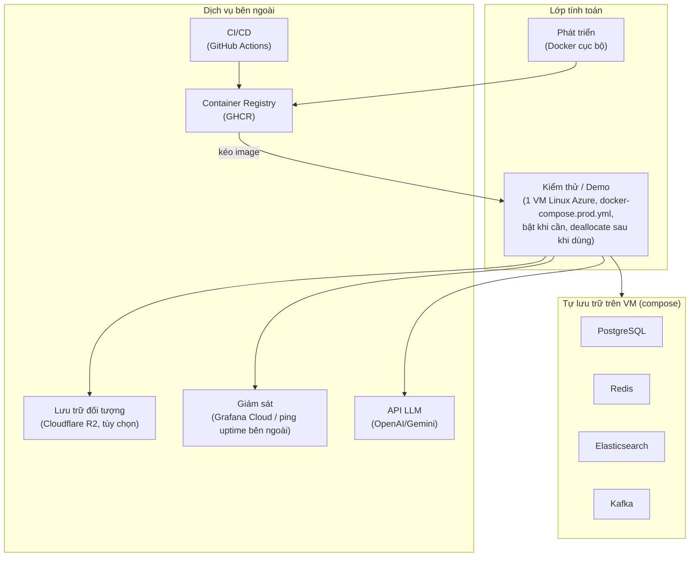
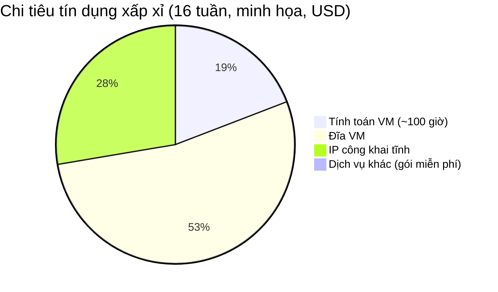
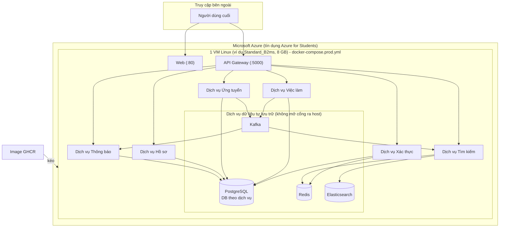
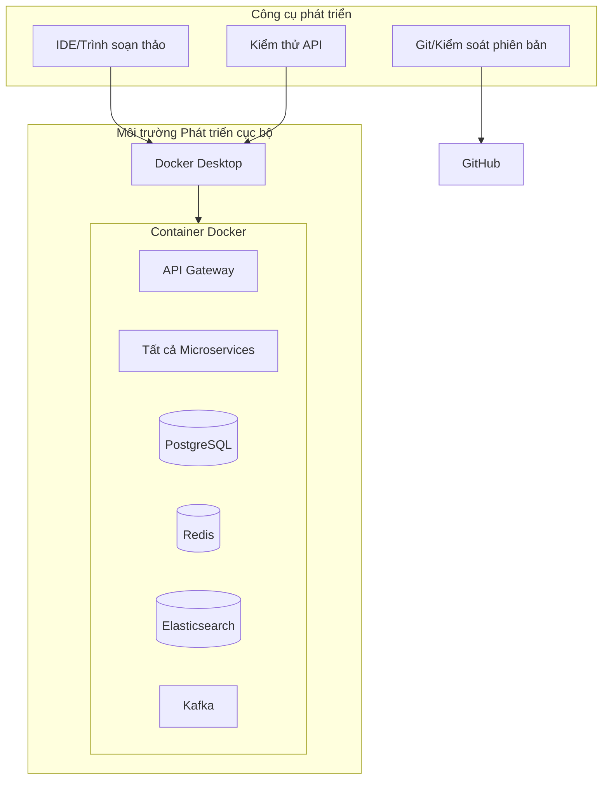
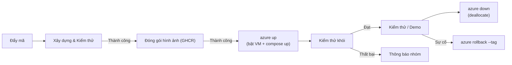

# Đặc tả Yêu cầu Phần mềm (SRS)

[English](../en/9-infra-cost-analysis.md) | [Tiếng Việt](9-infra-cost-analysis.vi.md)

## Nền tảng Việc làm Việt Nam - Kiến trúc Microservices

**Phiên bản:** 1.0  
**Ngày:** 17 tháng 8 năm 2026  
**Dự án:** Nền tảng Việc làm Việt Nam (Vietnam Job Platform)  

---

## Phần 9: Hạ tầng và Phân tích chi phí

### 9.1 Tổng quan

Phần này ghi lại chiến lược hạ tầng và phân tích chi phí cho Nền tảng Việc làm Việt Nam. **Đích triển khai là Microsoft Azure** (không còn dùng Render, Railway, Fly.io; PBL6-51, PR #17 của `job-platform-infra`): MỘT máy ảo Linux (ví dụ `Standard_B2ms`, 2 vCPU / 8 GB) chạy toàn bộ `docker-compose.prod.yml` từ image GHCR. VM chỉ được bật khi kiểm thử và giải phóng (deallocate) sau đó, nên được chi trả bằng **tín dụng Azure for Students** (3 tài khoản x $100, không gộp chung) thay vì gói miễn phí vĩnh viễn. Do đó chi phí *không phải đúng $0*: đây là một khoản nhỏ được chi trả bằng tín dụng (xem 9.3 và 9.4) và **không phát sinh chi phí tự bỏ ra** trong 16 tuần của dự án. Mọi con số đô la dưới đây chỉ là ước tính gần đúng và cần được kiểm tra lại bằng Azure pricing calculator.

Stack compose tự lưu trữ PostgreSQL, Redis, Elasticsearch và Kafka trên VM cho môi trường kiểm thử. Các gói miễn phí được quản lý (Supabase, Upstash, Bonsai, Confluent, Cloudflare R2, Grafana Cloud, ...) vẫn được ghi ở 9.3 và 9.8 như phương án thay thế và cho các dịch vụ nằm ngoài stack compose.

Hạ tầng được tổ chức thành các lớp sau:

---

### 9.2 Thành phần hạ tầng

Bảng sau đây ghi lại tất cả các thành phần hạ tầng cần thiết cho hệ thống.

| Danh mục thành phần | Thành phần | Mục đích | Nhà cung cấp | Mức độ ưu tiên |
|:--------------------|:-----------|:---------|:-------------|:---------------|
| **Tính toán** | Môi trường Phát triển | Phát triển và kiểm thử cục bộ | Docker Compose (Cục bộ) | BẮT BUỘC |
| **Tính toán** | Môi trường Staging / Kiểm thử | Kiểm thử tiền sản phẩm (một VM, bật khi cần) | VM Microsoft Azure (Azure for Students) | NÊN CÓ |
| **Tính toán** | Môi trường Sản phẩm / Demo | Triển khai demo (cùng VM và stack compose) | VM Microsoft Azure (Azure for Students) | NÊN CÓ |
| **Cơ sở dữ liệu** | PostgreSQL | Lưu trữ dữ liệu chính | Tự lưu trữ trong compose trên VM (Supabase = thay thế) | BẮT BUỘC |
| **Bộ nhớ đệm** | Redis | Đệm và lưu trữ phiên | Tự lưu trữ trong compose trên VM (Upstash = thay thế) | NÊN CÓ |
| **Công cụ tìm kiếm** | Elasticsearch | Tìm kiếm toàn văn và lập chỉ mục | Tự lưu trữ trong compose trên VM (Bonsai / Elastic Cloud = thay thế) | BẮT BUỘC |
| **Message Broker** | Kafka | Giao tiếp hướng sự kiện | Tự lưu trữ trong compose trên VM (Confluent Cloud = thay thế) | NÊN CÓ |
| **Lưu trữ đối tượng** | Lưu trữ tương thích S3 | Lưu trữ tệp (CV, ảnh đại diện) | Cloudflare R2 | NÊN CÓ |
| **Container Registry** | Docker Registry | Lưu trữ hình ảnh container | GitHub Container Registry | BẮT BUỘC |
| **CI/CD** | Đường ống Tự động hóa | Tự động hóa xây dựng, kiểm thử và triển khai | GitHub Actions | BẮT BUỘC |
| **Giám sát** | Ngăn xếp Quan sát | Chỉ số, nhật ký và cảnh báo | Grafana Cloud | NÊN CÓ |
| **Dịch vụ AI** | API LLM | Chatbot AI và chấm điểm CV | OpenAI / Google Gemini | TỐT NÊN CÓ |
| **Tên miền/Đường hầm** | Tiếp xúc Công khai | Truy cập công khai an toàn | Cloudflare Tunnel | NÊN CÓ |

---

### 9.3 Phân tích chi phí chi tiết

Bảng sau đây cung cấp phân tích chi phí cho các thành phần hạ tầng trong 16 tuần của dự án. Các con số Azure chỉ là **ước tính gần đúng** (Standard_B2ms, giả định khu vực Southeast Asia; kiểm tra lại bằng Azure pricing calculator). Các dòng đánh dấu *thay thế* không được dùng bởi môi trường kiểm thử dựa trên compose.

| Danh mục thành phần | Nhà cung cấp dịch vụ | Gói / Giá ước tính | Thời hạn hiệu lực | Chi phí 16 tuần |
|:--------------------|:---------------------|:-------------------|:------------------|:----------------|
| **Tính toán (VM)** | Microsoft Azure (Azure for Students) | `Standard_B2ms` (2 vCPU, 8 GB), ~$0,09/giờ khi chạy; chạy toàn bộ stack compose | 3 tài khoản x $100 tín dụng (không gộp chung); chi trả bằng tín dụng | ~$9 cho mỗi 100 giờ chạy (tín dụng) |
| **Đĩa VM** | Microsoft Azure (Azure for Students) | StandardSSD 64 GB, ~$5-8/tháng; vẫn tính phí khi VM đã deallocate | Cùng tín dụng | ~$20-30 (tín dụng) |
| **IP công khai** | Microsoft Azure (Azure for Students) | IP công khai SKU Standard là tĩnh, ~$3,6/tháng; vẫn tính phí kể cả khi VM đã deallocate | Cùng tín dụng | ~$13 (tín dụng) |
| **Tự động tắt** | Azure `az vm auto-shutdown` | Lưới an toàn hằng đêm (mặc định 22:00 giờ Việt Nam) | Miễn phí | $0 |
| **Tính toán (VM)** | Google Cloud Platform | f1-micro: 0.2 vCPU, 0.6 GB RAM, 30 GB HDD (thay thế) | Always Free (trong giới hạn) | $0 |
| **Cơ sở dữ liệu được quản lý** | Supabase | PostgreSQL: 500 MB lưu trữ (thay thế cho Postgres tự lưu trữ) | Always Free (trong giới hạn) | $0 |
| **Cơ sở dữ liệu được quản lý** | Neon | PostgreSQL: 1 GB lưu trữ, nhánh (thay thế) | Always Free (trong giới hạn) | $0 |
| **Bộ nhớ đệm được quản lý** | Upstash | Redis: 10.000 lệnh mỗi ngày (thay thế) | Always Free (trong giới hạn) | $0 |
| **Công cụ tìm kiếm** | Bonsai | Elasticsearch: 1 GB cluster (thay thế) | Always Free (trong giới hạn) | $0 |
| **Công cụ tìm kiếm** | Elastic Cloud | Elasticsearch: 1 GB cluster (dùng thử, thay thế) | 14 ngày (có thể gia hạn) | $0 |
| **Message Broker** | Confluent Cloud | Kafka: Gói Basic với thông lượng giới hạn (thay thế) | Always Free (trong giới hạn) | $0 |
| **Lưu trữ đối tượng** | Cloudflare R2 | 10 GB lưu trữ, egress không giới hạn | Always Free (trong giới hạn) | $0 |
| **Container Registry** | GitHub Container Registry | Kho lưu trữ công khai không giới hạn | Always Free | $0 |
| **Đường ống CI/CD** | GitHub Actions | 2.000 phút miễn phí/tháng (repo riêng), không giới hạn (repo công) | Always Free (trong giới hạn) | $0 |
| **Chất lượng mã** | SonarCloud | Job CI tùy chọn, chỉ chạy khi có secret `SONAR_TOKEN` (xem 3.13) | Miễn phí cho dự án công khai | $0 |
| **Ngăn xếp Giám sát** | Grafana Cloud | 10.000 chỉ số Prometheus, 50 GB logs, 50 GB traces/tháng | Always Free (trong giới hạn) | $0 |
| **Dịch vụ AI (LLM)** | OpenAI | $5 tín dụng miễn phí | Khuyến mãi / Giới hạn | $0 |
| **Dịch vụ AI (LLM)** | Google Gemini | ~60 yêu cầu/phút miễn phí | Always Free (trong giới hạn) | $0 |
| **Tên miền / Đường hầm** | Cloudflare Tunnel | Tiếp xúc công khai an toàn không cần IP công khai hoặc tên miền trả phí | Always Free | $0 |

---

### 9.4 Tổng chi phí ước tính

VM Azure **không miễn phí**; nó được chi trả từ tín dụng Azure for Students. Ước tính minh họa cho 16 tuần (gần đúng; giả định ~100 giờ chạy cho các phiên kiểm thử và demo, đĩa 64 GB giữ trong ~3,7 tháng):

| Hạng mục | Giả định | Chi phí xấp xỉ (USD) |
|:---------|:---------|:---------------------|
| Tính toán VM | ~100 giờ x ~$0,09/giờ | ~$9 |
| Đĩa VM | ~$5-8/tháng x ~3,7 tháng | ~$20-30 |
| IP công khai tĩnh | ~$3,6/tháng x ~3,7 tháng (vẫn tính phí khi deallocate) | ~$13 |
| Tất cả còn lại | Gói miễn phí / mã nguồn mở / GitHub | $0 |
| **Tổng** | Nằm trong một khoản tín dụng $100 | **~$40-50, chi trả bằng tín dụng** |

**Chi phí tự bỏ ra: dự kiến $0**, với điều kiện VM được deallocate sau mỗi phiên (VM đang chạy tiêu tốn tín dụng 24/7; tắt hệ điều hành từ bên trong VM *không* dừng tính phí). Nếu tín dụng của một tài khoản sắp hết, dùng subscription sinh viên tiếp theo (chạy lại script provision; dữ liệu trên đĩa VM không được di chuyển và phải seed lại).

---

### 9.5 Chiến lược tối ưu chi phí

Các chiến lược sau giữ hạ tầng nằm trong tín dụng Azure for Students (không phát sinh chi phí tự bỏ ra):

| Chiến lược | Mô tả | Triển khai |
|:-----------|:------|:-----------|
| **Một VM theo nhu cầu** | Một VM Azure chạy toàn bộ stack compose; chỉ bật khi kiểm thử, deallocate sau đó (deallocate = chỉ tốn chi phí đĩa + IP tĩnh) | `scripts/deploy.sh azure up` / `azure down`; `az vm auto-shutdown` hằng đêm làm lưới an toàn |
| **Luân phiên tín dụng sinh viên** | Dùng tín dụng Azure for Students (3 tài khoản x $100, không gộp chung); chuyển sang subscription tiếp theo khi sắp hết | `AZURE_SUBSCRIPTION_ID` + chạy lại `scripts/azure-provision.sh` |
| **Tận dụng Gói miễn phí** | Dùng gói Always Free cho các dịch vụ ngoài stack compose | Cloudflare R2, GHCR, GitHub Actions, Grafana Cloud (Supabase, Upstash, Bonsai giữ làm phương án thay thế) |
| **Tránh chi phí Egress** | Sử dụng dịch vụ có chuyển dữ liệu miễn phí | Cloudflare R2 cung cấp egress miễn phí |
| **Quản lý chi phí API AI** | Sử dụng nhà cung cấp LLM gói miễn phí một cách chiến lược | Gemini cho yêu cầu số lượng lớn, tín dụng OpenAI cho tạo mẫu |
| **Triển khai Container hóa** | Đóng gói tất cả dịch vụ bằng Docker; image được build trong CI và đẩy lên GHCR | `docker-compose.prod.yml` kéo image GHCR về VM Azure |
| **Dịch vụ dữ liệu tự lưu trữ (môi trường kiểm thử)** | PostgreSQL, Redis, Elasticsearch và Kafka chạy trong stack compose trên VM, tránh hạn mức dịch vụ được quản lý | Dữ liệu nằm trên đĩa VM, còn nguyên sau khi deallocate; không bao giờ `docker compose down -v` |
| **Hạ tầng dưới dạng mã** | Tự động hóa cung cấp hạ tầng | Giảm lỗi thủ công và chi phí quản lý |

---

### 9.6 Kiến trúc hạ tầng

#### 9.6.1 Kiến trúc Kiểm thử / Demo (VM Azure)

Tất cả dịch vụ chạy trên một VM Linux Azure qua `docker-compose.prod.yml` (project `job-platform-prod`, mạng nội bộ, chỉ gateway và web được publish). Dịch vụ AI không nằm trong stack compose.

#### 9.6.2 Kiến trúc phát triển

---

### 9.7 Quy trình triển khai

#### 9.7.1 Các bước triển khai cho một phiên kiểm thử (VM Azure)

| Bước | Hành động | Người phụ trách | Xác nhận |
|:-----|:----------|:---------------|:---------|
| 1 | Xây dựng tất cả dịch vụ và ứng dụng | CI/CD (GitHub Actions) | Tất cả bản xây dựng thành công |
| 2 | Chạy tất cả kiểm thử tự động (phân tích SonarCloud tùy chọn) | CI/CD (GitHub Actions) | Tất cả kiểm thử thành công |
| 3 | Đóng gói hình ảnh Docker và đẩy lên GHCR | CI/CD (GitHub Actions) | Hình ảnh được đẩy thành công |
| 4 | Bật VM và triển khai: `scripts/deploy.sh azure up` (bật VM, đồng bộ compose và env, kéo image, `up -d --wait`) | TM1 | Các container khỏe |
| 5 | Chạy kiểm thử khói (`/health` qua gateway, `/health/ready` từng dịch vụ) | Tất cả | Các điểm cuối chính phản hồi |
| 6 | Mời người dùng kiểm thử | Tất cả | Người dùng truy cập được môi trường |
| 7 | Thu thập và xử lý phản hồi | Tất cả | Các vấn đề được giải quyết |
| 8 | Deallocate: `scripts/deploy.sh azure down` | TM1 | VM đã deallocate (chỉ tốn chi phí đĩa + IP tĩnh) |

VM được tạo một lần bằng Terraform (`terraform/`, xem 9.7.4; `scripts/azure-provision.sh` vẫn còn làm phương án dự phòng). Các bước trên cũng có thể chạy từ workflow thủ công `deploy-azure.yml`. Cả hai script đều hỗ trợ `--dry-run`.

#### 9.7.2 Rollback và quản lý tín dụng

| Bước | Hành động | Người phụ trách | Xác nhận |
|:-----|:----------|:---------------|:---------|
| 1 | Rollback về tag image trước đó: `scripts/deploy.sh --tag <previous-sha> azure rollback` | TM1 | Phiên bản trước hoạt động tốt |
| 2 | Không bao giờ xóa volume (`docker compose down -v`) | TM1 | Dữ liệu được giữ qua các phiên |
| 3 | Luôn deallocate sau khi kiểm thử; kiểm tra `azure status` | TM1 | VM không chạy nhàn rỗi |
| 4 | Khi tín dụng sắp hết, chuyển sang subscription sinh viên tiếp theo và provision lại | TM1 | VM mới chạy; dữ liệu được seed lại |
| 5 | Cập nhật tài liệu | Tất cả | Tài liệu phản ánh môi trường |

#### 9.7.3 Đường ống triển khai

> **Tình trạng xuất bản image (PBL6-84):** cả 8 repo triển khai được (`auth-svc`, `gateway`, `job-svc`, `search-svc`, `app-svc`, `profile-svc`, `notif-svc`, `web`) sẽ đẩy `ghcr.io/dut-pbl6-2026/job-platform-<repo>` (tag: SHA commit đầy đủ và `latest`) khi các PR đang chờ được merge: `search-svc` #15, `app-svc` #9, `profile-svc` #8, `notif-svc` #8 và `web` #23 mỗi repo thêm `publish-image.yml` (`auth-svc`, `gateway`, `job-svc` đã đẩy image). Package GHCR mặc định là private: hãy đặt public, hoặc cấu hình `GHCR_USER` / `GHCR_TOKEN` (PAT có `read:packages`) cho VM khi pull. Image `web` nhúng `VITE_API_BASE_URL` lúc build từ biến repository, nên cần đặt biến này thành URL gateway công khai trước lần publish đầu tiên.

#### 9.7.4 Hạ tầng dưới dạng mã và CD thủ công (PBL6-83)

PR #18 của `job-platform-infra` (xếp chồng trên #17, đang mở tại thời điểm viết) thay script provision thủ công bằng Terraform và thêm các workflow GitHub Actions kích hoạt thủ công:

| Hạng mục | Mô tả |
|:---------|:------|
| `terraform/` (`azurerm ~> 4`, ghim phiên bản) | Resource group, VNet/subnet, NSG (SSH giới hạn theo `admin_cidr`; 80, 443 và cổng gateway tùy chọn), IP công khai tĩnh SKU Standard kèm DNS label, NIC, VM Ubuntu 24.04 (`Standard_B2ms`, StandardSSD 64 GB, cloud-init cài Docker + compose plugin) và lịch tắt VM (mặc định 15:00 UTC = 22:00 giờ Việt Nam) |
| Một workspace cho mỗi subscription | `envs/sub1\|sub2\|sub3.tfvars`, mỗi subscription một workspace/state Terraform; backend `azurerm` từ xa tùy chọn; tfstate và tfvars không được commit. Chuyển sang subscription sinh viên tiếp theo = workspace mới + `apply` |
| `terraform.yml` | PR chạm `terraform/**` chạy `fmt` + `validate`; `plan` chỉ chạy khi đã cấu hình OIDC và remote state (nếu không thì bỏ qua); `workflow_dispatch` thủ công `plan` hoặc `apply`, trong đó **apply chạy trong environment `production`** (cần reviewer duyệt) |
| `deploy-azure.yml` | `workflow_dispatch` thủ công với action `up`, `down`, `status` hoặc `rollback`, `image_tag` và `auto_deallocate_after_hours` (0-23); chạy `scripts/deploy.sh`; smoke test `/health` và `/health/ready` (chỉ bắt buộc readiness khi `REQUIRE_HEALTH_READY=true`); có khóa concurrency |
| Xác thực | Azure OIDC (`azure/login`) khi có các secret `AZURE_CLIENT_ID` / `AZURE_TENANT_ID` / `AZURE_SUBSCRIPTION_ID`; nếu không thì dùng phương án chỉ SSH (`AZURE_VM_HOST`, `AZURE_SSH_PRIVATE_KEY`, `PROD_ENV_FILE`) chỉ hỗ trợ `up` và `rollback` (không điều khiển nguồn VM) |
| Tự động deallocate | Không dùng job sleep: `auto_deallocate_after_hours=N` (chế độ OIDC) đặt lại auto-shutdown gốc của Azure thành bây giờ + N giờ; lịch tắt 22:00 giờ Việt Nam hằng đêm từ Terraform vẫn là lưới an toàn |

`scripts/azure-provision.sh` chỉ được giữ làm phương án dự phòng không dùng Terraform. CI của infra chạy thêm `terraform fmt`/`validate` và `actionlint`. Tác giả PR chưa kiểm thử: `terraform plan/apply` thật, đăng nhập OIDC, chạy workflow, và SSH từ runner GitHub (NSG chặn trừ khi mở rộng `admin_cidr`).

---

### 9.8 Chiến lược Gói miễn phí

#### 9.8.1 Dịch vụ chính (Always Free, trừ tính toán Azure)

| Dịch vụ | Nhà cung cấp | Giới hạn | Sử dụng |
|:--------|:-------------|:---------|:--------|
| **Tính toán** | GCP | f1-micro (0.2 vCPU, 0.6 GB RAM) | Gateway hoặc giám sát nhẹ |
| **Tính toán** | Microsoft Azure (tín dụng sinh viên) | 1 VM, ~$0,09/giờ khi chạy, chi trả bằng tín dụng (không miễn phí) | Tất cả microservices + web + dịch vụ dữ liệu tự lưu trữ |
| **Cơ sở dữ liệu** | Supabase | 500 MB lưu trữ | Thay thế cho PostgreSQL tự lưu trữ |
| **Bộ nhớ đệm** | Upstash | 10.000 lệnh/ngày | Thay thế cho Redis tự lưu trữ |
| **Tìm kiếm** | Bonsai | 1 GB cluster | Thay thế cho Elasticsearch tự lưu trữ |
| **Message Broker** | Confluent | Gói Basic (thông lượng giới hạn) | Thay thế cho Kafka tự lưu trữ |
| **Lưu trữ** | Cloudflare R2 | 10 GB lưu trữ | Lưu CV, ảnh đại diện, logo |
| **CI/CD** | GitHub Actions | 2.000 phút/tháng | Tự động hóa xây dựng và kiểm thử |
| **Giám sát** | Grafana Cloud | 10.000 chỉ số | Quan sát |
| **Đường hầm** | Cloudflare | Không giới hạn | Tiếp xúc công khai an toàn |

#### 9.8.2 Dịch vụ dự phòng

| Dịch vụ | Nhà cung cấp | Giới hạn | Khi sử dụng |
|:--------|:-------------|:---------|:------------|
| **Tính toán** | AWS | Gói miễn phí 12 tháng | Nếu tín dụng Azure của tất cả tài khoản đã hết |
| **Tính toán** | DigitalOcean/Vultr | $200-$250 tín dụng | Nếu cần thêm tài nguyên tính toán |
| **Cơ sở dữ liệu** | Neon | 1 GB lưu trữ | Nếu vượt quá giới hạn Supabase |
| **Tìm kiếm** | Elastic Cloud | Dùng thử 14 ngày | Nếu vượt quá giới hạn Bonsai |

---

### 9.9 Giám sát tài nguyên

Để đảm bảo giới hạn gói miễn phí và tín dụng Azure không bị vượt quá, chiến lược giám sát sau được triển khai. VM Azure được deallocate ngoài các phiên kiểm thử, nên các monitor uptime sẽ báo động khi VM tắt và cần được tạm dừng.

| Tài nguyên | Chỉ số | Ngưỡng cảnh báo | Hành động |
|:-----------|:-------|:-----------------|:----------|
| **Tín dụng Azure** | Tín dụng còn lại của từng subscription sinh viên | Sắp hết (kiểm tra Azure Cost Management) | Chuyển sang subscription tiếp theo |
| **VM Azure** | Trạng thái nguồn | Đang chạy khi không ai kiểm thử | Chạy `scripts/deploy.sh azure down` |
| **Supabase** (nếu dùng) | Sử dụng lưu trữ | > 400 MB | Lưu trữ dữ liệu cũ |
| **Supabase** (nếu dùng) | Kết nối cơ sở dữ liệu | > 15 | Tăng giới hạn nhóm |
| **Upstash** (nếu dùng) | Lệnh/ngày | > 8.000 | Tối ưu chiến lược đệm |
| **Bonsai** (nếu dùng) | Kích thước cluster | > 800 MB | Xóa chỉ mục cũ |
| **Confluent** (nếu dùng) | Thông lượng | > 80% giới hạn | Giảm tốc độ xuất bản sự kiện |
| **GitHub Actions** | Phút/tháng | > 1.800 | Tối ưu đường ống CI |
| **Grafana** | Chỉ số | > 8.000 | Giảm thu thập chỉ số |

---

### 9.10 Cân nhắc rủi ro

| Rủi ro | Xác suất | Tác động | Chiến lược giảm thiểu |
|:-------|:---------|:---------|:----------------------|
| **Cạn kiệt tài nguyên gói miễn phí** | Trung bình | Cao | Giám sát chỉ số sử dụng; nâng cấp chỉ khi cần thiết |
| **Cạn kiệt tín dụng Azure** | Trung bình | Cao | Deallocate VM sau mỗi phiên; tự động tắt hằng đêm; chuyển sang subscription sinh viên tiếp theo (3 x $100, không gộp chung); dữ liệu không được di chuyển và phải seed lại |
| **VM bị bỏ chạy** | Trung bình | Trung bình | `az vm auto-shutdown`; kiểm tra `azure status`; tắt hệ điều hành bên trong VM không dừng tính phí |
| **Hạn chế của subscription sinh viên** (khu vực/SKU/quota) | Trung bình | Trung bình | Kiểm tra `az vm list-skus` / `az vm list-usage` trước; khu vực và kích thước là tham số của script provision |
| **Giới hạn tốc độ API (dịch vụ AI)** | Trung bình | Thấp | Triển khai đệm và giới hạn tốc độ; sử dụng Gemini cho yêu cầu số lượng lớn |
| **Lưu trữ dữ liệu khi khởi động lại dịch vụ** | Thấp | Cao | Dữ liệu nằm trên đĩa VM (Docker volume) và còn nguyên sau khi deallocate; không bao giờ `down -v`; môi trường kiểm thử không có sao lưu của dịch vụ được quản lý |
| **Nhà cung cấp dịch vụ thay đổi gói miễn phí** | Thấp | Cao | Đã xác định nhà cung cấp dự phòng |
| **Gián đoạn dịch vụ đám mây** | Thấp | Trung bình | Đa khu vực nếu có thể; phát triển cục bộ luôn sẵn sàng |
| **Giới hạn kết nối cơ sở dữ liệu** | Trung bình | Cao | Nhóm kết nối; giám sát kết nối đang hoạt động |

---

### 9.11 Tóm tắt yêu cầu hạ tầng

| Danh mục | BẮT BUỘC | NÊN CÓ | TỐT NÊN CÓ | Tổng |
|:---------|:---------|:-------|:-----------|:-----|
| Tính toán | 1 | 2 | 0 | 3 |
| Cơ sở dữ liệu | 1 | 0 | 0 | 1 |
| Bộ nhớ đệm | 0 | 1 | 0 | 1 |
| Tìm kiếm | 1 | 0 | 0 | 1 |
| Message Broker | 0 | 1 | 0 | 1 |
| Lưu trữ | 0 | 1 | 0 | 1 |
| Container Registry | 1 | 0 | 0 | 1 |
| CI/CD | 1 | 0 | 0 | 1 |
| Giám sát | 0 | 1 | 0 | 1 |
| Dịch vụ AI | 0 | 0 | 1 | 1 |
| Tên miền/Đường hầm | 0 | 1 | 0 | 1 |
| **Tổng** | **5** | **7** | **1** | **13** |

---

### 9.12 Cân nhắc sau dự án

Mặc dù dự án được thiết kế để nằm trong tín dụng Azure for Students (không phát sinh chi phí tự bỏ ra) trong 16 tuần, các cân nhắc sau áp dụng cho khả năng sử dụng trong tương lai:

| Cân nhắc | Khuyến nghị | Chi phí ước tính |
|:---------|:------------|:-----------------|
| **Mở rộng quy mô sản phẩm** | Nâng cấp lên gói trả phí khi cơ sở người dùng phát triển | $50-200/tháng |
| **Tăng trưởng dữ liệu** | Mở rộng cơ sở dữ liệu và lưu trữ khi cần | $10-50/tháng |
| **Tính năng AI** | Đăng ký dịch vụ AI trả phí cho sản phẩm | $20-100/tháng |
| **Tính sẵn sàng cao** | Triển khai đa khu vực để dự phòng | $100-300/tháng |
| **Hỗ trợ chuyên nghiệp** | Mua gói hỗ trợ cho dịch vụ quan trọng | $50-200/tháng |

---

**Hết Phần 9**